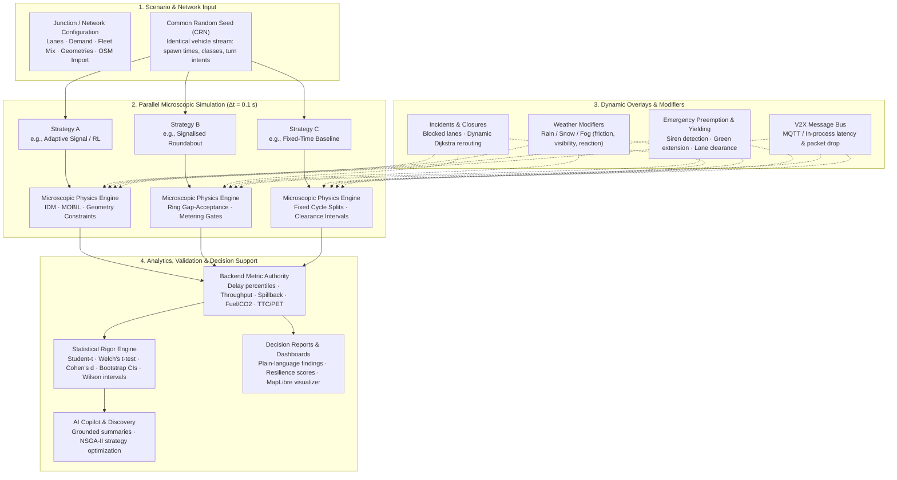
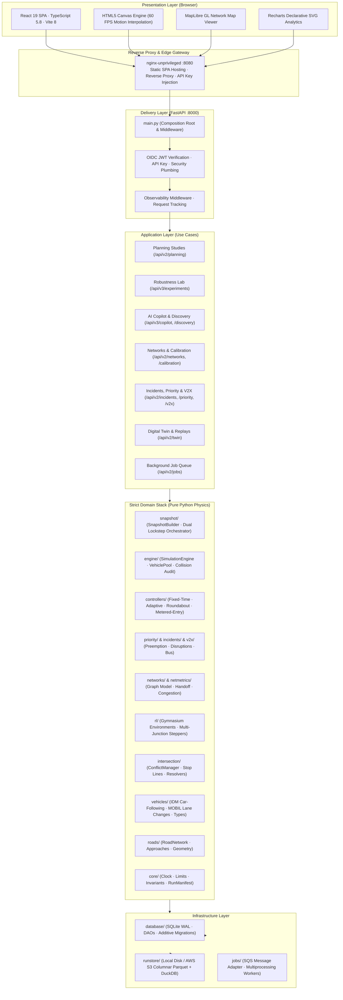
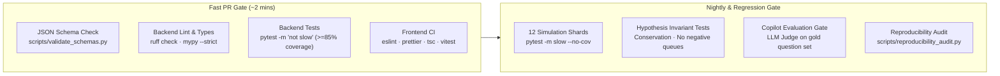

<div align="center">

# UrbanFlow

### Evidence-Based Traffic Simulation, Multi-Junction Network Control & Autonomous Mobility Decision-Support Platform

**From Single Junctions to Connected Urban Corridors: A rigorous, reproducible laboratory for evaluating fixed-time signals, adaptive controllers, multi-lane roundabouts, reinforcement learning, emergency priority, and connected vehicle autonomy.**

| Milestone | Version | Status | Key Deliverables & Evidence | Stack |
| :---: | :---: | :---: | :--- | :--- |
| **Foundation** | **V1.0–V1.5** | ✅ **Complete** | Discrete-time IDM engine (Δt = 0.1 s), 5 vehicle classes, MOBIL lane changes, adaptive signals, multi-lane roundabouts, real-world geometries ([Methodology](docs/simulation/methodology.md)) | Python 3.11 · FastAPI · React 19 · Canvas |
| **Decision Support** | **V2.0** | ✅ **Complete** | Multi-alternative planning studies, report exports (JSON/MD/CSV), bit-identical reproduction ([Audit](docs/roadmap/V2_COMPLETION_AUDIT.md)) | SQLite WAL · Docker · AWS EC2 |
| **Experimentation Lab** | **V3.0** | ✅ **Complete** | Robustness Lab, parameter uncertainty ensembles, signalised roundabouts (`metered_entry`), strategy registry, AI Copilot, AI Discovery Lab (NSGA-II), Python SDK, `.ufpkg` packages ([Release Candidate](docs/v3-release-candidate.md)) | Pydantic v2 · JSON Schema · LLM Eval Gate |
| **Trustworthy Results** | **V3.1–V3.8 (Phase 4)** | ✅ **Complete** | Bootstrap paired CIs, Hypothesis property-based testing, Parquet RunStore, Copilot eval harness, Go ingest microservice, Airflow nightly regression ([Plan](docs/plan/README.md)) | Go 1.22 · Protobuf · gRPC · Airflow · DuckDB |
| **Beyond One Junction** | **V3.9–V4.6 (Phase 5)** | ✅ **Complete** | Multi-junction graph model (ADR-021), 12-junction grid, vehicle handoff, congestion propagation heatmaps, OSM/SUMO/GTFS import, GEH/RMSE/MAPE calibration, multi-junction Gymnasium RL (PPO/baselines), Prometheus `/metrics/prom`, OpenTelemetry, Digital Twin replay & what-if, MapLibre UI ([Release Note](docs/releases/v4.6-beyond-one-junction.md)) | Gymnasium · PyTorch · Prometheus · MapLibre GL |
| **Resilience & Cloud** | **V4.7–V5.4 (Phase 6)** | ✅ **Complete** | Crashes, dynamic closures & rerouting, weather modifiers (friction/visibility/reaction), resilience scoring, emergency signal pre-emption & civilian yielding, transit priority, V2X MQTT messaging bus, multi-tenant OIDC RBAC & quotas, Terraform AWS staging (VPC/EKS/RDS/S3/SQS), async job worker ([Spec](docs/plan/FEATURE_SPECIFICATIONS.md)) | Terraform · AWS EKS · SQS · MQTT · OIDC |
| **Cooperation & Governance** | **V5.5–V6.0 (Phase 7)** | 🗓️ **Planned** | Leader-follower platooning, Autonomous Intersection Management (AIM) reservation manager, advisory approval workflows, hash-chained audit logs, per-run compute costing, physical ESP32/Pi signal-head bridge ([Execution Plan](docs/plan/EXECUTION_PLAN_V4_1_TO_V6_0.md)) | MicroPython / C · AWS IoT · Cryptographic Ledger |
| **Grand Showcase** | **V6.1** | 🗓️ **Planned** | Unified 20-feature full regression suite, final evaluation showcase, offline presentation drill packs | Test Runner · Fallback Bundles |

</div>

> [!IMPORTANT]
> **Evidence, not a verdict.** UrbanFlow does not presuppose whether traffic signals, modern roundabouts, adaptive actuators, or learned policies are superior. It simulates competing strategies on the exact same virtual networks under identical, common-random-number vehicle arrivals, measures multi-objective physical and operational metrics, quantifies statistical uncertainty with confidence intervals, and explicitly reports model assumptions and boundary conditions. **The decision remains with human planners and engineers.**

---

## Table of Contents

1. [At a Glance](#at-a-glance)
2. [How UrbanFlow Works](#how-urbanflow-works)
3. [Complete System Capabilities & Implementation Audit](#complete-system-capabilities--implementation-audit)
   - [Phase 1–3: Core Simulation & Experimentation (V1.0–V3.0)](#1-core-simulation--experimentation-v10v30)
   - [Phase 4: Trustworthy Results & Microservices (V3.1–V3.8)](#2-trustworthy-results--microservices-v31v38)
   - [Phase 5: Multi-Junction Networks & Digital Twins (V3.9–V4.6)](#3-multi-junction-networks--digital-twins-v39v46)
   - [Phase 6: Resilience, Priority, V2X & Enterprise Cloud (V4.7–V5.4)](#4-resilience-priority-v2x--enterprise-cloud-v47v54)
   - [Phase 7: Planned Features with Minute Detail (V5.5–V6.1)](#5-planned-features-with-minute-detail-v55v61)
4. [Technology Stack & Architectural Layers](#technology-stack--architectural-layers)
5. [Repository Structure](#repository-structure)
6. [API Route Catalog & Service Groups](#api-route-catalog--service-groups)
7. [Running UrbanFlow (Docker, Local, Kubernetes, Cloud)](#running-urbanflow)
8. [Testing, Linting & Verification Suite](#testing-linting--verification-suite)
9. [Documentation Hub Directory](#documentation-hub-directory)
10. [Team & Governance](#team--governance)

---

## At a Glance

| Question | UrbanFlow Approach |
| :--- | :--- |
| **What is it?** | An advanced microscopic simulation and decision-support platform scaling from isolated junctions to 12+ intersection urban networks, supporting fixed-time, actuated adaptive, multi-lane roundabouts, signalised roundabouts, reinforcement learning, emergency preemption, and connected vehicle autonomy. |
| **Who is it for?** | **Municipal Planning Officers & Transportation Authorities:** Clear, comparative decision support with plain-language explanations, HCM Level-of-Service grades, and uncertainty intervals.<br/>**Traffic Engineers & Researchers:** High-fidelity IDM/MOBIL physics, multi-seed Monte Carlo validation, OpenStreetMap import, network calibration, Gymnasium RL environments, and V2X messaging research. |
| **What problem does it solve?** | Traffic control decisions are routinely hindered by institutional inertia, intuition, or rigid handbooks. UrbanFlow provides reproducible, fair, multi-alternative evaluations under common random numbers, proving whether a strategy's advantage is statistically significant or an artefact of arrival variance. |
| **What does it simulate?** | Discrete-time microscopic physics (Δt = 0.1 s) with Intelligent Driver Model (IDM) car-following, MOBIL lane-changing, 5 vehicle classes, high/normal driver aggression profiles, paired signal stages, adaptive passage gap-out, roundabout critical gap acceptance, signalised metered-entry roundabouts, multi-junction arterial grids, dynamic road closures, adverse weather friction/visibility, emergency siren preemption, civilian yielding, transit priority, and V2X cooperative message exchange. |
| **How is fairness guaranteed?** | **Common Random Numbers (CRN):** Competing strategies run against the identical pseudo-random number generator seed. Vehicle spawn times, arrival arms, turning destinations, and driver traits are identical across all options—only the control strategy varies. |
| **How is quality proven?** | Multi-tiered verification: 3,100+ backend tests, 710+ frontend tests, Hypothesis property-based testing (conservation of vehicles, queue non-negativity), Copilot LLM evaluation gates, GEH network calibration statistics, and automated bit-identical manifest reproduction. |
| **How is it deployed?** | Multi-tier deployment flexibility: local Windows/macOS/Linux development, Docker Compose, local Kubernetes clusters via Helm and Kind, and AWS staging infrastructure defined via Terraform (VPC, EKS, RDS, SQS, S3, IAM OIDC). |

---

## How UrbanFlow Works



---

## Complete System Capabilities & Implementation Audit

Every capability documented below corresponds to verified, checked-in code in the repository. Status tags follow our strict verification convention:
- **`VERIFIED`**: Implemented, tested, and passing in the active environment.
- **`WRITTEN`**: Code, configuration, or infrastructure manifests authored and verified syntactically, waiting for external cluster/cloud execution.
- **`NEEDS-INPUT`**: Architecturally complete, pending owner dataset selection or third-party cloud credential assignment.

---

### 1. Core Simulation & Experimentation (V1.0–V3.0)

| Subsystem | Verified Capabilities | Status | Documentation / Source |
| :--- | :--- | :---: | :--- |
| **Microscopic Physics Engine** | Discrete-time simulation engine (default $\Delta t = 0.1\text{ s}$); Intelligent Driver Model (IDM) car-following; curve speed limits based on turning radii; collision audits using oriented bounding boxes via Separating Axis Theorem (SAT); safe insertion spawner. | `VERIFIED` | [Methodology](docs/simulation/methodology.md) · `backend/src/engine/` |
| **Heterogeneous Fleet** | 5 distinct vehicle classes (passenger car, SUV, transit bus, heavy truck, motorcycle) with dedicated acceleration ($a$), comfortable deceleration ($b$), desired time headway ($T$), minimum jam distance ($s_0$), vehicle dimensions, and cornering limits. | `VERIFIED` | `backend/src/vehicles/` |
| **MOBIL Lane Changing** | Minimizing Overall Braking Induced by Lane changes (MOBIL) model; politeness factors; acceleration threshold checking; shadow lane reservations for realistic gradual lateral transitions. | `VERIFIED` | `backend/src/vehicles/` |
| **Fixed-Time Signal Control** | Paired N/S and E/W phases; configurable green, yellow, and all-red clearance intervals; cycle offsets; permissive left turns; per-approach corridor green timing. | `VERIFIED` | `backend/src/controllers/fixed_time_signal.py` |
| **Actuated Adaptive Signals** | Stop-line vehicle presence detection; passage-based green extensions; gap-out logic; maximum green limits; rest-in-green; stage skipping for uncalled approaches. | `VERIFIED` | `backend/src/controllers/adaptive_signal.py` |
| **Multi-Lane Roundabouts** | Critical gap acceptance ($4.0\text{ s}$ default); follow-up headway ($2.5\text{ s}$ default); multi-lane circulating ring assignment; exit convergence zones in arrival order. | `VERIFIED` | `backend/src/controllers/roundabout.py` |
| **Signalised Roundabouts** | Metered-entry signalised roundabout (`metered_entry`); stop-line presence detection at entry approaches; signal cycles gating access to the ring while preserving internal circulating gap acceptance. | `VERIFIED` | [Signalised Roundabout](docs/simulation/signalised-roundabout.md) · `backend/src/controllers/signalised_roundabout.py` |
| **Composable Strategy Registry** | Pluggable strategy descriptors, compatibility validation, fingerprint parity, layered control architecture (ADR-014). | `VERIFIED` | `backend/src/strategies/` |
| **Driver Aggression Profiles** | Configurable driver aggression profiles (V1 standard vs. V2 high aggression with shortened headways and assertive gap acceptance; ADR-016, ADR-019, ADR-020). | `VERIFIED` | `backend/src/core/config_models.py` |
| **Robustness Lab** | Parameter uncertainty space definition; multi-factor quasi-random Sobol and Latin hypercube sampling; paired CRN ensembles; Wilson score intervals and bootstrap paired differences. | `VERIFIED` | [Uncertainty Guide](docs/research/uncertainty.md) · `backend/src/experiments/` |
| **AI Experiment Copilot** | LLM-assisted experiment formulation; proposal-only, backend-validated schema verification; confirm-before-run workflow; grounded evidence summaries guarded against hallucinations. | `VERIFIED` | [Copilot Guide](docs/ai/copilot.md) · `backend/src/copilot/` |
| **AI Strategy Discovery Lab** | Bounded multi-objective evolutionary search (NSGA-II) optimizing cycle lengths, green splits, and offsets against delay, stops, and emissions on held-out seeds. | `VERIFIED` | `backend/src/discovery/` |
| **Strategy Breakpoint Explorer** | High-load traffic chaos and stability breakpoint detection under stationary and non-stationary saturation. | `VERIFIED` | `backend/src/stress/` |
| **Python SDK & `.ufpkg` Packages** | Standard-library Python client (`urbanflow-client`); portable self-contained `.ufpkg` experiment archives with SHA-256 integrity verification; personal access tokens. | `VERIFIED` | [SDK Guide](sdk/python/README.md) · `backend/src/experiments/package.py` |

---

### 2. Trustworthy Results & Microservices (V3.1–V3.8, Phase 4)

| Feature | Verified Capabilities | Status | Documentation / Source |
| :--- | :--- | :---: | :--- |
| **Statistical Rigor Engine (F6)** | Welch's t-test for unequal variances, Student-t confidence intervals, Cohen's d effect sizes, bootstrap paired difference distributions, Wilson score intervals for proportion metrics. | `VERIFIED` | `backend/src/uncertainty/`, `backend/src/study/` |
| **Hypothesis Property Testing (F4)** | Automated property-based tests enforcing physical invariants: vehicle conservation ($\text{spawned} = \text{active} + \text{completed}$), strictly non-negative queue lengths, bounded accelerations, deterministic seed repeatability. | `VERIFIED` | `backend/tests/core/test_properties.py` |
| **Copilot Evaluation Gate (F4)** | Automated LLM judge evaluating Copilot responses against versioned gold question sets (`copilot_questions_v1.json`); enforces a pass threshold in CI before code merges. | `VERIFIED` | `backend/evals/gate.py`, `backend/src/copilot/eval_harness.py` |
| **Results Lakehouse & RunStore (F7)** | High-throughput run persistence supporting local disk and AWS S3 storage with Parquet columnar layouts; DuckDB SQL analytical queries; run manifests embedding code version and configuration hashes. | `VERIFIED` | `backend/src/runstore/`, `backend/src/core/run_manifest.py` |
| **Environmental & Safety Proxies (F9)** | Instantaneous fuel consumption and $\text{CO}_2$ emissions models (Akçelik polynomial formulation); safety conflict indicators (Time-to-Collision [TTC] and Post-Encroachment Time [PET]). | `VERIFIED` | `backend/src/metrics/` |
| **Grounded Summary Engine (F8)** | Rigorous factual assertion checker comparing generated markdown narratives against underlying numerical JSON results to prevent hallucinated metric values. | `VERIFIED` | `backend/src/copilot/grounded_summary.py` |
| **Go Ingest Microservice (F1)** | High-performance Go telemetry ingestion service with Protobuf contract and gRPC/REST endpoints, including generated Python client bindings. | `WRITTEN` | `services/ingest-go/`, `proto/ingest.proto` |
| **Container & Airflow Orchestration (F3)** | Umbrella Helm chart (`deploy/helm/urbanflow`); local Kind Kubernetes cluster setup; Apache Airflow DAGs for nightly regressions (`nightly_regression.py`) and multi-seed batch experiments (`batch_experiments.py`). | `WRITTEN` (DAGs verified locally) | `deploy/helm/`, `deploy/kind/`, `airflow/dags/` |

---

### 3. Multi-Junction Networks & Digital Twins (V3.9–V4.6, Phase 5)

| Feature | Verified Capabilities | Status | Documentation / Source |
| :--- | :--- | :---: | :--- |
| **Network Graph Model (F5)** | Node-edge directed network graph (ADR-021); approach-to-approach internal links; two-junction arterial corridors; 3x3 (9-junction) and 12-junction arterial grids with conserved vehicle handoffs across junctions. | `VERIFIED` | `backend/src/networks/graph.py`, `corridor.py`, `grid.py` |
| **Network Importers (F11)** | Parsers and graph converters for OpenStreetMap (OSM Overpass XML/JSON), SUMO network files (`.net.xml`), General Transit Feed Specification (GTFS), and Synchro CSV exports. | `VERIFIED` | `backend/src/networks/osm.py`, `sumo.py`, `gtfs.py`, `synchro.py` |
| **Network Metrics & Congestion Spread (F5)** | Network-wide delay, total throughput, link spillback, and space-mean speeds; link-to-link congestion propagation analysis producing topological shockwave heatmaps. | `VERIFIED` | `backend/src/netmetrics/metrics.py`, `congestion.py` |
| **Network Calibration (F11)** | Field-count loader (turning counts, link volumes, 15-minute intervals); GEH statistic calculation, Root Mean Square Error (RMSE), and Mean Absolute Percentage Error (MAPE); Nelder-Mead/Powell parameter fitting with continuous warm-start recalibration. | `VERIFIED` (Synthetic ground truth; `NEEDS-INPUT` for D1 city data) | `backend/src/calibration/network_*.py`, `scripts/calibrate_network.py` |
| **Multi-Junction Reinforcement Learning (F18)** | Gymnasium environment wrappers for multi-junction signal control; fixed-time and max-pressure baselines; PPO and DQN training pipelines with PyTorch; MLflow experiment tracking; Airflow retraining DAG (`rl_retrain.py`). | `VERIFIED` (Smoke budgets; real long-budget training `WRITTEN`) | `backend/src/rl/`, `airflow/dags/rl_retrain.py` |
| **Observability & SLOs (F15)** | OpenTelemetry distributed tracing hooks; Prometheus metrics exposition at `GET /metrics/prom`; Service Level Objective (SLO) definitions (`deploy/observability/slo.json`) and evaluation CLI; Grafana dashboard JSON models; k6 load scripts; chaos injection probes. | `VERIFIED` (Metrics & evaluator; Grafana/k6 `WRITTEN`) | `backend/src/observability/`, `deploy/observability/`, `deploy/k6/`, `deploy/chaos/` |
| **Digital Twin Core (F14)** | Replay adapter over recorded vehicle telemetry; real-time prediction-vs-observation comparison API; what-if branching allowing planners to fork live feeds into hypothetical interventions. | `VERIFIED` (Replay engine; live feeds `NEEDS-INPUT`) | `backend/src/twin/` |
| **Network Visualizer UI** | Interactive network page (`/app/network`) powered by MapLibre GL; offline vector tile fixtures; live congestion heatmaps; network-level KPI ribbons; calibration reports; RL vs. baseline comparisons. | `VERIFIED` | `frontend/src/netpage/`, `frontend/src/mapview/`, `frontend/src/congestion/` |

---

### 4. Resilience, Priority, V2X & Enterprise Cloud (V4.7–V5.4, Phase 6)

| Feature | Verified Capabilities | Status | Documentation / Source |
| :--- | :--- | :---: | :--- |
| **Incidents & Disruptions (F13)** | Incident engine modelling physical crashes, stranded vehicles, and single/multi-lane blockages; dynamic road closures with real-time Dijkstra/A* path rerouting; event-day traffic demand surge profiles. | `VERIFIED` | `backend/src/incidents/engine.py`, `model.py`, `catalogue.py` |
| **Adverse Weather Physics (F13)** | Dynamic weather parameterization: rain, dense fog, snow, and ice; adjusts road tire friction coefficients ($a_{\max}, b_{\text{comfort}}$), driver forward visibility distances, and IDM reaction time headways ($T$). | `VERIFIED` | `backend/src/incidents/weather.py` |
| **Resilience Scoring (F13)** | Comparative recovery-time calculations and system resilience scores ($R$) quantifying how rapidly competing strategies restore steady-state throughput following disruption. | `VERIFIED` | `backend/src/incidents/resilience.py`, `/api/v2/incidents/` |
| **Emergency Signal Pre-emption (F12)** | Dedicated emergency vehicle physics; acoustic siren broadcast detection radius; signal preemption phases (immediate green extension, yellow/all-red truncation, safe minimum clearance intervals). | `VERIFIED` | `backend/src/priority/controller.py`, `phases.py`, `models.py` |
| **Civilian Vehicle Yielding (F12)** | Yielding and corridor clearance behaviour: civilian vehicles pull to outer lanes or decelerate to open an emergency green corridor; response-time calculation and compliance audit logging. | `VERIFIED` | `backend/src/priority/yielding.py`, `audit.py` |
| **Transit Signal Priority (TSP) (F12)** | Public transit priority: detects scheduled buses and adjusts phase durations to reduce transit passenger-delay while preventing cross-street gridlock. | `VERIFIED` | `backend/src/priority/comparison.py`, `/api/v2/priority/` |
| **V2X Communication Bus (F19)** | Vehicle-to-Everything (V2X) messaging infrastructure; in-process publish/subscribe message bus; network MQTT broker adapter (`paho-mqtt`); stochastic network latency and packet loss models. | `VERIFIED` | `backend/src/v2x/channel.py`, `bus.py`, `mqtt_bus.py` |
| **Cooperative Driving Experiments (F20)** | Cooperative longitudinal car-following and lane-changing; V2X information sharing allowing vehicles to react before visual line-of-sight; cooperative vs. non-cooperative comparative benchmarks. | `VERIFIED` | `backend/src/v2x/behaviour.py`, `experiment.py`, `/api/v2/v2x/` |
| **Enterprise Multi-Tenancy (F16)** | Multi-tenant isolation architecture; OIDC JWT token verification; Role-Based Access Control (RBAC) with 4 roles (`viewer`, `planner`, `engineer`, `admin`); tenant-scoped resource isolation; quotas and token rate limits. | `VERIFIED` | [Tenancy Architecture](docs/security/tenancy.md) · `backend/src/tenancy/`, `/api/v2/tenancy/` |
| **TypeScript SDK Generation (F16)** | Automated client generator parsing the live OpenAPI v3 contract and emitting type-safe TypeScript API client libraries for frontend integration. | `VERIFIED` | `scripts/generate_ts_client.py` |
| **Asynchronous Job Worker (F17)** | Decoupled background task processing; in-process memory queue and AWS SQS message queue adapters; worker runner executing heavy simulation batches with cost-tag tracking. | `VERIFIED` | `backend/src/jobs/queue.py`, `sqs.py`, `worker.py`, `cost_tags.py` |
| **AWS Terraform Staging Stack (F2)** | Production-grade Infrastructure as Code (IaC) modularized in `infra/terraform/`: multi-AZ VPC, private EKS cluster, RDS PostgreSQL database, encrypted S3 run buckets, IAM OIDC roles, AWS Secrets Manager, and AWS Budget alerts. | `WRITTEN` | [Terraform Guide](infra/terraform/README.md) · `infra/terraform/` |
| **Cloud CI/CD & Worker Deployment (F2, F17)** | Automated GitHub Actions staging workflow (`.github/workflows/aws-staging.yml`); Kubernetes worker deployment manifests with KEDA autoscaling configuration. | `WRITTEN` | `.github/workflows/aws-staging.yml`, `deploy/helm/urbanflow/templates/worker-deployment.yaml` |

---

### 5. Planned Features with Minute Detail (V5.5–V6.1)

The upcoming milestones complete the V3.1–V6.1 master plan, introducing cooperative autonomy, automated governance, physical hardware-in-the-loop demonstrations, and the final grand showcase:

```mermaid
flowchart LR
    subgraph W55["Week 55 (V5.5)"]
        P1["Leader-Follower Platooning<br/>String stability · Intra-gap control"]
        C1["Run Cost Accounting<br/>Compute-time & AWS list rates"]
    end

    subgraph W56["Week 56 (V5.6)"]
        P2["Dynamic Platoon Maneuvers<br/>Join · Leave · Split · Merge"]
        G1["Advisory Governance<br/>Approval workflows · Hash-chained audit"]
    end

    subgraph W57["Week 57 (V5.7)"]
        AIM["Autonomous Intersection (AIM)<br/>Reservation manager · Space-time tiles"]
        SHAD["Shadow Mode Evaluation<br/>Recommendation vs. reality audit"]
    end

    subgraph W58["Week 58 (V5.8)"]
        HW["Hardware Signal-Head Demo<br/>ESP32/Pi firmware · MQTT IoT Core"]
        V2XP["Platooning + V2X Messaging<br/>Aerodynamic drafting · CO2 reduction"]
    end

    subgraph W59_61["Weeks 59–61 (V5.9–V6.1)"]
        REG["Unified 20-Feature Regression<br/>scripts/full_regression.py"]
        SHOW["Grand Showcase & Buffer<br/>Frozen claims register · Fallback pack"]
    end

    W55 --> W56 --> W57 --> W58 --> W59_61
```



#### Detailed Breakdown of Upcoming Phases:

#### 1. Week 55 (V5.5) — Platoon Controller & Run Cost Accounting
* **Leader-Follower Platoon Controller (`backend/src/platoon/`):**
  - Implement constant-time-headway and constant-spacing cooperative longitudinal controllers.
  - Formulate string stability criteria ($\|\Gamma(j\omega)\| < 1$) to eliminate phantom traffic shockwave amplification.
  - Tightly bounded vehicle gaps ($s = 1.0\text{ m}$ to $2.0\text{ m}$ for passenger cars).
* **Per-Run Cost Accounting Engine (`backend/src/costing/`):**
  - Compute accurate simulation cost estimates using CPU/GPU execution time and memory footprint mapped against current AWS pricing tables (t3, c5, spot instances).
  - Expose per-experiment cost tags via API (`/api/v3/costing/estimate`).
* **Frontend:** Platoon bounding bracket visualizations on HTML5 Canvas and live per-run compute cost badges.

#### 2. Week 56 (V5.6) — Platoon Maneuvers & Enterprise Advisory Governance
* **Dynamic Platoon Maneuvers (`backend/src/platoon/maneuvers.py`):**
  - Cooperative multi-vehicle protocols for joining a passing platoon, leaving/splitting at turn-offs, and coordinated multi-lane merging.
  - Conflict resolution logic guaranteeing collision-free aborts if gaps close unexpectedly.
* **Advisory Governance & Hash-Chained Audit Trail (`backend/src/governance/`):**
  - Two-stage approval workflow (`draft` $\to$ `submitted` $\to$ `approved` $\to$ `archived`) for municipal policy changes.
  - Append-only, cryptographically hash-chained audit log (SHA-256 blocks with parent pointers) recording reviewer signatures, run IDs, and approval decisions to prevent tampering.
* **Frontend:** Governance approval review dashboard wired directly into decision reports.

#### 3. Week 57 (V5.7) — Autonomous Intersection Management (AIM) & Shadow Mode
* **Reservation-Based Autonomous Intersection Manager (`backend/src/aim/`):**
  - Signal-free intersection controller dividing conflict zones into a fine grid of discrete space-time reservation tiles ($\Delta x, \Delta y, \Delta t$).
  - First-Come-First-Served (FCFS) trajectory negotiation allowing connected autonomous vehicles to cross without stopping if conflict tiles are open.
  - Formal safety validation (Gate **G-AIM**): mathematical guarantee of zero overlapping tile reservations under bounded deceleration.
* **Shadow Mode Analytics (`backend/src/governance/shadow.py`):**
  - Comparative engine evaluating what would have occurred had UrbanFlow's recommendations been executed against historical or real-world observed traces.

#### 4. Week 58 (V5.8) — Platooning with V2X & Hardware Signal-Head Bridge
* **V2X-Enabled Platooning Benefits:**
  - Quantify aerodynamic drafting fuel and $\text{CO}_2$ reductions using inter-vehicle V2X communication compared to disconnected human driving.
* **Physical Hardware-in-the-Loop Signal Bridge (`hardware/`, `backend/src/hardware_bridge/`):**
  - MicroPython / C firmware for physical microcontroller signal heads (Raspberry Pi Pico W / ESP32) equipped with real tri-color LEDs.
  - Bi-directional MQTT bridge over AWS IoT Core / Mosquitto: simulation engine drives hardware LED states in real time while physical push-buttons trigger simulator pedestrian/actuation calls.
  - Virtual hardware simulator fallback for automated CI testing without physical boards.

#### 5. Weeks 59–60 (V5.9–V6.0) — Unified Regression, G-REL4 Gate & Research Closure
* **Unified Full Regression Suite (`scripts/full_regression.py`):**
  - One-click regression script executing fast test suites across all 20 features, outputting an exhaustive terminal summary table verifying zero regressions.
* **G-REL4 Gate Verification:**
  - Formal check of all exit criteria: hardware measured, platoon throughput quantified, signal-free vs. signal comparison validated, audit trail verified, per-run cost visible.
* **Claims Register Freeze:**
  - Final audit of `docs/releases/` mapping every public assertion to a passing test or measured data file.

#### 6. Week 61 / Showcase (V6.1) — Final Grand Showcase
* End-to-end presentation rehearsal drills, verified offline fallback data packs (`fallback-pack/`), and presentation video assets (`recordings/`).

---

## Technology Stack & Architectural Layers

UrbanFlow strictly enforces a unidirectional four-layer architecture. **The browser never runs physics and never calculates a metric.**



---

## Repository Structure

```
Traffic-Simulation/
├── .github/                       # CI/CD workflows: ci.yml, docker.yml, k8s-deploy.yml, aws-staging.yml
├── airflow/                       # Apache Airflow orchestration: DAGs and test suites
│   ├── dags/                      # batch_experiments, nightly_history, nightly_regression, rl_retrain
│   └── tests/                     # DAG importability and structure tests
├── backend/                       # Python 3.11 FastAPI backend and simulation engine
│   ├── src/                       # Application source packages
│   │   ├── main.py                # Composition root: middleware, DB init, router mounting
│   │   ├── api/                   # Delivery plumbing: auth, security, origins, error envelopes
│   │   ├── core/                  # Clock, config models, limits, enums, run manifest
│   │   ├── roads/                 # RoadNetwork, lanes, approach geometry, bearings
│   │   ├── vehicles/              # IDM physics, spawner, router, MOBIL lane changing, fleet types
│   │   ├── intersection/          # ConflictManager, stop lines, predictive resolver
│   │   ├── controllers/           # BaseController, fixed-time, adaptive, roundabout, factory
│   │   ├── strategies/            # Composable strategy registry, descriptors, validation (ADR-014)
│   │   ├── engine/                # SimulationEngine, vehicle pool, deadlock detector, collision audit
│   │   ├── snapshot/              # SnapshotBuilder, snapshot buffer, DualSimulationOrchestrator
│   │   ├── metrics/               # MetricCollector, delay, queues, stops, fuel/CO2, TTC/PET
│   │   ├── scenario/              # Scenario document validation, lane rules, compilation
│   │   ├── planning/              # V2.0 decision support studies, report generator, store
│   │   ├── experiments/           # V3.0 Robustness Lab API, service, document models, package runner
│   │   ├── uncertainty/           # Parameter uncertainty spec, Sobol/LHS sampler, bootstrap CIs
│   │   ├── copilot/               # AI Experiment Copilot, prompt engine, proposal gate, grounded summaries
│   │   ├── discovery/             # NSGA-II evolutionary multi-objective control strategy search
│   │   ├── stress/                # Strategy breakpoint explorer, traffic chaos test runner
│   │   ├── networks/              # Network graph model (ADR-021), OSM/SUMO/GTFS import, handoff
│   │   ├── netmetrics/            # Network delay/throughput metrics, link spillback, congestion heatmap
│   │   ├── calibration/           # Observed count loader, GEH/RMSE metrics, Nelder-Mead fitting
│   │   ├── rl/                    # Multi-junction Gymnasium environment, baselines, PPO/DQN training
│   │   ├── observability/         # OpenTelemetry tracing, Prometheus /metrics/prom, SLO evaluator
│   │   ├── twin/                  # Digital twin replay, prediction-vs-observation API, what-if
│   │   ├── incidents/             # Crashes, closures, dynamic rerouting, weather modifiers, resilience
│   │   ├── priority/              # Emergency pre-emption, civilian yielding, transit signal priority
│   │   ├── v2x/                   # In-process pub/sub bus, MQTT adapter, packet delay/loss, cooperation
│   │   ├── tenancy/               # OIDC token verification, RBAC roles, tenant scoping, quotas
│   │   ├── jobs/                  # Background task queue, SQS adapter, worker daemon, cost tags
│   │   ├── runstore/              # Parquet columnar storage, S3 adapter, DuckDB query helpers
│   │   └── database/              # SQLite WAL mode connection, additive migrations, DAOs
│   ├── tests/                     # 3,100+ tests mirroring src/ (unit, integration, architecture)
│   ├── pyproject.toml             # Ruff, strict Mypy, and Pytest configuration (85% coverage floor)
│   └── requirements.txt           # Pinned runtime dependencies
├── frontend/                      # React 19 + TypeScript 5.8 + Vite user interface
│   ├── src/                       # Application source code
│   │   ├── landing/               # Product landing page components and canvas showcase
│   │   ├── components/            # UI components (guided wizard, analytics, canvas maps, shell)
│   │   ├── netpage/ · mapview/    # MapLibre GL network map, node-edge layouts, offline tiles
│   │   ├── congestion/            # Topological link congestion heatmaps
│   │   ├── calibration/           # Turning-count calibration report and GEH distribution viewer
│   │   ├── netrl/                 # Multi-junction RL training curves and baseline comparisons
│   │   ├── twinview/              # Digital twin predicted-vs-observed telemetry dashboard
│   │   ├── loadtest/              # k6 load testing and system performance dashboard
│   │   ├── incidents/ · rescommon/# Incident setup, weather scenario builder, resilience charts
│   │   ├── routing.ts             # Client-side SPA routing mirroring backend and nginx fallbacks
│   │   ├── metrics/               # Metric catalog and plain-language explanation rules
│   │   ├── services/              # API and WebSocket service clients (REST, liveSession, v2, v3)
│   │   └── test/                  # 710+ Vitest unit, component, and axe-core accessibility tests
│   ├── package.json               # Node dependencies and scripts
│   └── vite.config.ts             # Vite build configuration, proxy rules, and Vitest setup
├── shared/                        # Language-agnostic JSON Schema contracts
│   ├── schemas/                   # config.schema.json, snapshot.schema.json, vehicle_state.json
│   │   ├── v2/                    # planning-study, planning-report, calibration, network schemas
│   │   └── v3/                    # experiment, uncertainty-spec, openapi.v3.snapshot.json
│   └── README.md                  # Schema contract documentation and validation guide
├── services/                      # Polyglot microservices
│   ├── ingest-go/                 # Go 1.22 high-throughput telemetry ingest service (Protobuf / gRPC)
│   └── consumer-go/               # Go Redpanda / Kafka streaming consumer
├── proto/                         # Protobuf service definitions (ingest.proto)
├── infra/                         # Cloud Infrastructure as Code
│   ├── terraform/                 # Modular AWS Terraform: VPC, EKS, RDS, S3, SQS, IAM, Budgets
│   └── k8s/                       # Kubernetes manifests and deployment specifications
├── deploy/                        # Production deployment configurations
│   ├── helm/                      # Umbrella Helm charts for UrbanFlow services
│   ├── kind/                      # Local Kubernetes cluster configuration
│   ├── observability/             # Prometheus alert rules, SLO specifications, Grafana dashboards
│   ├── k6/                        # k6 load, smoke, and spike performance test scripts
│   └── chaos/                     # Chaos engineering failure injection scripts
├── sdk/python/                    # UrbanFlow Python Client SDK (`urbanflow-client`)
├── scripts/                       # Engineering automation, study runners, benchmarks, and tools
├── docs/                          # Comprehensive documentation hub (architecture, research, operations)
└── start.ps1                      # Automated Windows build, launch, and smoke-test script
```

---

## API Route Catalog & Service Groups

UrbanFlow exposes a versioned, secure REST and WebSocket API. Mutating and compute routes require an API key (`X-API-Key`) and authenticated user identity (`Authorization: Bearer <token>`):

| Family | Base Path | Core Endpoints & Capabilities | Status |
| :--- | :--- | :--- | :---: |
| **System & Meta** | `/health`, `/api/version`, `/api/me` | Liveness health probe, build Git commit, Python version, authenticated user profile. | `VERIFIED` |
| **Live Interactive** | `/api/simulation/*`, `/ws/simulation/*` | Dual lockstep (`/dual/play`, `/dual/pause`) and single-junction sessions with ~10 Hz WebSocket streaming. | `VERIFIED` |
| **Versioned Core** | `/api/v1/simulations`, `/ws/v1/stream` | Formal simulation lifecycle, scenario validation (`/scenarios/validate`), compilation (`/scenarios/compile`). | `VERIFIED` |
| **Analytics & Studies** | `/api/v1/study/*` | Traffic volume sweeps (`/sweeps`), Monte Carlo validation (`/validation`), control comparison (`/control-comparison`). | `VERIFIED` |
| **Run History** | `/api/v1/study/history/runs` | Stored simulation records, filtering by tags/labels, JSON/CSV exports, exact-seed reproduction. | `VERIFIED` |
| **Decision Support** | `/api/v2/planning` | Multi-alternative planning studies, async compute jobs, structured Markdown/JSON/CSV decision reports. | `VERIFIED` |
| **Network Graphs** | `/api/v2/network-graphs` | Graph import from OpenStreetMap, SUMO, GTFS, and Synchro; corridor/grid assembly; validation and compilation. | `VERIFIED` |
| **Network Metrics** | `/api/v2/network-metrics` | Multi-junction grid execution, network-wide metrics, link spillback, congestion propagation heatmaps, map data. | `VERIFIED` |
| **Calibration** | `/api/v2/calibration` | Turning-count ingestion, GEH/RMSE/MAPE error reporting, Nelder-Mead parameter optimization, continuous recalibration. | `VERIFIED` |
| **Incidents & Resilience**| `/api/v2/incidents` | Crash injection, lane closures, dynamic Dijkstra rerouting, rain/snow/fog weather modifiers, resilience scores. | `VERIFIED` |
| **Priority Control** | `/api/v2/priority` | Emergency signal pre-emption, acoustic siren detection, civilian yielding, transit priority, response-time audit. | `VERIFIED` |
| **V2X Communication** | `/api/v2/v2x` | In-process & MQTT message bus, network latency/drop simulation, cooperative car-following benchmarks. | `VERIFIED` |
| **Asynchronous Jobs** | `/api/v2/jobs` | Background task queue status, job enqueue dry-run, worker queue statistics. | `VERIFIED` |
| **Multi-Tenancy** | `/api/v2/tenancy` | OIDC token verification, RBAC roles (`viewer`, `planner`, `engineer`, `admin`), tenant scoping, resource quotas. | `VERIFIED` |
| **Digital Twin** | `/api/v2/twin` | Replay adapter over recorded runs, real-time prediction-vs-observation comparison, what-if branching. | `VERIFIED` |
| **Robustness Lab** | `/api/v3/experiments` | Parameter uncertainty experiments, multi-factor sampling, paired CRN runner, bootstrap paired difference intervals. | `VERIFIED` |
| **AI Copilot** | `/api/v3/copilot` | Natural language experiment proposals, schema validation gate, grounded non-hallucinating narrative summaries. | `VERIFIED` |
| **AI Discovery Lab** | `/api/v3/discovery` | Bounded multi-objective evolutionary search (NSGA-II) for optimal signal timing parameters. | `VERIFIED` |
| **Stress Lab** | `/api/v3/stress` | Strategy breakpoint discovery and high-load traffic chaos testing. | `VERIFIED` |
| **Insights** | `/api/v3/*` | Comparative result views, parameter sensitivity charts, nightly regression metrics, latest k6 load-test summaries. | `VERIFIED` |
| **Access Tokens** | `/api/v3/tokens` | Scoped Personal Access Tokens (PATs) for Python SDK and CLI automation. | `VERIFIED` |
| **Observability** | `/metrics`, `GET /metrics/prom`| Prometheus text format metrics exposition (run counters, queue depth, endpoint latencies). | `VERIFIED` |

---

## Running UrbanFlow

### 1. Docker Compose (Recommended)

Run the full production-like stack (backend, frontend, reverse proxy) locally:

```bash
# Build and start all containers in detached mode
GIT_COMMIT=$(git rev-parse HEAD) docker compose up --build -d

# Verify container health checks
docker compose ps
```

Access the application:
- **Landing Page & Web App:** `http://localhost/` or `http://localhost:3000/`
- **Interactive Swagger API Docs:** `http://localhost:8000/docs`
- **Prometheus Metrics:** `http://localhost:8000/metrics/prom`

To stop the containers:
```bash
docker compose down            # Preserves persistent database volume
docker compose down -v         # Removes containers and persistent database volume
```

### 2. Windows Orchestration (`start.ps1`)

Windows developers with Docker Desktop can use the helper script:

```powershell
.\start.ps1                    # Build changed services, start containers, run health checks
.\start.ps1 -Dev               # Launch development mode with live hot-reload
.\start.ps1 -SmokeTest         # Run automated HTTP and WebSocket smoke tests
.\start.ps1 -Logs backend      # Stream logs from the backend container
.\start.ps1 -Status            # View container statuses, ports, and health checks
.\start.ps1 -Clean -DeleteData # Teardown stack and purge persistent volumes
```

### 3. Native Local Development

Run services directly on the host machine for development:

**Terminal 1 — Backend:**
```bash
cd backend
python -m venv .venv
.venv\Scripts\activate          # Windows
# source .venv/bin/activate     # macOS / Linux

pip install -r requirements-dev.txt
DEV_AUTH_BYPASS=1 uvicorn src.main:app --reload --host 0.0.0.0 --port 8000
```

**Terminal 2 — Frontend:**
```bash
cd frontend
npm install
npm run dev                     # Starts Vite server at http://localhost:5173
```

### 4. Local Kubernetes via Kind & Helm

```bash
# Build local images
docker build -f backend/Dockerfile -t urbanflow-backend:dev .
docker build -f frontend/Dockerfile -t urbanflow-frontend:dev ./frontend

# Create kind cluster and load images
kind create cluster --name urbanflow --config deploy/kind/kind-config.yaml
kind load docker-image urbanflow-backend:dev urbanflow-frontend:dev --name urbanflow

# Install umbrella Helm chart
helm upgrade --install urbanflow deploy/helm/urbanflow -f deploy/helm/values-kind.yaml --wait

# Run smoke test against NodePort (http://127.0.0.1:8080)
bash deploy/scripts/smoke-test.sh http://127.0.0.1:8080
```

---

## Testing, Linting & Verification Suite

UrbanFlow maintains a strict multi-tier quality gate enforcing physical correctness, numerical determinism, and type safety:



### Essential Quality Commands

```bash
# 1. Validate Shared JSON Contracts
python scripts/validate_schemas.py

# 2. Backend Fast Test Suite & Static Analysis
cd backend
pytest -m "not slow"                                 # Fast test suite (enforces >=85% coverage)
ruff check src/ tests/                               # Linter
ruff format --check src/ tests/                      # Formatter check
mypy src/                                            # Strict type check

# 3. Backend Regression & Invariant Tests
pytest -m slow --no-cov                              # Full-strength slow simulation regression
pytest tests/core/test_properties.py --no-cov        # Hypothesis property-based invariant suite
python -m evals.gate                                 # Copilot LLM evaluation score gate

# 4. Frontend Unit, Component, and Accessibility Tests
cd ../frontend
npm run test                                         # Vitest unit & component suites
npm run type-check                                   # Strict TypeScript compiler check
npm run lint                                         # ESLint code analysis
npm run format                                       # Prettier formatting verification
npm run build                                        # Production bundle compilation
```

---

## Documentation Hub Directory

| Audience | Recommended Starting Points |
| :--- | :--- |
| **Planners & Decision-Makers** | [Product Story](docs/product/README.md) · [Planner User Guide](docs/product/planner-guide.md) · [Evaluation Metrics](docs/product/urbanflow-evaluation-metrics.md) · [Known Limitations](docs/research/validation.md#5-known-limitations) |
| **Traffic Engineers & Scientists** | [Simulation Methodology](docs/simulation/methodology.md) · [Metrics Reference](docs/research/metrics-reference.md) · [Uncertainty Engine](docs/research/uncertainty.md) · [Signalised Roundabout](docs/simulation/signalised-roundabout.md) · [Comparative Report](docs/reports/comparative_report.md) |
| **Developers & Architects** | [Documentation Hub](docs/README.md) · [System Overview](docs/architecture/00-system-overview.md) · [Backend Architecture](docs/architecture/02-backend-architecture.md) · [Frontend Architecture](docs/architecture/03-frontend-architecture.md) · [API Reference](docs/api/README.md) · [ADR Library](docs/decisions/README.md) |
| **DevOps & Cloud Engineers** | [Deployment Guide](docs/deployment/README.md) · [Terraform AWS Staging](infra/terraform/README.md) · [Observability & SLOs](docs/operations-observability.md) · [Operations Platform](docs/operations-platform.md) · [Quality Gates](docs/testing/README.md) |
| **Project Roadmaps & Plans** | [Project Master Roadmap](docs/ROADMAP.md) · [Plan Hub](docs/plan/README.md) · [Weekly Sprint Plan](docs/plan/WEEKLY_PLAN.md) · [Feature Specifications F1–F20](docs/plan/FEATURE_SPECIFICATIONS.md) · [Future Scope](docs/future-scope/future_scope.md) |

---

## Team & Governance

| Contributor | Focus Area | Core Responsibilities |
| :--- | :--- | :--- |
| **Viraj Jadhao** | Backend, Science & Platform | Microscopic physics engine, IDM/MOBIL models, control strategies, metrics calculation, multi-junction networks, calibration, priority & V2X, cloud infrastructure, and decision-support APIs. |
| **Khushi Kashyap** | Frontend, Analytics & ML | User interface architecture, HTML5 Canvas 60 FPS motion rendering, MapLibre GL network maps, Recharts visual analytics, Reinforcement Learning training pipelines, and decision report generators. |

---

## License

All rights reserved. Unauthorized copying, distribution, or modification of this project, in source or binary forms, is strictly prohibited.
