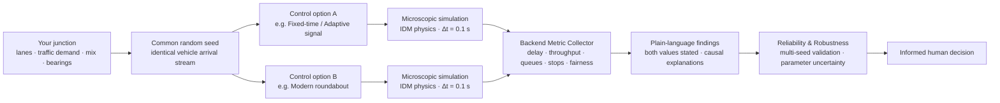
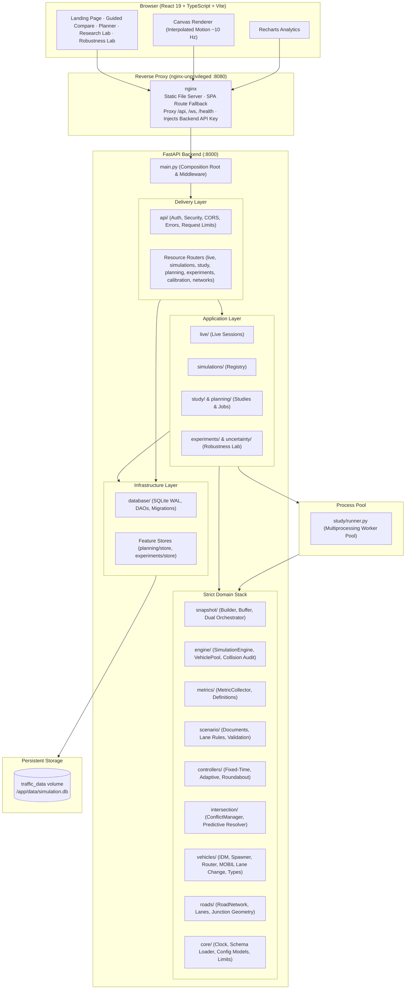
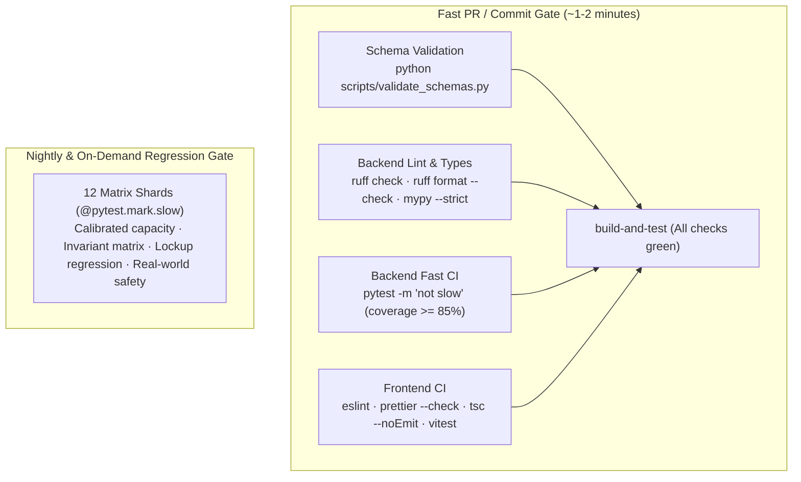
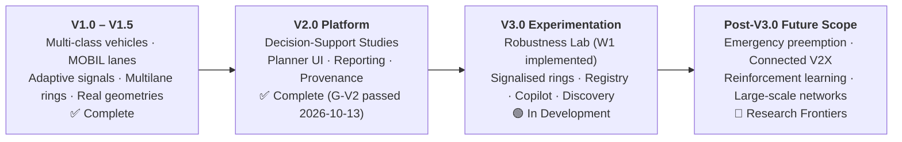

<div align="center">

# UrbanFlow

### Signal or roundabout? Try both.

**An evidence-based traffic simulation and decision-support platform for comparing intersection control strategies under controlled, reproducible conditions.**

| Version | Status | Milestone Detail | Core Stack |
| :-: | :-: | :-: | :-: |
| **V2.0** | ✅ **Complete** | Release gate passed 2026-10-13 ([audit](docs/roadmap/V2_COMPLETION_AUDIT.md)) | Python 3.11 · FastAPI · React 19 · TypeScript · Docker · AWS EC2 |
| **V3.0** | 🟢 **In Development** | W1 Robustness Lab vertical slice implemented; W2–W9 planned ([roadmap](docs/ROADMAP.md#7-v30--composable-ai-assisted-traffic-control-experimentation-planned-proposed)) | Composable strategies · Parameter uncertainty · Common random numbers |

</div>

> [!IMPORTANT]
> **Evidence, not a verdict.** UrbanFlow does not assume that traffic signals are better, or that roundabouts are better. It simulates both strategies on the exact same virtual junction with identical vehicle arrival streams, measures what happens across standardized operational metrics, quantifies statistical uncertainty, and explicitly reports model limitations. **The decision stays with you.**

---

## At a Glance

| Question | UrbanFlow Approach |
| --- | --- |
| **What is it?** | A microscopic traffic simulation and decision-support platform providing a guided planner experience, an interactive comparison dashboard, and a research lab comparing **fixed-time signals**, **adaptive signals**, and **roundabouts**. |
| **Who is it for?** | **Primary:** Municipal planning officers, transportation analysts, and non-specialist decision participants who need clear, evidence-backed evaluation without navigating complex simulation tools.<br/>**Secondary:** Traffic engineers and academic researchers who require granular metrics, multi-seed statistical validation, and reproducible parameter-uncertainty testing. |
| **What problem does it solve?** | Intersection control decisions are frequently argued from intuition or rigid guidelines. UrbanFlow turns "signal or roundabout?" into a fair, reproducible test that evaluates competing options on identical traffic patterns and reports findings in plain language. |
| **What does it simulate?** | Individual vehicles moving under the **Intelligent Driver Model (IDM)**, safe insertion, 5 distinct vehicle classes, gradual **MOBIL** lane changing, fixed-time signals (paired NS/EW stages, configurable offsets, per-corridor greens), vehicle-actuated adaptive signals (gap-out, max-green), multi-lane roundabouts (critical gap, follow-up time, exit convergence zones), and real-world 3- or 4-arm geometries with configurable compass bearings and lane widths. |
| **How is the comparison controlled?** | Both strategies receive the **identical random seed** and common random arrival sequences. Vehicles enter with identical arrival times, directions, vehicle classes, and turn intents. Only the intersection control strategy differs. Multi-seed studies demonstrate whether a difference is statistically consistent or the result of stochastic variation. |
| **How is it validated?** | Multi-tier test suite: unit, integration, and architectural boundary tests; physical invariant checks (vehicle conservation, non-negative speeds, no conflicting greens, zero collisions at calibrated demand); cross-process determinism; a calibrated one-lane capacity curve pinned by regression tests; and statistical difference testing (Student-t, Welch's t-test, Cohen's d, Wilson score intervals, bootstrap paired differences). |
| **How is it deployed?** | Two container services orchestrated with Docker Compose on Amazon EC2: an `nginx-unprivileged` frontend reverse proxy and a Python 3.11 FastAPI backend, persisting runs and studies to SQLite in WAL mode on a named persistent volume. |

---

## How UrbanFlow Works



1. **Describe the junction**: Select a real-world preset or configure the junction layout (number of arms, approach bearings, lane counts, lane arrows, traffic demand, turning proportions, and vehicle mix).
2. **Simulate in lockstep**: Watch both options run side by side on synchronized HTML5 canvas maps with real-time motion interpolation (~10 Hz snapshot stream).
3. **Examine the metrics**: Inspect time lost per vehicle, total throughput, queue lengths, vehicle stops, direction fairness (Jain's index), and planning-time index.
4. **Read plain-language findings**: Review HCM-style level-of-service grades, balance bands, and transparent explanations detailing *why* one strategy performed differently.
5. **Verify reliability and robustness**: Repeat the scenario across fresh random seeds to test for consistency, or submit to the **Robustness Lab** to evaluate whether the comparative preference holds under declared demand, vehicle mix, and driver headway uncertainty.

---

## Key Capabilities & Status

Every capability in UrbanFlow is grounded in the current codebase. Capabilities are categorized below according to their verified implementation and roadmap status:

### 1. Implemented & Available

| Area | Verified Capabilities | Documentation Reference |
| --- | --- | --- |
| **Microscopic Engine** | Discrete-time engine (Δt = 0.1 s); Intelligent Driver Model (IDM) car-following; curve speed caps; safe vehicle insertion at spawn; collision audit via oriented bounding boxes (SAT). | [Simulation Methodology](docs/simulation/methodology.md) |
| **Heterogeneous Vehicles** | 5 distinct vehicle classes (car, SUV, bus, truck, motorcycle), each with dedicated physical dimensions, IDM parameters ($a, b, T, s_0$), desired speed ranges, cornering limits, and lane-changing behavior (V1.1). | [Methodology §5.4](docs/simulation/methodology.md#54-vehicle-classes-v11) |
| **Advanced Lane Modelling** | Per-approach lane counts; explicit lane identity; permitted turn enforcement; gradual distance-based MOBIL lane changing with shadow lane occupancy and IDM safety gap verification (V1.2). | [Methodology §6.1](docs/simulation/methodology.md#61-lane-changing-v12) |
| **Fixed-Time Signal Control** | Paired NS/EW phase sequencing; configurable green, yellow, and all-red clearance intervals; per-corridor green timings; cycle offsets (V1.0). | [Methodology §7.1](docs/simulation/methodology.md#7-traffic-control-strategies) |
| **Adaptive Signal Control** | Vehicle-actuated signal control; stop-line presence detection; passage-based green extension and gap-out; maximum green limits; rest-in-green; cyclic stage skipping when approaches are empty (V1.3). | [Methodology §7.3](docs/simulation/methodology.md#73-adaptive-signal--controllersadaptive_signalpy-v13) |
| **Roundabout Modelling** | Critical gap acceptance ($4.0\text{ s}$ default); follow-up headway ($2.5\text{ s}$ default); multi-lane circulating ring (1–2 lanes); explicit lane assignment (left turns inner, right turns outer, straight lane-aligned); merging entries; exit convergence zones in arrival order (V1.4). | [Methodology §7.4](docs/simulation/methodology.md#741-multi-lane-rings-v14) |
| **Real-World Geometries** | 3- and 4-arm junctions; configurable compass bearings within 30° of cardinal slots; per-arm lane counts and lane widths; skew-aware stop lines; dedicated U-turn movements conforming to design turning radii (V1.5). | [Methodology §4.4](docs/simulation/methodology.md#44-real-world-junction-geometry-v15) |
| **Standardized Metrics** | Delay family (mean, median, p95); throughput; max and mean queue lengths; stop counts; Jain's fairness index; planning-time index; idle-green loss; vehicle conservation and integrity audits (computed strictly backend-side). | [Metrics Reference](docs/research/metrics-reference.md) |
| **Guided Planner Workflow** | Three-step comparison wizard; plain-language results with HCM-style delay grades; direction fairness bands; causal "Why did this happen?" explanations; one-click multi-seed reliability check. | [Planner Guide](docs/product/planner-guide.md) |
| **Research Lab** | Demand-volume sweeps with automatic delay crossover bracketing; Monte Carlo statistical validation (Student-t confidence intervals, Welch's t-test for unequal variances, Cohen's d effect sizes); single-strategy engineering views. | [Research Validation](docs/research/validation.md) |
| **Decision Support (V2.0)** | Multi-alternative junction studies (`/app/planner`, `/api/v2/planning`); paired common-seed evaluations; background compute jobs; structured report exports (JSON, Markdown, CSV); bit-identical reproduction checks. | [Decision Support Design](docs/product/decision-support.md) |
| **Robustness Lab (V3.0 W1)** | Parameter uncertainty exploration (`/app/experiments/:id`, `/api/v3/experiments`); multi-factor uncertainty sampling (demand, turning shares, vehicle mix, driver headway, critical gap); paired CRN ensemble runner; statistical contract with Wilson win/tie/loss intervals and bootstrap paired differences. | [Uncertainty & Robustness](docs/research/uncertainty.md) |

### 2. Experimental or Limited Scope

* **Safety & Environmental Proxies (V1.6):** Near-miss Time-to-Collision (TTC), Post-Encroachment Time (PET), conflict counts, and fuel/$\text{CO}_2$ consumption estimates are implemented in the specialist layer. These are **uncalibrated exploratory indicators**, not validated crash-risk or emissions models.
* **Mixed-Traffic Calibration:** Individual vehicle types have distinct physics, but multi-class mixed-traffic interactions have not been validated against empirical field observations.
* **Calibration Framework (V1.8):** A formal comparison framework exists at `/api/v2/calibration` to score simulation agreement against user-provided turning counts. However, **no real-world field observation dataset has been run through it, and model parameters are not automatically fitted**.
* **Network-Level Compilation (V1.9):** Multi-junction network documents can be validated, compiled, and fingerprinted via `/api/v2/networks`, but **multi-junction network simulation is not yet supported** (the simulation engine executes one junction at a time).

### 3. Planned Features (V3.0 Roadmap: W2–W9)

The approved V3.0 roadmap introduces composable, AI-assisted traffic-control experimentation:
* **W2:** Signalised roundabouts (`metered_entry` gating entry lanes while preserving ring gap-acceptance).
* **W3:** Composable control strategy registry with compatibility validation and fingerprint parity.
* **W4:** High driver aggression profile as a declared default for new scenarios.
* **W5:** AI Traffic Experiment Copilot (proposal-only, backend-validated, confirm-before-run).
* **W6:** AI Control Strategy Discovery Lab (bounded multi-objective evolutionary search).
* **W7:** Python SDK, `.ufpkg` portable experiment packages, quota and token management.
* **W8–W9:** Strategy Breakpoint Explorer and final integration showcase.

### 4. Not Supported (Future Scope)

Capabilities outside the V1.0–V3.0 roadmap are catalogued in [Future Scope](docs/future-scope/future_scope.md):
* Emergency vehicle priority preemption (FS-1)
* Reinforcement learning (RL) signal controllers (FS-2)
* Connected vehicle communication (V2V/V2I) and platooning (FS-3, FS-4)
* Autonomous intersection management (AIM) reservation systems (FS-5)
* Incidents, disruptions, and adverse weather conditions (FS-7, FS-8)
* Large-scale multi-junction network simulations (FS-9)
* Real-time continuously updated digital twins (FS-10)

---

## Technology Stack & Architecture

### Technology Overview

| Component | Technology | Rationale |
| --- | --- | --- |
| **Backend Runtime** | Python 3.11 (`>=3.11` in `pyproject.toml`) | Rich scientific computing ecosystem, precise numerical physics simulation. |
| **Backend Framework** | FastAPI · Uvicorn · Starlette | Asynchronous HTTP endpoints, native WebSockets, automatic OpenAPI documentation. |
| **Data Validation** | Pydantic v2 · jsonschema | Strict request/response parsing and runtime schema validation. |
| **Persistence** | SQLite (WAL mode) | Zero-ops local persistence on a persistent Docker volume, foreign keys, 5 s busy timeout, in-place additive migrations. |
| **Frontend Framework** | React 19 · TypeScript 5.8 | Modern reactive UI, strict static type safety across components. |
| **Frontend Build** | Vite 8 · Tailwind CSS v4 · Framer Motion | Fast HMR development, modern styled components, smooth workspace transitions. |
| **Visualization** | HTML5 Canvas · Recharts | High-performance 60 FPS vehicle motion rendering on Canvas; declarative SVG charts for analytics. |
| **Contracts** | JSON Schema (Draft 2020-12) | Language-agnostic contracts (`shared/schemas/`) defining configuration, snapshots, and experiments. |
| **Containerization** | Docker Compose v2 · nginx-unprivileged | Production container isolation, static file hosting, and reverse proxying. |
| **Cloud Target** | Amazon EC2 (Ubuntu Linux) | Single-instance deployment, automated GitHub Actions CI/CD. |

### Architectural Boundaries & Data Flow

UrbanFlow strictly enforces the principle that **the backend is the single source of truth for all simulation physics and metric computation**. The browser never simulates motion and never computes a metric.



* **Domain Stack Rule:** Packages in `backend/src/` follow an import hierarchy enforced by `backend/tests/test_architecture.py`. Domain packages (`core` through `snapshot`) import only downwards and never import from delivery, application, or infrastructure layers.
* **Lockstep Execution:** Dual comparisons use `DualSimulationOrchestrator` to step two engines (signal and roundabout) with the exact same seed and arrival stream.
* **Worker Process Isolation:** Heavy study sweeps and Monte Carlo runs execute in background worker processes (`STUDY_WORKERS`), preventing simulation workloads from blocking the API or WebSocket streams.

---

## Repository Structure

```
Traffic-Simulation/
├── backend/                       # Simulation engine, physics, metrics, API, persistence
│   ├── src/                       # Source packages
│   │   ├── main.py                # FastAPI composition root: middleware, DB init, router mounting
│   │   ├── api/                   # Shared delivery plumbing (auth, API key, error envelope, limits, meta)
│   │   ├── live/                  # Live dashboard session registry, compilation, routes, WebSockets
│   │   ├── simulations/           # Versioned simulation lifecycle, config validation, stream handler
│   │   ├── study/                 # Volume sweeps, Monte Carlo validation, control comparison, worker pool
│   │   ├── planning/              # V2.0 decision-support planning studies, report generator, store
│   │   ├── experiments/           # V3.0 Robustness Lab API, service, document models, quotas, store
│   │   ├── uncertainty/           # V3.0 parameter uncertainty spec, sampler, factor application, analysis
│   │   ├── calibration/           # V1.8 observed-count comparison framework and store
│   │   ├── networks/              # V1.9 multi-junction network validation and compilation
│   │   ├── history/               # Persisted run history, tags, labels, CSV/JSON export, reproduction
│   │   ├── replays/ & suites/     # Replay persistence and scenario suite batch execution
│   │   ├── core/                  # Kernel: clock, limits, provenance, schema loader, config models
│   │   ├── roads/                 # RoadNetwork, lanes, approaches, real-world junction geometry
│   │   ├── vehicles/              # IDM physics, spawner, router, MOBIL lane change, vehicle types
│   │   ├── intersection/          # Conflict manager, stop lines, predictive conflict resolver
│   │   ├── controllers/           # BaseController, fixed-time signal, adaptive signal, roundabout, factory
│   │   ├── metrics/               # MetricCollector, efficiency scoring, metric definitions
│   │   ├── scenario/              # Strategy-neutral scenario documents, lane & cross-field rules
│   │   ├── engine/                # SimulationEngine (tick loop, lock), VehiclePool, collision audit
│   │   ├── snapshot/              # SnapshotBuilder, SnapshotBuffer, DualSimulationOrchestrator
│   │   └── database/              # SQLite connection, WAL mode, migrations, DAOs
│   ├── tests/                     # Test suite mirroring src/ (+ integration/, test_architecture.py)
│   ├── Dockerfile                 # Multi-stage image (dev target with bind-mount; prod target with appuser)
│   ├── pyproject.toml             # Ruff, Mypy strict, and Pytest configuration (85% coverage floor)
│   ├── requirements.txt           # Pinned Python dependencies
│   └── README.md                  # Backend architecture and local test guide
├── frontend/                      # User interface and visual analytics (React 19 + TypeScript + Vite)
│   ├── src/                       # Application source
│   │   ├── landing/               # Landing page components, animation, narrative
│   │   ├── components/            # UI components (guided/, analytics/, scenario/, shell/, ui/)
│   │   ├── hooks/                 # React hooks (useWebSocketSnapshot, useStudyJob, useAuthSession)
│   │   ├── services/              # API and WebSocket service clients (REST, liveSession, v2, v3)
│   │   ├── metrics/               # Metric catalog and plain-language presentation rules
│   │   ├── routing.ts             # Client-side router matching SPA URL paths
│   │   ├── types/                 # TypeScript interfaces mirroring data contracts
│   │   └── test/                  # Vitest unit, component, and axe-core accessibility tests
│   ├── templates/                 # nginx configuration template (SPA fallback, proxy, API key injection)
│   ├── index.html · app.html      # Multi-page Vite HTML entry points
│   ├── vite.config.ts             # Vite build configuration, dev proxy, history fallback
│   ├── package.json               # Node dependencies and scripts
│   ├── Dockerfile                 # Multi-stage build serving built static assets via nginx-unprivileged
│   └── README.md                  # Frontend development and testing guide
├── shared/                        # Machine-readable JSON Schema contracts (jointly owned)
│   ├── schemas/                   # Root schemas: config.schema.json, snapshot.schema.json, vehicle_state.json
│   │   ├── v2/                    # V2.0 schemas: planning study, planning report, calibration, networks
│   │   └── v3/                    # V3.0 schemas: experiment, uncertainty spec, openapi.v3.snapshot.json
│   └── README.md                  # Contract rules and validation guide
├── scripts/                       # Automation, study runners, deployment, and validation tools
│   ├── run_full_study.py          # Headless study runner (volume sweep + Monte Carlo validation to CSV/JSON)
│   ├── validate_schemas.py        # Validates top-level shared JSON Schema files (config, snapshot, vehicle_state)
│   ├── deploy-ec2.sh              # EC2 deployment automation script
│   └── README.md                  # Scripts directory index and usage guide
├── docs/                          # Comprehensive technical and scientific documentation hub
│   ├── README.md                  # Documentation navigation hub and status index
│   ├── ROADMAP.md                 # Single authoritative project roadmap (V0.1 through V3.0 and beyond)
│   ├── architecture/              # System overview, backend/frontend architecture, shared contracts
│   ├── simulation/                # Simulation methodology and configuration reference
│   ├── research/                  # Metrics reference, validation evidence, uncertainty, reproducibility
│   ├── product/                   # Product story, user narrative, planner guide, decision support
│   ├── deployment/                # AWS EC2 deployment runbook, CI/CD setup, production operations
│   ├── testing/                   # Quality pyramid, backend/frontend test guides, slow regression matrix
│   ├── decisions/                 # Architecture Decision Records (ADR-001 through ADR-018)
│   └── roadmap/                   # V2.0 completion audit, V3 product strategy, sprint plans
├── fallback-pack/                 # Offline demo packs (precomputed & small live study) for presentations
├── docker-compose.yml             # Production Docker Compose orchestration
├── docker-compose.dev.yml         # Development Docker Compose orchestration (hot-reload, bind-mounted)
├── start.ps1                      # Windows orchestration script (build, start, logs, smoke test, clean)
└── README.md                      # Primary repository entry point (this document)
```

---

## Prerequisites & Environment Setup

### System Prerequisites

* **Python:** Version 3.11 or newer (Python 3.11 is the tested runtime in CI and Docker).
* **Node.js:** Node.js 20.x or newer (CI uses Node 20; npm is the package manager).
* **Docker:** Docker Engine with Compose v2 (`docker compose version` must succeed).
* **Git:** For cloning, submodules, and recording build commit metadata.

### Environment Configuration

UrbanFlow reads configuration from shell environment variables or a `.env` file located in the repository root. Docker Compose loads `.env` automatically.

| Variable | Scope | Default | Description |
| --- | --- | --- | --- |
| `API_KEY` | Backend & Nginx | *(empty: disabled)* | Secret key protecting mutating and compute-heavy endpoints. In production, nginx passes this as `X-API-Key` automatically. |
| `CORS_ORIGINS` | Backend | `http://localhost:5173,http://127.0.0.1:5173` | Comma-separated list of allowed origins. In production behind nginx, browser requests are same-origin. |
| `DB_PATH` | Backend | `backend/simulation.db` (local) / `/app/data/simulation.db` (Docker) | Path to SQLite database file. WAL mode and foreign keys are enabled on startup. |
| `STUDY_WORKERS` | Backend | *(empty: $\min(\text{CPUs}, 8)$)* | Number of worker processes spawned for background studies. Lower to 2 on 1 GB RAM hosts. |
| `DEV_AUTH_BYPASS` | Backend | `0` (prod) / `1` (dev stack) | When set to `1`, requests with the development token are accepted as "Local developer" without Cognito. |
| `AWS_REGION` | Backend & Frontend | `ap-south-1` | AWS region hosting the optional Amazon Cognito User Pool. |
| `COGNITO_USER_POOL_ID` | Backend & Frontend | *(empty)* | Cognito User Pool ID for user authentication and multi-tenant resource ownership. |
| `COGNITO_CLIENT_ID` | Backend & Frontend | *(empty)* | Cognito App Client ID for authentication. |
| `ADMIN_EMAILS` | Backend | *(empty)* | Comma-separated list of emails granted administrative access. |
| `URBANFLOW_HTTP_PORT` | Compose | `80` | Host port mapped to the frontend nginx proxy (mapped to container port 8080). |
| `URBANFLOW_ALT_HTTP_PORT` | Compose | `3000` | Secondary host port mapped to the frontend proxy. |
| `GIT_COMMIT` | Build argument | *(empty)* | Git commit SHA embedded into images and saved with simulation provenance. |

---

## Running the Application

### 1. Docker Compose (Production & Evaluation Mode)

This is the recommended path for evaluating the full stack in a containerised environment:

```bash
# Build and start all services in the background
GIT_COMMIT=$(git rev-parse HEAD) docker compose up --build -d

# Check service status and health checks
docker compose ps
```

To stop the containers while preserving database volume data:
```bash
docker compose down
```

To stop containers and delete the persistent SQLite database volume:
```bash
docker compose down -v
```

### 2. Windows PowerShell: `start.ps1`

On Windows systems with Docker Desktop, `start.ps1` automates port conflict detection, image building, health-check waiting, and stack verification:

```powershell
.\start.ps1                    # Build changed services, start stack, and run smoke tests
.\start.ps1 -Dev               # Launch development hot-reload stack (Vite on :5173, FastAPI on :8000)
.\start.ps1 -Status            # Display status of containers, ports, and health
.\start.ps1 -Logs backend      # Follow backend container logs (or: frontend)
.\start.ps1 -SmokeTest         # Run smoke verification tests against the running stack
.\start.ps1 -Restart           # Recreate containers without deleting database data
.\start.ps1 -Rebuild           # Force rebuild of images from scratch
.\start.ps1 -Clean             # Stop and remove containers and images (preserves data volume)
.\start.ps1 -Clean -DeleteData # Stop and delete everything, including the database volume
```

### 3. Native Local Development

Run backend and frontend independently for local development:

**Terminal 1 — Backend:**
```bash
cd backend
python -m venv .venv

# Activate virtual environment
.venv\Scripts\activate          # Windows PowerShell / CMD
# source .venv/bin/activate     # macOS / Linux

# Install dependencies
pip install -r requirements.txt

# Run FastAPI with hot-reload and dev auth bypass enabled
DEV_AUTH_BYPASS=1 uvicorn src.main:app --reload --host 0.0.0.0 --port 8000
```

**Terminal 2 — Frontend:**
```bash
cd frontend
npm install

# Start Vite dev server with proxy to http://localhost:8000
npm run dev
```

### 4. Headless CLI Study Execution

Run the complete validated simulation study (volume sweep and Monte Carlo analysis) directly against the physics engine without starting the web server:

```bash
# Display available options
python scripts/run_full_study.py --help

# Execute standard study (generates study_report.csv and study_report.json)
python scripts/run_full_study.py --output-csv study_report.csv --output-json study_report.json
```

### Application URLs

| URL | Component | Notes |
| --- | --- | --- |
| `http://localhost/` | Landing Page | Product narrative, core principles, overview. (Also accessible on port 3000). |
| `http://localhost/app/comparative` | Guided Comparison | 3-step guided comparison wizard between signal and roundabout. |
| `http://localhost/app/planner` | Decision Support Planner | V2.0 multi-alternative planning study workflow and report downloads. |
| `http://localhost/app/research` | Research Lab Hub | Traffic volume sweeps, delay crossover explorer, Monte Carlo validation. |
| `http://localhost/app/history` | Run History | Stored simulation runs, parameter comparisons, bit-level reproduction. |
| `http://localhost/app/experiments/:id` | Robustness Lab | V3.0 parameter uncertainty experiment viewer, eligibility checklist, intervals. |
| `http://localhost/health` | Health Check | Proxied to backend `/health`, returns `{"status":"healthy"}`. |
| `http://localhost/api/version` | Backend Version | Returns running Git commit hash and Python runtime version. |
| `http://localhost:8000/docs` | Interactive OpenAPI Docs | Swagger UI (available directly on backend port 8000 in native/dev mode). |

### Troubleshooting Common Issues

* **Port 80 or 3000 in use:** Set `URBANFLOW_HTTP_PORT=8080` and `URBANFLOW_ALT_HTTP_PORT=3001` in your environment or `.env`.
* **Backend fails on startup with schema error:** The backend requires `shared/schemas/config.schema.json` to exist. Verify you are running from the repository root or that the volume mount includes `shared/`.
* **Dashboard displays 401 Unauthorized:** If `API_KEY` is configured in the backend environment, ensure `BACKEND_API_KEY` matches in the frontend nginx container or configure `DEV_AUTH_BYPASS=1` for local development.
* **Low memory on 1 GB cloud hosts:** Image compilation can trigger Out-Of-Memory errors on small instances. Configure at least 1 GB of swap space as documented in [AWS Deployment](docs/deployment/AWS_FREE_TIER_DEPLOYMENT.md).

---

## Testing, Linting, & Validation Workflow

UrbanFlow employs a strict multi-tier quality gate to ensure physical correctness, statistical reproducibility, and interface contracts:



### 1. Backend Testing Commands

```bash
cd backend

# Fast CI test suite (deselects slow simulation sweeps; enforces 85% coverage floor)
pytest -m "not slow"

# Full slow simulation regression sweep (nightly in CI; runs with --no-cov)
pytest -m slow --no-cov

# Architectural boundary and slow-matrix synchronization check
pytest tests/test_architecture.py tests/test_ci_slow_matrix.py --no-cov

# Linter, code formatter, and strict type check
ruff check src/ tests/
ruff format --check src/ tests/
mypy src/
```

> [!NOTE]
> **Why `--no-cov` is used on slow and targeted tests:** Pyproject configuration sets a project-wide coverage floor (`--cov-fail-under=85`). When running individual test files or isolated slow shards, measuring coverage over a single module produces a localized coverage percentage that fails the gate. `--no-cov` is passed during targeted test execution.

### 2. Slow Simulation Regression Shard Matrix

Full simulation sweeps are excluded from ordinary pull-request gates to maintain fast CI feedback, running instead nightly at 02:30 UTC or via manual `workflow_dispatch`. The 12 matrix shards are synchronized by `test_ci_slow_matrix.py`:

| Shard Name | Test File | Regression Target Guarded |
| --- | --- | --- |
| `signal-capacity` | `tests/integration/test_signal_capacity.py` | Signal throughput scaling under rising demand. |
| `roundabout-conflicts` | `tests/integration/test_roundabout_conflicts.py` | Conflict/contact budgets across lane configurations. |
| `roundabout-lockup` | `tests/integration/test_roundabout_lockup.py` | Circulating ring deadlock prevention under saturation. |
| `calibrated-capacity` | `tests/integration/test_calibrated_capacity_regression.py` | Published one-lane capacity curve regression pin. |
| `signal-lockup` | `tests/vehicles/test_router.py` | Saturated-signal exit routing and queue discharge. |
| `calibration-pass` | `tests/integration/test_calibration_pass.py` | Gap acceptance, free-flow delay, and lane capacity. |
| `adaptive-signal-runs` | `tests/integration/test_adaptive_signal_runs.py` | Adaptive signal actuation and gap-out stability. |
| `real-world-junctions` | `tests/integration/test_real_world_junctions_v15.py` | 60-run safety matrix across 3- and 4-arm geometries. |
| `roundabout-multilane` | `tests/integration/test_roundabout_multilane_v14.py` | Multi-lane ring exit convergence safety. |
| `vehicle-types-and-lanes`| `tests/integration/test_vehicle_types_and_lanes.py` | Mixed vehicle populations and multi-lane interaction. |
| `roundabout-lane-capacity`| `tests/integration/test_roundabout_lane_capacity.py` | Multi-lane roundabout capacity scaling. |
| `randomized-invariants` | `tests/integration/test_randomized_invariants.py` | 48 random valid scenarios checking conservation, speeds, and seeds. |

### 3. Frontend Quality Commands

```bash
cd frontend

# Run unit, component, and automated accessibility tests
npm run test

# Strict TypeScript type check
npm run type-check

# ESLint code analysis
npm run lint

# Prettier format check (npm run format:fix to auto-format)
npm run format

# Production bundle compilation
npm run build
```

### 4. Contract & Container Validation

```bash
# Validate all shared JSON Schemas
python scripts/validate_schemas.py

# Verify Docker Compose production and development syntax
docker compose config
docker compose -f docker-compose.dev.yml config

# Run end-to-end local stack smoke test
powershell .\start.ps1 -SmokeTest
```

---

## API & Developer Workflows

### Authentication Architecture

* **API Key Security:** Mutating and compute-heavy routes (`/api/v1/simulations`, `/api/v2/*`, `/api/v3/*`, study execution) require an API key passed via the `X-API-Key` or `Authorization: Bearer` header. In production, nginx automatically attaches `BACKEND_API_KEY` for reverse-proxied browser traffic.
* **User Ownership:** In authenticated mode, user identity is verified via Amazon Cognito JWT access tokens. In local development, setting `DEV_AUTH_BYPASS=1` automatically signs requests in as a local developer.
* **Tenant Isolation:** Planning studies (`/api/v2/planning`) and Robustness Lab experiments (`/api/v3/experiments`) are private to their creator. Access attempts from another user ID return an HTTP 404 response.

### Route Summary

| Route Group | Base Path | Key Capabilities |
| --- | --- | --- |
| **Meta & System** | `/health`, `/api/version`, `/api/me` | Health status, commit SHA, runtime version, authenticated identity. |
| **Live Session** | `/api/simulation/*`, `/ws/simulation/*` | Interactive dual and single-junction simulation sessions; ~10 Hz WebSocket streaming. |
| **Versioned Simulation** | `/api/v1/simulations`, `/ws/v1/stream` | Formal simulation lifecycle, scenario document compilation (`/api/v1/scenarios/compile`), validation, persistence. |
| **Study & Analytics** | `/api/v1/study/*` | Demand volume sweeps (`/sweeps`), Monte Carlo validation (`/validation`), control comparisons (`/control-comparison`), async jobs (`/jobs`). |
| **Run History** | `/api/v1/study/history/runs` | Stored simulation runs, metadata, tags, CSV/JSON export, exact seed reproduction. |
| **Calibration** | `/api/v2/calibration` | Stateless ingestion of user-provided turn counts and agreement scoring against simulated volumes. |
| **Networks** | `/api/v2/networks` | Multi-junction network document validation, compilation, and fingerprinting (stateless). |
| **Decision Support** | `/api/v2/planning` | Multi-alternative junction studies, background jobs, findings, and Markdown/JSON/CSV report generation. |
| **Robustness Lab** | `/api/v3` | System capabilities (`/capabilities`), parameter uncertainty validation (`/experiments/validate`), execution, and result analysis. |

---

## Scientific Methodology & Limitations

### Scientific Methodology

1. **Deterministic Car-Following Physics:** Vehicles follow the Intelligent Driver Model (IDM) with explicit acceleration and deceleration bounds. Curve speeds are capped geometrically based on turn radii.
2. **Common Random Numbers (CRN):** In lockstep dual comparisons and Robustness Lab ensembles, both strategies receive identical pseudo-random number generator seeds. Vehicles arrive with the exact same timestamps, velocity, vehicle class, and turn direction, ensuring that observed differences reflect control strategy efficiency rather than arrival noise.
3. **Warm-Up Clipping:** To avoid empty-grid bias, metrics collection excludes a configurable warm-up period (default 30 s). Statistics reflect steady-state operational conditions.
4. **Statistical Rigor:** Multi-seed studies report Student-t confidence intervals, Welch's t-test p-values for unequal variances, Cohen's d effect sizes, Wilson score intervals for proportion metrics, and bootstrap intervals for paired differences.

### Model Assumptions & Known Boundaries

UrbanFlow is designed for comparative analysis under stated assumptions. It is **not an unconstrained real-world traffic predictor**:

* **Internal Consistency vs. Field Calibration:** The simulation engine is rigorously validated against internal physical invariants and numerical reproducibility. **UrbanFlow is not calibrated against real-world observed traffic counts**, and no model parameters are fitted to empirical field measurements.
* **Exploratory Metrics:** Measures for near-miss safety (Time-to-Collision, Post-Encroachment Time) and environmental impact (fuel consumption, $\text{CO}_2$ emissions) are exploratory proxies and should not be used as certified safety or air-quality assessments.
* **Roundabout Ring Capacity (K1):** On two-lane roundabouts, adding a third entry lane provides no capacity benefit because entries merge into available circulating ring lanes.
* **Network Execution:** Multi-junction network specifications are validated and compiled by the API, but the simulation engine currently executes individual junctions.

---

## Roadmap & Version Status

UrbanFlow's roadmap is maintained exclusively in [docs/ROADMAP.md](docs/ROADMAP.md):



* **V1.0 – V2.0 (Complete):** Core microscopic simulation, 5 vehicle classes, MOBIL lane changes, adaptive signals, multi-lane roundabouts, real-world junction geometries, and the V2.0 Decision-Support Planning Platform. The V2.0 release gate (G-V2) officially passed on 2026-10-13 ([audit report](docs/roadmap/V2_COMPLETION_AUDIT.md)).
* **V3.0 (In Development):** Composable, AI-assisted traffic control experimentation platform:
  * **W1 (Implemented 2026-10-15):** Robustness Lab vertical slice (uncertainty sampling, paired CRN runner, statistical contracts, experiment viewer at `/app/experiments/:id`).
  * **W2–W9 (Planned):** Signalised roundabouts (`metered_entry`), composable strategy registry, high driver aggression default, AI experiment copilot, AI strategy discovery lab, and Python SDK (`.ufpkg`).
* **Post-V3.0 Future Scope:** Long-term research frontiers (emergency vehicle priority, learned RL controllers, V2X communication, autonomous intersection management, large-scale networks, real-time digital twins) catalogued in [Future Scope](docs/future-scope/future_scope.md).

---

## Documentation Directory Index

| Audience | Recommended Starting Points |
| --- | --- |
| **Planners & Non-Specialists** | [Product Story](docs/product/README.md) · [Planner Guide](docs/product/planner-guide.md) · [Known Limitations](docs/research/validation.md#5-known-limitations) |
| **Traffic Researchers** | [Simulation Methodology](docs/simulation/methodology.md) · [Metrics Reference](docs/research/metrics-reference.md) · [Validation Evidence](docs/research/validation.md) · [Uncertainty Engine](docs/research/uncertainty.md) · [Comparative Report](docs/reports/comparative_report.md) |
| **Developers & Architects** | [Documentation Hub](docs/README.md) · [System Overview](docs/architecture/00-system-overview.md) · [Backend Architecture](docs/architecture/02-backend-architecture.md) · [Frontend Architecture](docs/architecture/03-frontend-architecture.md) · [API Reference](docs/api/README.md) · [Architecture Decisions](docs/decisions/README.md) |
| **DevOps & Operators** | [Deployment Guide](docs/deployment/README.md) · [AWS EC2 Runbook](docs/deployment/AWS_FREE_TIER_DEPLOYMENT.md) · [Production Operations](docs/operations.md) · [Testing & Quality Gates](docs/testing/README.md) |

---

## Project Team

| Contributor | Focus Area | Core Responsibilities |
| --- | --- | --- |
| **Viraj Jadhao** | Backend & Science | Simulation physics, IDM dynamics, controllers, metrics collector, study engines, decision-support API, Robustness Lab. |
| **Khushi Kashyap** | Frontend & Visualization | Dashboard architecture, Canvas maps, Recharts analytics, guided planner UI, experiment viewer, AWS deployment handoff. |

---

## Contributing

Pull requests are validated against strict automated quality gates. Before opening a PR, ensure all checks pass:

```bash
# 1. Validate JSON Schemas
python scripts/validate_schemas.py

# 2. Run backend checks (fast tests + lint + format + strict typing)
cd backend
pytest -m "not slow"
pytest tests/test_architecture.py tests/test_ci_slow_matrix.py --no-cov
ruff check src/ tests/
ruff format --check src/ tests/
mypy src/

# 3. Run frontend checks (tests + types + lint + format)
cd ../frontend
npm run test
npm run type-check
npm run lint
npm run format
```

Refer to [Engineering Standards](docs/architecture/09-engineering-standards.md) and [Testing](docs/testing/README.md) for detailed guidelines.

---

## License

No `LICENSE` file is currently included in the repository. All rights reserved.
