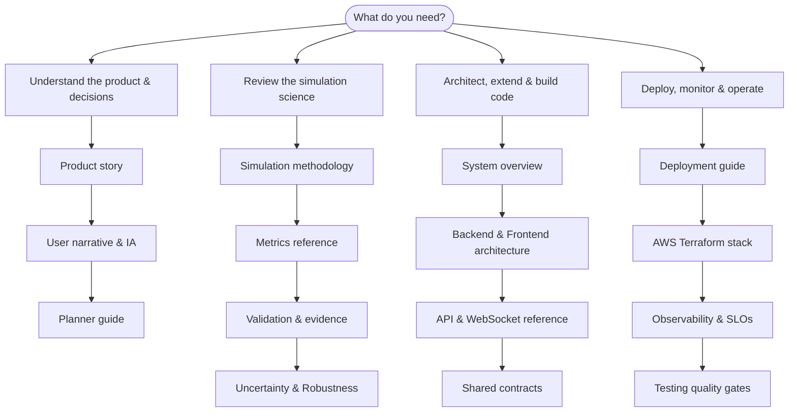

# UrbanFlow Documentation Hub

> The unified index of technical, scientific, and operational documentation across UrbanFlow.  
> **Platform Status:** **V5.4 — IMPLEMENTED** (Phases 1–6 complete; Phase 7 planned). Every technical document is traceable to checked-in code, formal tests, or dated scientific benchmarks.

---

## Find Your Path

| Your Role | Recommended Reading Order |
| :--- | :--- |
| **Municipal Planner / Reviewer** | [Product Story](product/README.md) $\to$ [Planner Guide](product/planner-guide.md) $\to$ [Methodology §1–2](simulation/methodology.md) $\to$ [Known Limitations](research/validation.md#5-known-limitations) |
| **Traffic Researcher / Scientist** | [Methodology](simulation/methodology.md) $\to$ [Metrics](research/metrics-reference.md) $\to$ [Signalised Roundabouts](simulation/signalised-roundabout.md) $\to$ [Uncertainty Engine](research/uncertainty.md) $\to$ [Comparative Report](reports/comparative_report.md) |
| **Software Architect / Engineer** | [System Overview](architecture/00-system-overview.md) $\to$ [Backend Architecture](architecture/02-backend-architecture.md) $\to$ [Frontend Architecture](architecture/03-frontend-architecture.md) $\to$ [API Reference](api/README.md) $\to$ [Roadmap](ROADMAP.md) |
| **DevOps / Cloud Operator** | [Root README](../README.md#quick-start) $\to$ [Deployment Guide](deployment/README.md) $\to$ [AWS Terraform Stack](../infra/terraform/README.md) $\to$ [Observability & SLOs](operations-observability.md) $\to$ [Testing](testing/README.md) |

---

## Document Status Legend

| Status | Meaning |
| :---: | :--- |
| **Current** | Verified against the active repository source tree across V1.0–V5.4. |
| **Reference** | Deep architectural contract, standard, or formal decision record. |
| **Record** | A dated record of work (audits, release notes, empirical benchmarks). Accurate for its release date. |
| **Historical** | Early planning or bootstrap specifications preserved for institutional context. |

---

## Documentation Directory Index

### 1. Product & Decision Support
| Document | Status | Scope & Purpose |
| :--- | :---: | :--- |
| [../README.md](../README.md) | Current | Primary repository entry point, capabilities, and quick-start. |
| [product/README.md](product/README.md) | Current | Product vision: problem statement, personas, core principles, user journey. |
| [product/planner-guide.md](product/planner-guide.md) | Current | Step-by-step planner guide for multi-alternative studies at `/app/planner`. |
| [product/urbanflow-user-narrative.md](product/urbanflow-user-narrative.md) | Reference | Narrative structure, information architecture, and plain-language findings. |
| [product/urbanflow-evaluation-metrics.md](product/urbanflow-evaluation-metrics.md) | Reference | Detailed metric formulas, Level-of-Service grades, and validity thresholds. |
| [product/decision-support.md](product/decision-support.md) | Reference | Multi-alternative study design and common-seed evaluation protocols. |

### 2. Simulation Methodology & Research
| Document | Status | Scope & Purpose |
| :--- | :---: | :--- |
| [simulation/methodology.md](simulation/methodology.md) | Current | Microscopic traffic models: IDM car-following, MOBIL lanes, signals, roundabouts. |
| [simulation/configuration.md](simulation/configuration.md) | Current | Complete configuration reference, schema fields, and environment variables. |
| [simulation/signalised-roundabout.md](simulation/signalised-roundabout.md) | Current | Metered-entry signalised roundabout controller (`metered_entry`): physics, gap acceptance, G-SR gate. |
| [simulation/driver-aggression.md](simulation/driver-aggression.md) | Current | Normal vs. high aggression driver behavior profiles (ADR-016, ADR-019, ADR-020). |
| [research/metrics-reference.md](research/metrics-reference.md) | Current | Metric definitions: delay, throughput, queues, stops, fuel/CO2, TTC/PET. |
| [research/uncertainty.md](research/uncertainty.md) | Current | Robustness Lab: Sobol/LHS parameter uncertainty, bootstrap paired differences, Wilson intervals. |
| [research/reproducibility.md](research/reproducibility.md) | Current | Determinism, Common Random Numbers (CRN), and run provenance tracking. |
| [research/validation.md](research/validation.md) | Current | Validated vs. assumed capabilities, known limitations, and boundary conditions. |
| [research/calibration.md](research/calibration.md) | Current | Turning-count calibration framework: GEH statistic, RMSE, MAPE, continuous recalibration. |
| [ai/copilot.md](ai/copilot.md) | Current | AI Experiment Copilot: proposal-only schema gate and grounded summary assertion checker. |

### 3. Architecture & Contracts
| Document | Status | Scope & Purpose |
| :--- | :---: | :--- |
| [architecture/00-system-overview.md](architecture/00-system-overview.md) | Current | High-level system architecture, four-layer stack, communication flows, security. |
| [architecture/01-repository-architecture.md](architecture/01-repository-architecture.md) | Current | Directory layouts, subsystem boundaries, code ownership split. |
| [architecture/02-backend-architecture.md](architecture/02-backend-architecture.md) | Current | Backend package structure, layering rules, router mounts, persistence DAOs. |
| [architecture/03-frontend-architecture.md](architecture/03-frontend-architecture.md) | Current | React 19 SPA architecture, routing table, canvas motion interpolation, MapLibre GL. |
| [architecture/04-shared-contract-layer.md](architecture/04-shared-contract-layer.md) | Reference | Shared JSON Schema specifications and cross-language contract ownership. |
| [architecture/05-snapshot-contract.md](architecture/05-snapshot-contract.md) | Reference | High-frequency telemetry snapshot schema (`snapshot.schema.json`). |
| [architecture/06-scenario-configuration-contract.md](architecture/06-scenario-configuration-contract.md) | Reference | Scenario configuration schema specification (`config.schema.json`). |
| [architecture/07-metric-contract.md](architecture/07-metric-contract.md) | Reference | Metric formulas, sampling intervals, and edge-case definitions. |
| [architecture/08-communication-contract.md](architecture/08-communication-contract.md) | Reference | REST and WebSocket communication patterns and payload standards. |
| [architecture/09-engineering-standards.md](architecture/09-engineering-standards.md) | Reference | Code quality standards, Git commit conventions, linting and formatting rules. |
| [decisions/README.md](decisions/README.md) | Reference | Architectural Decision Records index (ADR-001 through ADR-022). |

### 4. API Reference, Testing & Operations
| Document | Status | Scope & Purpose |
| :--- | :---: | :--- |
| [api/README.md](api/README.md) | Current | Complete REST and WebSocket endpoint reference for `/api/v1`, `/api/v2`, `/api/v3`. |
| [testing/README.md](testing/README.md) | Current | Testing pyramid: pytest, Hypothesis property tests, Vitest, CI coverage floor ($\ge 85\%$). |
| [deployment/README.md](deployment/README.md) | Current | Deployment guide: Docker Compose, Nginx reverse proxy, production images. |
| [deployment/AWS_FREE_TIER_DEPLOYMENT.md](deployment/AWS_FREE_TIER_DEPLOYMENT.md) | Current | Step-by-step EC2 runbook and single-instance cloud deployment guide. |
| [operations-observability.md](operations-observability.md) | Current | Distributed tracing, Prometheus `/metrics/prom`, SLO evaluation, Grafana, k6, chaos. |
| [operations-platform.md](operations-platform.md) | Current | Kubernetes platform operations: Helm charts, Kind local clusters, and Airflow DAGs. |
| [security/tenancy.md](security/tenancy.md) | Current | Enterprise multi-tenancy: OIDC authentication, RBAC roles, tenant isolation, quotas. |

### 5. Project Roadmap & Delivery Plans
| Document | Status | Scope & Purpose |
| :--- | :---: | :--- |
| [ROADMAP.md](ROADMAP.md) | Authoritative | Single authoritative project roadmap: V0.1 through V6.1 evolution. |
| [plan/README.md](plan/README.md) | Authoritative | Master delivery plan (W31–W60): calendar, release gates, Demo Mondays, risks. |
| [plan/WEEKLY_PLAN.md](plan/WEEKLY_PLAN.md) | Authoritative | Week-by-week sprint tracking: delivered status vs. scheduled Phase 7 scope. |
| [plan/FEATURE_SPECIFICATIONS.md](plan/FEATURE_SPECIFICATIONS.md) | Authoritative | Detailed scope and acceptance criteria for all 20 features (F1 through F20). |
| [future-scope/future_scope.md](future-scope/future_scope.md) | Authoritative | Post-V6.1 long-term research frontiers (RF-1 through RF-6). |
| [releases/v4.6-beyond-one-junction.md](releases/v4.6-beyond-one-junction.md) | Record | G-REL2 Phase 5 release note and evidence mapping. |
| [releases/claims-register-v4.6.md](releases/claims-register-v4.6.md) | Record | Claims register for Phase 5 release mapping assertions to tests. |
| [v3-release-candidate.md](v3-release-candidate.md) | Record | V3.0 release candidate and claims register. |
| [roadmap/V2_COMPLETION_AUDIT.md](roadmap/V2_COMPLETION_AUDIT.md) | Record | V2.0 completion audit — release gate G-V2 passed 2026-10-13. |
