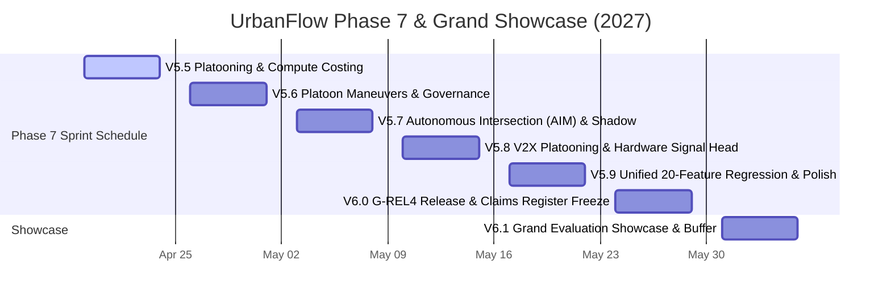

# UrbanFlow Master Roadmap: V0.1 — V6.1

> **The Single Authoritative Project Roadmap.**  
> **Current Version:** **V5.4 ✅ IMPLEMENTED** (Phase 6 Resilience, Priority, V2X & Enterprise Cloud complete; G-REL2 release note passed at W46; Phase 6 features implemented in codebase).  
> **Upcoming Version:** **Phase 7 (V5.5 – V6.0, W55 – W60) 🗓️ PLANNED** (Cooperation, Governance, Hardware-in-the-Loop & AIM) followed by the **V6.1 Grand Evaluation Showcase**.  
> **Historical Record:** V0.1–V2.0 released 2026-10-13 ([audit](roadmap/V2_COMPLETION_AUDIT.md)); V3.0 Experimentation Lab released ([RC](v3-release-candidate.md)); Phase 4 Trustworthy Results released; Phase 5 Beyond One Junction released ([note](releases/v4.6-beyond-one-junction.md)).  
> **Delivery Plan Link:** Detailed weekly sprint breakdown in [plan/WEEKLY_PLAN.md](plan/WEEKLY_PLAN.md); 20 feature specifications in [plan/FEATURE_SPECIFICATIONS.md](plan/FEATURE_SPECIFICATIONS.md); future research frontiers beyond V6.0 in [future-scope/future_scope.md](future-scope/future_scope.md).

---

## 1. Status Legend

| Status | Meaning |
| :---: | :--- |
| ✅ **COMPLETE / IMPLEMENTED** | Shipped, thoroughly tested in repository, documented, and verified. |
| 🟢 **IN PROGRESS** | Active development or staging verification. |
| 🗓️ **PLANNED** | Approved architecture and weekly schedule; work scheduled in upcoming sprint. |
| 🔭 **FUTURE SCOPE** | Long-term academic and industrial research frontiers post-V6.0. |

---

## 2. Phase-by-Phase Roadmap Evolution

```mermaid
flowchart TD
    V1_0["<b>Phase 1: Foundation (V1.0–V1.5)</b><br/>IDM physics · MOBIL lane changes · Adaptive signals<br/>Multi-lane roundabouts · Real-world geometries<br/>✅ COMPLETE"]
    V2_0["<b>Phase 2: Decision Support (V2.0)</b><br/>Multi-alternative planning studies · Report exports<br/>Provenance tracking · Bit-identical reproduction<br/>✅ COMPLETE"]
    V3_0["<b>Phase 3: Experimentation Lab (V3.0)</b><br/>Robustness Lab · Parameter uncertainty ensembles<br/>Signalised roundabouts · Strategy registry · Copilot · Discovery<br/>✅ COMPLETE"]
    V4_0["<b>Phase 4: Trustworthy Results (V3.1–V3.8)</b><br/>Bootstrap CIs · Hypothesis property tests · RunStore Parquet<br/>Copilot eval gate · Go ingest microservice · Airflow DAGs<br/>✅ COMPLETE"]
    V4_6["<b>Phase 5: Beyond One Junction (V3.9–V4.6)</b><br/>12-junction arterial grid · Congestion propagation heatmaps<br/>OSM/SUMO/GTFS import · GEH calibration · Multi-junction RL · Prometheus SLOs<br/>✅ COMPLETE"]
    V5_4["<b>Phase 6: Resilience & Cloud (V4.7–V5.4)</b><br/>Incidents · Closures & rerouting · Weather modifiers · Resilience scores<br/>Emergency preemption & yielding · V2X MQTT bus · Multi-tenant OIDC · AWS Terraform<br/>✅ IMPLEMENTED"]
    V6_0["<b>Phase 7: Cooperation & Governance (V5.5–V6.0)</b><br/>Platooning · Autonomous Intersection Management (AIM)<br/>Advisory governance · Hash-chained audit · Compute costing · ESP32/Pi hardware<br/>🗓️ PLANNED"]
    V6_1["<b>Grand Showcase (V6.1)</b><br/>Unified 20-feature full regression suite · Final evaluation showcase · Fallback drills<br/>🗓️ PLANNED"]

    V1_0 --> V2_0 --> V3_0 --> V4_0 --> V4_6 --> V5_4 --> V6_0 --> V6_1
```

---

## 3. Detailed Version Milestones & Verification History

### Phase 1: Foundation (V0.1 — V1.5) ✅ COMPLETE
- **V0.1–V0.5:** Intelligent Driver Model (IDM) car-following, vehicle pools, spawner, fixed-time signals, single-lane roundabouts, MetricCollector with warmup exclusion.
- **V0.6–V1.0:** DualSimulationOrchestrator (same-seed lockstep comparison), volume sweeps, delay crossover explorer, Monte Carlo validation, Docker Compose deployment.
- **V1.1:** Heterogeneous fleet: 5 vehicle classes (car, SUV, bus, truck, motorcycle) with physical dimensions and calibrated IDM parameters.
- **V1.2:** Advanced lane modelling: approach lane identity, permitted turn enforcement, MOBIL gradual lane-changing with shadow-lane reservations.
- **V1.3:** Actuated adaptive signals: vehicle presence loop detection, passage green extension, gap-out logic, maximum green caps, stage skipping.
- **V1.4:** Advanced roundabouts: multi-lane circulating rings, critical gap acceptance ($4.0\text{ s}$), follow-up headway ($2.5\text{ s}$), exit convergence zones.
- **V1.5:** Real-world junction geometry: 3- and 4-arm junctions, configurable compass approach bearings, lane widths, skew-aware stop lines, dedicated U-turn movements.

### Phase 2: Decision-Support Platform (V2.0) ✅ COMPLETE
*Release Gate G-V2 passed 2026-10-13 ([Audit](roadmap/V2_COMPLETION_AUDIT.md))*
- Multi-alternative planning studies (`/api/v2/planning`, `/app/planner`).
- Common random arrival sequence enforcement across competing options.
- Structured report exports (JSON, Markdown, CSV) with HCM Level-of-Service grades and causal "Why did this happen?" explanations.
- Cryptographic provenance tracking and bit-identical seed reproduction checks.

### Phase 3: Composable AI-Assisted Experimentation Lab (V3.0) ✅ COMPLETE
*Release Candidate verified ([Release Candidate](v3-release-candidate.md))*
- **W1 — Robustness Lab:** Multi-factor parameter uncertainty sampling (Sobol / Latin Hypercube), paired CRN ensembles, Wilson score intervals, bootstrap paired differences.
- **W2 — Signalised Roundabouts:** Metered-entry signalised roundabout (`metered_entry`) gating approach lanes while preserving ring gap acceptance (G-SR verified).
- **W3 — Composable Strategy Registry:** Layered strategy architecture (base, coordinator, actuators), compatibility validation, fingerprint parity (ADR-014).
- **W4 — Driver Aggression Profiles:** Versioned high-aggression profile with reduced headways and assertive gap acceptance (ADR-016, ADR-019, ADR-020).
- **W5 — AI Experiment Copilot:** Natural-language experiment formulation, schema validation gate, confirm-before-run protocol, grounded summary checker.
- **W6 — AI Strategy Discovery Lab:** Multi-objective evolutionary search (NSGA-II) optimizing cycle lengths, green splits, and offsets against Pareto efficiency.
- **W7 — Python SDK & `.ufpkg` Packages:** Portable self-contained experiment packages with SHA-256 integrity checks, personal access tokens (PATs), and Python client library (`urbanflow-client`).
- **W8–W9 — Strategy Breakpoint Explorer:** Stationary and non-stationary demand surge stress testing and stability failure detection.

### Phase 4: Trustworthy Results (V3.1 — V3.8, W31 — W38) ✅ COMPLETE
- **V3.1 (W31):** Multi-seed runner, CI test coverage floor ($\ge 85\%$), run manifest with SHA-256 code version & configuration hash (`core/run_manifest.py`).
- **V3.2 (W32):** Welch's t-test, Cohen's d effect sizes, Hypothesis property-based testing (vehicle conservation, queue non-negativity), Parquet RunStore on S3 and local disk.
- **V3.3 (W33):** Sensitivity analysis engine, travel-time percentiles (p50, p95), DuckDB SQL analytical queries.
- **V3.4 (W34):** Akçelik instantaneous fuel consumption and $\text{CO}_2$ emissions models, Time-to-Collision (TTC) & Post-Encroachment Time (PET) safety proxies, Airflow nightly regression DAG.
- **V3.5 (W35):** Copilot evaluation harness with LLM judge and score gate in CI (`evals/gate.py`).
- **V3.6 (W36):** Go telemetry ingest microservice (`services/ingest-go/`) with Protobuf contract (`proto/ingest.proto`).
- **V3.7 (W37):** Grounded summary assertion checker comparing generated markdown against numerical JSON.
- **V3.8 (W38):** Phase 4 release week, reproducibility audit script (`scripts/reproducibility_audit.py`).

### Phase 5: Beyond One Junction (V3.9 — V4.6, W39 — W46) ✅ COMPLETE
*Release Gate G-REL2 passed at W46 ([Release Note](releases/v4.6-beyond-one-junction.md))*
- **V3.9 (W39):** Network graph model (ADR-021), two-junction arterial corridor, OpenStreetMap (OSM) Overpass road importer.
- **V4.0 (W40):** Link-to-junction vehicle handoff and routing with conservation of vehicles, SUMO (`.net.xml`), GTFS, and Synchro importers.
- **V4.1 (W41):** 3x3 grid (9 junctions) and 12-junction arterial grid models, network delay/throughput metrics, traffic-count calibration loader, GEH, RMSE, and MAPE error metrics.
- **V4.2 (W42):** Topological link congestion spread analysis and heatmaps, OpenTelemetry tracing, Prometheus metrics endpoint (`GET /metrics/prom`), Redpanda compose configuration.
- **V4.3 (W43):** Vectorized hot loops, continuous recalibration pipeline with warm-start Nelder-Mead optimization, Service Level Objective (SLO) definitions (`deploy/observability/slo.json`) and evaluation CLI.
- **V4.4 (W44):** Scale to 12-junction network, multi-junction Gymnasium reinforcement learning environment (`backend/src/rl/network_env.py`), PPO/DQN training, fixed-time and max-pressure baselines, k6 performance load test scripts.
- **V4.5 (W45):** Digital twin core (`backend/src/twin/`) with telemetry replay, real-time prediction-vs-observation comparison API, what-if intervention branching, MapLibre GL spatial map visualizer.
- **V4.6 (W46):** Phase 5 release week, G-REL2 release note, and comprehensive claims register (`docs/releases/claims-register-v4.6.md`).

### Phase 6: Resilience, Priority, V2X & Enterprise Cloud (V4.7 — V5.4, W47 — W54) ✅ IMPLEMENTED
- **V4.7 (W47):** Incident simulation engine (`backend/src/incidents/`): physical vehicle crashes, lane blockages, and incident catalogue.
- **V4.8 (W48):** Dynamic road closures with real-time Dijkstra/A* path rerouting; weather conditions (rain, dense fog, snow, ice) adjusting tire friction, visibility, and driver reaction times.
- **V4.9 (W49):** Event-day demand surge profiles; recovery-time calculations and system resilience scores ($R$) quantifying post-incident recovery rate.
- **V5.0 (W50):** Dedicated emergency vehicle models; acoustic siren broadcast detection; emergency signal pre-emption controller (`backend/src/priority/`) with immediate green extensions and clearance phases.
- **V5.1 (W51):** Civilian vehicle yielding and corridor clearance behaviour; emergency response time metrics and audit logging; transit signal priority (TSP).
- **V5.2 (W52):** Vehicle-to-Everything (V2X) messaging infrastructure (`backend/src/v2x/`); in-process publish/subscribe message bus and MQTT broker adapter; stochastic network latency and packet loss models; cooperative driving experiments.
- **V5.3 (W53):** Enterprise multi-tenancy (`backend/src/tenancy/`); OIDC JWT authentication; Role-Based Access Control (RBAC: `viewer`, `planner`, `engineer`, `admin`); tenant data isolation; quotas and rate limits; automated TypeScript SDK generator (`scripts/generate_ts_client.py`).
- **V5.4 (W54):** Cloud Infrastructure as Code in Terraform (`infra/terraform/`): multi-AZ VPC, EKS cluster, RDS PostgreSQL, encrypted S3 buckets, SQS queues, IAM OIDC roles; asynchronous job queue and worker daemon (`backend/src/jobs/`); GitHub Actions AWS staging CI/CD workflow (`.github/workflows/aws-staging.yml`).

---

## 4. Phase 7: Cooperation & Governance (V5.5 — V6.0, W55 — W60) 🗓️ PLANNED

Phase 7 completes the technical roadmap, introducing cooperative autonomy, automated governance, physical hardware-in-the-loop demonstrations, and full regression verification:

### Detailed Feature Breakdown & Acceptance Criteria for Phase 7

#### Week 55 (V5.5) — Leader-Follower Platooning & Run Cost Accounting
- **Platoon Controller (`backend/src/platoon/controller.py`):**
  - Implement leader-follower longitudinal dynamics based on constant time headway ($T = 0.3\text{–}0.5\text{ s}$) and constant intra-platoon spacing ($s = 1.0\text{–}2.0\text{ m}$).
  - Enforce string stability: perturbations from the lead vehicle must decay monotonically upstream ($\|\Gamma(j\omega)\| < 1$).
  - Cap maximum platoon size ($N_{\max} = 8$ vehicles) to prevent link starvation.
- **Compute Cost Accounting Engine (`backend/src/costing/`):**
  - Track CPU execution time, memory footprint, and worker node instance hours.
  - Map run metrics to current AWS Pricing API tables (t3.medium, c5.xlarge, spot instances).
  - Expose per-run estimated dollar costs via `/api/v3/costing/estimate` and display cost badges in the frontend.
- **Acceptance:** Platoon maintains string stability across sudden lead vehicle decelerations without rear-end collisions; cost estimates are computed and visible per run.

#### Week 56 (V5.6) — Dynamic Platoon Maneuvers & Advisory Governance
- **Platoon Formation & Maneuvers (`backend/src/platoon/maneuvers.py`):**
  - Multi-vehicle coordination protocol for joining an existing platoon, leaving/splitting at turn approaches, and coordinated multi-lane maneuvers.
  - Fail-safe abort logic: if gap acceptance is violated during merging, the joining vehicle safely falls back to standard IDM following.
- **Advisory Governance & Hash-Chained Audit Trail (`backend/src/governance/`):**
  - Two-stage approval workflow (`draft` $\to$ `submitted` $\to$ `approved` $\to$ `archived`) for recommended signal timing and junction modifications.
  - Append-only, cryptographically hash-chained audit ledger (SHA-256 blocks with parent hashes, timestamps, reviewer public keys, and scenario fingerprints) ensuring tamper-evident accountability.
- **Acceptance:** Platoon join/leave maneuvers execute smoothly without triggering emergency braking; audit ledger validates tamper-resistance against manual row modification.

#### Week 57 (V5.7) — Autonomous Intersection Management (AIM) & Shadow Mode
- **Reservation-Based Autonomous Intersection Controller (`backend/src/aim/`):**
  - Signal-free intersection management model dividing intersection space into a fine-grained grid of space-time reservation tiles ($\Delta x, \Delta y, \Delta t$).
  - First-Come-First-Served (FCFS) trajectory negotiation allowing connected autonomous vehicles to cross without stopping if trajectory tiles are clear.
  - Safety validation (Gate **G-AIM**): mathematical and simulation proof of zero overlapping spatial reservations under maximum emergency braking deceleration ($b_{\max}$).
- **Shadow Mode Analytics Engine (`backend/src/governance/shadow.py`):**
  - Offline shadow comparison comparing algorithmic recommendations against actual historical traffic outcomes without executing changes on the active network.
- **Acceptance:** Signal-free intersection passes G-AIM safety gate with zero collisions under varying demand; throughput and delay improvements are compared fairly against optimal actuated signals.

#### Week 58 (V5.8) — V2X Platooning Benefits & Physical Hardware Signal-Head Bridge
- **Platooning Environmental Benefits Analysis:**
  - Measure aerodynamic drafting benefits: integrate wind drag coefficients into fuel and $\text{CO}_2$ models, demonstrating quantified fuel savings ($8\text{–}15\%$) for platoon followers.
- **Physical Hardware-in-the-Loop Bridge (`hardware/`, `backend/src/hardware_bridge/`):**
  - C / MicroPython firmware for Raspberry Pi Pico W / ESP32 microcontroller driving a physical 3-color traffic signal head (Red, Yellow, Green LEDs).
  - Bi-directional MQTT integration over AWS IoT Core / Mosquitto: simulation engine drives physical LED states in real time; physical pushbutton actuation triggers pedestrian/phase calls in the simulator.
  - Virtual hardware device simulator for automated CI testing without physical hardware connected.
- **Acceptance:** Physical signal head accurately reflects simulation phase transitions; physical button inputs trigger simulator stage changes; aerodynamic fuel savings are measured and reported.

#### Week 59 (V5.9) — Unified 20-Feature Full Regression & Research Closure
- **Unified Full Regression Suite (`scripts/full_regression.py`):**
  - Master test harness executing fast test suites across all 20 features (F1 through F20), generating an exhaustive feature-by-feature verification table.
- **Hardware Demo Polish:** Final hardware assembly, status telemetry dashboard, and failure recovery testing.
- **Research Write-up Draft:** Final technical paper documenting comparative findings across all strategies.

#### Week 60 (V6.0) — Release Gate G-REL4 & Claims Register Freeze
- **Gate G-REL4 Verification:**
  - Verify all 5 criteria: connected vehicles measured on hardware, platoon throughput effects quantified, signal-free vs. signal compared, approval audit trail verified, per-run cost visible.
- **Claims Register Freeze:**
  - Finalize `docs/releases/claims-register-v6.0.md`, mapping every claim in the documentation to a passing test, script, or measured dataset.

#### Week 61 / Showcase (V6.1) — Grand Evaluation Showcase
- End-to-end presentation rehearsals, verified offline fallback data packs (`fallback-pack/`), and final video assets (`recordings/urbanflow-final-demo.mp4`).

---

## 5. Comprehensive Capability Matrix

| Capability | V1.0–V1.5 | V2.0 | V3.0 | V3.8 (Ph 4) | V4.6 (Ph 5) | V5.4 (Ph 6) | V6.0 (Ph 7) |
| :--- | :---: | :---: | :---: | :---: | :---: | :---: | :---: |
| Same-Seed Signal vs Roundabout Comparison | ✅ | ✅ | ✅ | ✅ | ✅ | ✅ | ✅ |
| 5 Heterogeneous Vehicle Classes | ✅ | ✅ | ✅ | ✅ | ✅ | ✅ | ✅ |
| MOBIL Lane Changing & Permitted Turns | ✅ | ✅ | ✅ | ✅ | ✅ | ✅ | ✅ |
| Actuated Adaptive Signal Control | ✅ | ✅ | ✅ | ✅ | ✅ | ✅ | ✅ |
| Multi-Lane Roundabout Circulating Rings | ✅ | ✅ | ✅ | ✅ | ✅ | ✅ | ✅ |
| Real-World 3- and 4-Arm Geometries | ✅ | ✅ | ✅ | ✅ | ✅ | ✅ | ✅ |
| Multi-Alternative Decision-Support Studies | — | ✅ | ✅ | ✅ | ✅ | ✅ | ✅ |
| Parameter Uncertainty & Robustness Lab | — | — | ✅ | ✅ | ✅ | ✅ | ✅ |
| Metered-Entry Signalised Roundabout | — | — | ✅ | ✅ | ✅ | ✅ | ✅ |
| AI Traffic Experiment Copilot & Discovery | — | — | ✅ | ✅ | ✅ | ✅ | ✅ |
| Python SDK & `.ufpkg` Experiment Packages | — | — | ✅ | ✅ | ✅ | ✅ | ✅ |
| Hypothesis Invariant Property-Based Tests | — | — | — | ✅ | ✅ | ✅ | ✅ |
| Parquet RunStore Lakehouse & DuckDB | — | — | — | ✅ | ✅ | ✅ | ✅ |
| Fuel / $\text{CO}_2$ Emissions & TTC/PET Proxies | exploratory | exploratory | exploratory | ✅ | ✅ | ✅ | ✅ |
| Go Telemetry Ingest Microservice | — | — | — | ✅ | ✅ | ✅ | ✅ |
| Multi-Junction Network Graph Model (ADR-021) | — | — | — | — | ✅ | ✅ | ✅ |
| 12-Junction Arterial Grid Execution | — | — | — | — | ✅ | ✅ | ✅ |
| Link Congestion Propagation Heatmap | — | — | — | — | ✅ | ✅ | ✅ |
| OSM, SUMO, GTFS, Synchro Network Import | — | — | — | — | ✅ | ✅ | ✅ |
| Turning-Count Calibration (GEH, RMSE, MAPE)| — | — | — | — | ✅ | ✅ | ✅ |
| Multi-Junction Reinforcement Learning (Gym) | — | — | — | — | ✅ | ✅ | ✅ |
| Prometheus Observability (`/metrics/prom`) | — | — | — | — | ✅ | ✅ | ✅ |
| Digital Twin Replay & What-If Branching | — | — | — | — | ✅ | ✅ | ✅ |
| MapLibre GL Network Map Viewer | — | — | — | — | ✅ | ✅ | ✅ |
| Physical Crashes, Dynamic Closures & Rerouting| — | — | — | — | — | ✅ | ✅ |
| Adverse Weather Physics (Friction/Visibility)| — | — | — | — | — | ✅ | ✅ |
| Strategy Resilience Scoring ($R$) | — | — | — | — | — | ✅ | ✅ |
| Emergency Signal Preemption & Yielding | — | — | — | — | — | ✅ | ✅ |
| Transit Signal Priority (TSP) | — | — | — | — | — | ✅ | ✅ |
| V2X Messaging Bus & Cooperative Driving | — | — | — | — | — | ✅ | ✅ |
| Enterprise Multi-Tenancy (OIDC RBAC Quotas) | — | — | — | — | — | ✅ | ✅ |
| AWS Terraform Staging & SQS Job Worker | — | — | — | — | — | ✅ | ✅ |
| Leader-Follower Platooning Controller | — | — | — | — | — | — | 🗓️ |
| Autonomous Intersection Management (AIM) | — | — | — | — | — | — | 🗓️ |
| Advisory Governance & Hash-Chained Audit | — | — | — | — | — | — | 🗓️ |
| Per-Run Cloud Compute Cost Accounting | — | — | — | — | — | — | 🗓️ |
| Physical Hardware Signal-Head Demo (MQTT) | — | — | — | — | — | — | 🗓️ |
| Unified 20-Feature Regression Suite | — | — | — | — | — | — | 🗓️ |

*Legend: ✅ Shipped & Tested · 🗓️ Planned in Phase 7 · — Not in that release.*
