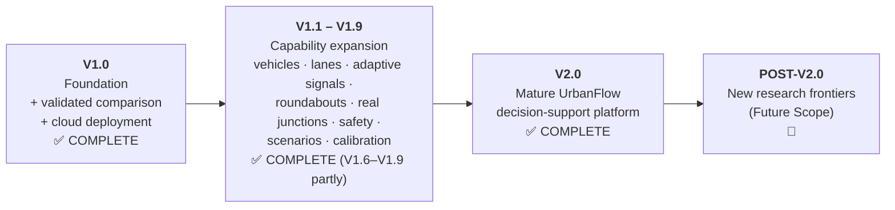
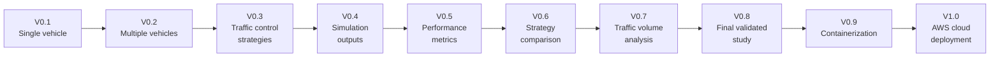
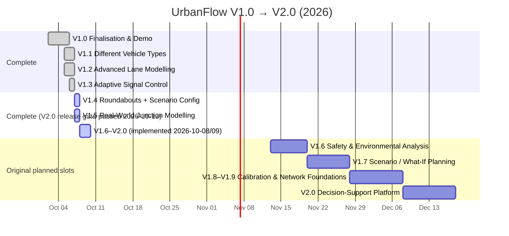

# UrbanFlow Roadmap

> **This is the single authoritative roadmap.** It supersedes every earlier roadmap, deferred-features log and V1.1/V2/V3 plan in this repository (preserved in git history).
> **Current version:** **V2.0 ✅ COMPLETE** — the V2.0 release gate (G-V2) passed on 2026-10-13 (gate commit `6b609ce`, CI green; production deployment left to the product owner, manual) · V1.6–V1.9 are delivered *partially*, as each milestone states · evidence: [V2.0 completion audit](roadmap/V2_COMPLETION_AUDIT.md) · **Last updated:** 2026-10-13 (release status; scope and planned dates unchanged)
> **After V2.0:** [§7 V3.0](#7-v30--composable-ai-assisted-traffic-control-experimentation-planned-proposed) — composable, AI-assisted traffic-control experimentation (**PLANNED, proposed** — the V2.0 release gate has passed; implementation waits for the V3.0 design-approval gate, #150; detail in [`roadmap/`](roadmap/V3_PRODUCT_STRATEGY.md)). **Beyond that:** [Future Scope](future-scope/future_scope.md) — research frontiers only.

| Status | Meaning |
| --- | --- |
| ✅ **COMPLETE** | Shipped, documented, tested |
| 🟢 **CURRENT / IMPLEMENTED** | Implemented, not yet released (none at present); a milestone marked *partial* delivers only part of its scope, as stated |
| 🔜 **PLANNED / UPCOMING** | Next in line; work starts imminently |
| 🗓️ **PLANNED** | Scheduled, not implemented (V3.0, §7) |
| 🔭 **FUTURE SCOPE** | After V2.0 — not part of this roadmap |

---

## 1. The boundary

**The V2.0 line is a hard boundary.** Everything listed in §4 belongs to the V1.1–V2.0 product roadmap. [Future Scope](future-scope/future_scope.md) contains only capabilities that are genuinely new beyond V2.0, and never duplicates a roadmap item.

---

## 2. How UrbanFlow got here — V0.1 → V1.0 ✅

| Version | Milestone | Realised in the codebase as | Status |
| --- | --- | --- | --- |
| V0.1 | Single Vehicle | IDM car-following (`vehicles/idm.py`); single-vehicle demo routes (`/api/simulation/single-vehicle`) and canvas | ✅ |
| V0.2 | Multiple Vehicles | Seeded spawner, vehicle pool, leaders and routing (`vehicles/spawner.py`, `pool.py`, `router.py`) | ✅ |
| V0.3 | Traffic Control Strategies | `FixedTimeSignalController`, `RoundaboutController`, conflict management | ✅ |
| V0.4 | Simulation Outputs | Snapshots, WebSocket streams, canvas visualisation, snapshot history buffer | ✅ |
| V0.5 | Performance Metrics | `MetricCollector` with warm-up exclusion and the metric definitions | ✅ |
| V0.6 | Strategy Comparison | `DualSimulationOrchestrator` (same seed, lockstep), comparative dashboard | ✅ |
| V0.7 | Traffic Volume Analysis | Volume sweeps, sweep sessions, delay crossover | ✅ |
| V0.8 | Final Validated Study | Monte Carlo validation, invariant checks, calibration pass, `scripts/run_full_study.py`, [comparative report](reports/comparative_report.md) | ✅ |
| V0.9 | Containerization | Backend/frontend images, Compose stacks, nginx proxy, `start.ps1` | ✅ |
| V1.0 | AWS Cloud Deployment | EC2 + Docker Compose deployment; guided planner experience; saved runs and reproducibility; finalisation (below) | ✅ |

---

## 3. V1.0 — Finalisation & Demo ✅ COMPLETE

**W11 · Oct 2 – Oct 5, 2026**

| Finalisation work | Status |
| --- | --- |
| Final application QA and recording | ✅ |
| Documentation freeze (this documentation overhaul) | ✅ |
| Presentation readiness · presentation visuals | ✅ |
| Final technical QA · research validation | ✅ |
| Demo workflow | ✅ |
| Final UI polish · UX QA | ✅ |

### V1.0 capability baseline

What every later version builds on — all implemented and documented:

| Area | V1.0 capability | Reference |
| --- | --- | --- |
| Simulation | Discrete-time engine (Δt 0.1 s), IDM, seeded Poisson/uniform arrivals, curve speed rule, safe insertion | [Methodology](simulation/methodology.md) |
| Control | Fixed-time signal (paired NS/EW plan, optional per-corridor greens, offset); single-geometry roundabout with gap acceptance | [Methodology §7](simulation/methodology.md#7-traffic-control-strategies) |
| Comparison | Same-seed lockstep comparison; repeated-seed reliability check; demand ladder | [Methodology §10](simulation/methodology.md#10-controlled-comparison) |
| Metrics | Delay family, throughput, queues, stops, fairness, reliability, exploratory TTC/PET, integrity counters | [Metrics reference](research/metrics-reference.md) |
| Evidence | Invariant checks, Monte Carlo (Student-t, Welch, Cohen's d), calibrated one-lane capacity curve | [Validation & evidence](research/validation.md) |
| Reproducibility | Provenance record per run; reproduce endpoint; JSON/CSV export | [Reproducibility](research/reproducibility.md) |
| Product | Landing → Compare (3 steps) → Results → reliability → Saved → Research Lab | [Product story](product/README.md) |
| Platform | FastAPI REST + 3 WebSocket streams; background study jobs; SQLite persistence; Cognito sign-in path | [API reference](api/README.md) · [System overview](architecture/00-system-overview.md) |
| Delivery | Docker Compose on AWS EC2 behind nginx; CI (lint, types, tests, images, nightly regression) | [Deployment](deployment/README.md) · [Testing](testing/README.md) |

Known V1.0 limitations, and which milestone addresses each, are listed in [Validation & evidence §5](research/validation.md#5-known-limitations).

---

## 4. V1.1 → V2.0

| Week | Dates | Version | Theme | Status |
| --- | --- | --- | --- | --- |
| W11 | Oct 2 – Oct 5 | V1.0 | Finalisation & Demo | ✅ COMPLETE |
| W12 | Oct 5 – Oct 6 | V1.1 | Different Vehicle Types | ✅ COMPLETE (with V1.2) |
| W12 | Oct 5 – Oct 6 | V1.2 | Advanced Lane Modelling | ✅ COMPLETE (with V1.1) |
| W12 | Oct 6 | V1.3 | Adaptive Signal Control | ✅ COMPLETE (ahead of the W14 slot) |
| W12 | Oct 7 | V1.4 | Advanced Roundabout Modelling + Full Scenario Configuration | ✅ COMPLETE (ahead of the W15 slot) |
| W12 | Oct 7 | V1.5 | Real-World Junction Modelling | ✅ COMPLETE (ahead of the W16 slot) |
| W17 (plan) | Nov 13 – Nov 19 | V1.6 | Safety & Environmental Analysis | ✅ COMPLETE 2026-10-09, *partial* — proxies and estimates exploratory, not validated |
| W18 (plan) | Nov 20 – Nov 27 | V1.7 | Scenario / What-If Planning | ✅ COMPLETE 2026-10-09, *partial* — batches are demand sweeps of one scenario; what-if alternatives are the V2.0 planner |
| W19 (plan) | Nov 28 – Dec 7 | V1.8 / V1.9 | Calibration & Network-Level Foundations | ✅ COMPLETE 2026-10-08, *partial* — see the milestone notes |
| W20 (plan) | Dec 8 – Dec 17 | V2.0 | UrbanFlow Decision-Support Platform | ✅ COMPLETE — release gate passed 2026-10-13 |

V1.4 – V2.0 were implemented ahead of their planned weeks; the weeks and dates above are the original plan, kept for reference. V1.4 – V2.0 were released together when the V2.0 release gate passed on 2026-10-13 ([V2.0 completion audit](roadmap/V2_COMPLETION_AUDIT.md)).

Each milestone below lists its **goal**, its **scope** (authoritative), and the **V1.0 starting point** — a factual note on what exists today, so the work starts from the code rather than from assumptions.

---

### V1.1 — Different Vehicle Types

**✅ COMPLETE · delivered with V1.2 on 2026-10-06**

**Goal:** introduce heterogeneous traffic.

| Scope | |
| --- | --- |
| Vehicle classes | Cars · SUVs · Buses · Trucks · Bikes |
| Behaviour | Differentiated vehicle behaviour · vehicle models · IDM parameters |
| Engine | Spawning · simulation logic · validation |
| Presentation | Vehicle representation · configuration UI · legends / visual differentiation |

**Delivered:** five vehicle classes — car, SUV, bus, truck, motorcycle — each with its own dimensions, IDM parameters (a, b, T, s₀), desired-speed range, cornering limit and lane-change behaviour (`backend/src/vehicles/vehicle_types.py`); `vehicleGeneration.vehicleMix` and `vehicleTypes` in the schema; type-aware seeded spawning; long-vehicle handling (axle-chord body pose, length-aware conflict zones, design-vehicle signal geometry, roundabout gap allowance and entry commitment); a per-class metric breakdown; a "What traffic uses the junction?" question, an advanced mix editor, class-specific map sprites, legends and a per-class results table. Without a mix, single-lane runs reproduce V1.0 bit for bit. Mixed results are exploratory (not calibrated). See [methodology §5.4](simulation/methodology.md#54-vehicle-classes-v11).

**V1.0 starting point (for reference):** one passenger-car population; length `U(4.0, 5.0)` m, width `U(1.8, 2.2)` m and desired speed are randomised per vehicle, but IDM parameters (`a`, `b`, `T`, `s₀`, `δ`) are shared by all vehicles (`vehicleGeneration.*`).

---

### V1.2 — Advanced Lane Modelling

**✅ COMPLETE · delivered with V1.1 on 2026-10-06**

**Goal:** move beyond single-lane assumptions.

| Scope | |
| --- | --- |
| Lane model | Multi-lane traffic · lane model · lane assignment · routing |
| Lane changing | Lane-changing foundations · lane changes |
| Quality | Physics and regression tests |
| Presentation | Lane configuration UI · visualisation · user controls |

**Delivered:** explicit lane identity and one lane-use policy (`RoadNetwork.permitted_turns`, narrowed by the signal plan where its heads demand it); per-approach lane counts via `roads.approaches[].lanes` (opposite approaches must match); MOBIL lane changing carried out as gradual, distance-based manoeuvres with shadow occupancy of both lanes, safety checks against each vehicle's own IDM, mandatory changes and missed-turn fallback (`backend/src/vehicles/lane_change.py`); `roads.laneChange` settings; lane arrows, lane-change indicators, a lane-changing switch and side-street lanes in the signal research view. V1.0's undocumented single-tick lane jump is gone. See [methodology §4 and §6.1](simulation/methodology.md#61-lane-changing-v12).

**V1.0 starting point (for reference):** 1–4 lanes per approach exist, but the calibrated comparison is one lane; a vehicle's lane is fixed at spawn by turn intent (left / straight / right policy); there is no lane changing; the versioned schema accepts only one lane count for all approaches.

---

### V1.3 — Adaptive Signal Control

**✅ COMPLETE · delivered on 2026-10-06 (planned for W14)**

**Goal:** compare fixed-time signals with responsive/adaptive control.

| Scope | |
| --- | --- |
| Control | Adaptive controller · control logic |
| Evidence | Experiments · validation |
| Presentation | Controller selection UI · visual comparison · result presentation |

**Delivered:** a vehicle-actuated adaptive signal (`backend/src/controllers/adaptive_signal.py`) on the fixed-time signal's own phase plan, heads, yellow and all-red — minimum green, passage-based extension and gap-out, maximum green once another phase calls, rest in green, cyclic order with phases skipped when nobody waits — selected by `controller.signalControl: "adaptive"` with `controller.adaptive` settings (fixed-time stays the default and is unchanged); stop-line detection shared with a new green-time measure for both signals (`metrics.signalTiming`); a reproducible three-way study, fixed-time vs adaptive vs roundabout (`/api/v1/study/control-comparison`, Research Lab); a "How should the signal respond to traffic?" question, adaptive advanced settings, a live map panel explaining each decision, and results that name the controller. Results: adaptive lowers delay against the fixed timetable below saturation and gains nothing measurable at and above capacity; on one lane the roundabout keeps the lowest delay from busy demand upwards ([validation §4.1](research/validation.md#41-fixed-time-vs-adaptive-vs-roundabout-v13-2026-10-06)). See [methodology §7.3](simulation/methodology.md#73-adaptive-signal--controllersadaptive_signalpy-v13).

**V1.0 starting point (for reference):** fixed-time control only. Controllers share the `BaseController` interface and are built by `controllers/factory.py`, so a new controller plugs in without changing the engine loop.

---

### V1.4 — Advanced Roundabout Modelling

**🟢 IMPLEMENTED · 2026-10-07 (ahead of the W15 slot) · ✅ COMPLETE (released with V2.0, 2026-10-13) — extended to full user configuration**

**Goal:** advance roundabout modelling beyond the current implementation, and let users build the junction they want to investigate.

| Scope | |
| --- | --- |
| Geometry & behaviour | Proper multi-lane circulation · lane assignment · spiral behaviour · independent rings · exit behaviour · weaving |
| Evidence | Collision validation |
| Presentation | Roundabout configuration · visualisation improvements |

**Delivered (implemented on `viraj-dev`, awaiting review):**

*Roundabout.* The ring has its own lane count (`geometry.circulatingLanes`, 1–2; three-lane rings are rejected as not yet validated) and an explicit two-lane designation — left turns inner, right turns outer, straight on the entry lane's own — with right-aligned entry and exit mapping, merging entries for approaches one lane wider than the ring, keep-clear entry and **exit convergence zones** taken in strict arrival order (`roads/lane_config.py`, `controllers/roundabout.py`). Roundabout approaches may now all differ. One-lane rings are unchanged to the last bit. Three rejected designs and the measurements behind each decision are in [methodology §7.4.1](simulation/methodology.md#741-multi-lane-rings-v14); safety results in [validation §4.2](research/validation.md#42-v14-roundabout-validation-matrix). This resolves **K1** for supported configurations.

*Full scenario configuration.* A strategy-neutral, versioned **scenario document** (`core/scenario.py`) — per-approach lanes, length, lane arrows, roundabout lane markings, demand, turning and vehicle mix; scenario mix; signal, adaptive and roundabout design; duration, warm-up, seed, arrival pattern — compiled once per strategy so comparisons differ only in control; strict validation that explains every rejection (`core/lane_validation.py`); `POST /api/v1/scenarios/validate` and `/compile`, scenario input to `/api/v1/simulations`, the live comparison and the control-comparison study; a per-approach results breakdown (`metrics.approachBreakdown`). Frontend: a **scenario builder** (guided "Build your own junction" and the Research Lab) with lane cards and movement toggles, "How busy is each road?", a live plan, completeness and validation panel, an explicit-percentage vehicle mix editor, presets as editable shortcuts, import/export; maps draw each arm and the ring from the snapshot; results name the scenario and split by approach.

**Starting point (V1.0–V1.3):** concentric rings, one per approach lane, without lane designation; multi-lane runs were exploratory (low-speed inner-ring-exit contacts under saturation); `controller.circulatingLanes` was accepted but inert (it still is — superseded by `geometry.circulatingLanes`).

---

### V1.5 — Real-World Junction Modelling

**🟢 IMPLEMENTED · 2026-10-07 (ahead of the W16 slot) · ✅ COMPLETE (released with V2.0, 2026-10-13)**

**Goal:** allow simulations to represent configurable real-world junction layouts.

| Scope | |
| --- | --- |
| Model | Junction geometry / configuration model · traffic inputs |
| Engine | Backend support |
| Presentation | Junction builder · configuration workflow · visual editor |

**Delivered (implemented on `viraj-dev`, awaiting review):**

*Geometry.* A geometry layer (`roads/junction_geometry.py`) between the validated scenario and the lanes the engine runs on: three- or four-arm junctions, each arm on its own compass bearing (within 30° of its compass slot, neighbours at least 45° apart) with its own lane count, length and lane width; skew-aware stop lines; turning paths bent at the true crossing of entry and exit lanes; roundabout entries checked for overlap. Built once at set-up, never per tick; arms on their slots' axes use the exact V1.0 arithmetic, so every earlier scenario is reproduced bit for bit. See [methodology §4.4](simulation/methodology.md#44-real-world-junction-geometry-v15).

*Movements.* An explicit **U-turn** movement, only where a scenario's lane use puts it: a half circle into the kerb lane at a signal (released with the lefts, yielding to all, rejected unless its radius meets the AASHTO design turning radius of every class using it), the inner ring lane at a roundabout. Movements, lanes and demand that would lead into a missing arm are rejected, never re-routed.

*Scenario, validation, comparison.* Optional document fields (`approaches.<dir>: null`, `bearing`, `laneWidth`, `"uturn"`, `turning.uturn`) — V1.4 documents compile and fingerprint unchanged (pinned against values recorded with the V1.4 code). Every rejection says what, where, why and what is valid ([contract §9](architecture/06-scenario-configuration-contract.md#9-real-world-junctions-v15)). Fast-tier safety validation passed with 0 contacts across all tested shapes, exact reproduction and legacy compatibility; the 60-run slow safety matrix and the full slow regression suite were not run at the time; they were run in the V2.0 release-gate audit — **60/60** for the V1.5 matrix, and the full slow suite green on Python 3.11 ([validation §4.4](research/validation.md#44-v20-validation-addendum--what-was-and-was-not-checked-2026-10-12)). The comparison pipeline is unchanged in kind — same scenario, different control — and reports approach-level results for the arms that exist. Frontend: the V1.4 builder gains "Which roads meet here?", U-turn arrows and shares, and per-arm bearing and lane width under Advanced; the plan preview and both live maps draw arms on their real bearings.

*Import foundation.* `assign_slots()` places measured arm bearings on compass slots or explains why it cannot — the step a future OpenStreetMap/GIS importer needs. No importer is part of V1.5.

*Deferred.* Five-or-more-arm and staggered junctions (need movement rules and signal stages beyond the slot model); lane drops inside a signalised junction (K3); U-turns via medians or jughandles; per-arm speed limits; a map-based importer.

**V1.0 starting point:** one abstract four-leg junction with symmetric approaches (`roads.approachLength`, `laneWidth`); `roads.approaches[]` is accepted by the schema but not read.

---

### V1.6 — Safety & Environmental Analysis

**Planned W17 · Nov 13 – Nov 19 · ✅ COMPLETE 2026-10-09, partial** — safety proxies (collisions, near-miss/TTC/PET) and a safety dashboard exist and are tested as implementation, but are exploratory, not validated; fuel/CO₂ are labelled uncalibrated estimates. Detail: audit A-16, A-17.

**Goal:** expand evaluation beyond delay and throughput.

| Scope | |
| --- | --- |
| Measures | Safety proxies · fuel/emissions modelling where scientifically supportable |
| Evidence | Validation |
| Presentation | New metrics dashboard · explanations · visualisations |

**V1.0 starting point:** exploratory TTC (all geometries) and PET (signal only) in the specialist layer; an overlap audit used as a model-integrity check; no fuel or emissions model.

---

### V1.7 — Scenario / What-If Planning

**Planned W18 · Nov 20 – Nov 27 · ✅ COMPLETE 2026-10-09, partial** — scenario suites with batch experiments (a demand sweep of one scenario), suite comparison and CSV reporting; suites are private to their creator. Comparing intervention alternatives is delivered by the V2.0 planner. Detail: audit A-18, A-19.

**Goal:** allow planners to compare intervention scenarios under different traffic conditions.

| Scope | |
| --- | --- |
| Engine | Scenario engine · batch experiments · reproducibility |
| Presentation | Scenario creation workflow · comparison UI · reporting |

**V1.0 starting point:** one scenario per comparison; "Try another scenario" and a session table; background study jobs, run provenance, and saved-run comparison of up to six runs.

---

### V1.8 / V1.9 — Calibration & Network-Level Foundations

**Planned W19 · Nov 28 – Dec 7 · ✅ COMPLETE 2026-10-08, partial** — *calibration:* a framework that compares a simulation with observed counts a user supplies and rates the agreement; **no observed field data has been run through it and no model parameters are fitted**, so no result is field-calibrated. *Networks:* network documents are validated, compiled and fingerprinted; **multi-junction networks are not simulated**; no network visualisation. API only (`/api/v2/calibration`, `/api/v2/networks`). Detail: audit A-20 – A-32.

**Goal:** connect simulations more closely to observed traffic and establish foundations for connected/networked simulation.

| Scope | |
| --- | --- |
| Calibration | Calibration framework · real-world traffic inputs |
| Networks | Network simulation foundations · network/scenario visualisation |
| Reporting | Expanded reporting |

**V1.0 starting point:** demand levels are calibrated against UrbanFlow's own measured capacity, not field data; the engine simulates one junction.

---

### V2.0 — UrbanFlow Decision-Support Platform

**Planned W20 · Dec 8 – Dec 17 · ✅ COMPLETE · planning API 2026-10-08, planner UI (`/app/planner`) 2026-10-12, release gate passed 2026-10-13** — evidence-only planning studies (no ranking or recommendation), background jobs, reports (JSON, Markdown, CSV) and reproduction; evidence in the [V2.0 completion audit](roadmap/V2_COMPLETION_AUDIT.md).

**Goal:** integrate the major capabilities into a mature evidence-based planning workflow.

| Scope | |
| --- | --- |
| Platform | Full-system integration · performance · reproducibility |
| Evidence | Research validation |
| Experience | End-to-end planner workflow · UX refinement · final presentation layer |

---

## 5. Capability matrix

| Capability | V1.0 | V1.1 | V1.2 | V1.3 | V1.4 | V1.5 | V1.6 | V1.7 | V1.8/9 | V2.0 |
| --- | :-: | :-: | :-: | :-: | :-: | :-: | :-: | :-: | :-: | :-: |
| Same-seed signal vs roundabout comparison | ✅ | ● | ● | ● | ● | ● | ● | ● | ● | ◆ |
| Plain-language results & reliability check | ✅ | ● | ● | ● | ● | ● | ● | ● | ● | ◆ |
| Reproducible saved runs | ✅ | ● | ● | ● | ● | ● | ● | ● | ● | ◆ |
| Heterogeneous vehicles | — | ✅ | ● | ● | ● | ● | ● | ● | ● | ◆ |
| Multi-lane traffic & lane changes | partial | | ✅ | ● | ● | ● | ● | ● | ● | ◆ |
| Adaptive signal control | — | | | ✅ | ● | ● | ● | ● | ● | ◆ |
| Multi-lane roundabout circulation | exploratory | | | | ▲ | ● | ● | ● | ● | ◆ |
| Real-world junction layouts | — | | | | | ▲ | ● | ● | ● | ◆ |
| Safety proxies & emissions | exploratory | | | | | | ▲ | ● | ● | ◆ |
| Scenario / what-if batches | — | | | | | | | ▲ | ● | ◆ |
| Calibration to observed traffic | — | | | | | | | | ▲ | ◆ |
| Network-level foundations | — | | | | | | | | ▲ | ◆ |

✅ shipped · ▲ introduced · ● carried forward · ◆ integrated into the V2.0 platform. V1.4 – V2.0 were released with V2.0 on 2026-10-13. "Calibration to observed traffic" is a comparison framework only: no field data has been run through it and nothing is fitted. "Network-level foundations" do not include multi-junction simulation.

---

## 6. Roadmap vs Future Scope

| Theme | Inside the roadmap (≤ V2.0) | Future Scope (post-V2.0) — only what is genuinely new |
| --- | --- | --- |
| Vehicles | Cars, SUVs, buses, trucks, bikes (V1.1) | Emergency vehicles with priority and yielding (FS-1; V3.0 §7 records its expected deferral) |
| Signals | Adaptive / responsive control (V1.3); signalised roundabouts and bounded strategy search (**V3.0, §7**) | Learning-based (RL) signal control (FS-2) |
| Lanes & cooperation | Lanes, lane changes (V1.2) | V2V/V2I communication (FS-3); platooning (FS-4) |
| Intersection control | Signals, roundabouts (V1.0–V1.4) | Reservation-based autonomous intersections (FS-5) |
| Evidence | Scenario batches & reproducibility (V1.7); calibration (V1.8/9); uncertainty & robustness (**V3.0 Robustness Lab, §7**, moved from FS-6) | — |
| Conditions | — | Weather & road condition (FS-7); incidents & disruption (FS-8) |
| Scale | Network-level **foundations** (V1.8/9) | Large-scale network simulation (FS-9) |
| Data | Real-world traffic **inputs** & calibration (V1.8/9) | Continuously updated digital twin (FS-10) |

---

## 7. V3.0 — Composable, AI-assisted traffic-control experimentation (PLANNED, proposed)

> **Status: 🗓️ PLANNED — proposed, not approved, nothing implemented.** V3.0 implementation starts only after the V2.0 release gate (G-V2, **passed 2026-10-13**) and the V3.0 design-approval gate (G-D, not yet passed). All dates and effort figures are proposals pending product-owner approval. Detail, contracts, acceptance criteria and gates: [V3 product strategy](roadmap/V3_PRODUCT_STRATEGY.md) · [weekly sprint plan](roadmap/V3_WEEKLY_SPRINT_PLAN.md) · [presentation plan](roadmap/V3_PRESENTATION_PLAN.md) · [V2.0 completion audit](roadmap/V2_COMPLETION_AUDIT.md). Tracking: GitHub umbrella issue #150.

**Direction.** Evolve UrbanFlow from an intersection simulator into a **composable, AI-assisted traffic-control experimentation platform** — *evidence, not a verdict*. Results are conditional on stated, assumed inputs; no AI output or simulation result is presented as proof that a strategy is universally superior.

**One major demonstrable feature per implementation week (proposed):**

| Week (proposed) | Major feature | Role | Funding |
| --- | --- | --- | --- |
| W1 · 30 Oct – 5 Nov 2026 | **Robustness Lab** vertical slice (uncertainty sampling, paired ensembles, statistical contract) — moved here from Future Scope FS-6 | Evidence engine | Committed |
| W2 · 6 – 12 Nov | **Signalised roundabouts** (`metered_entry`: signals gate entries, the existing gap-acceptance logic stays in force) | Flagship simulation feature | Committed |
| W3 · 13 – 19 Nov | **Composable control strategies** (registry, compatibility validation, fingerprint parity) + adaptive signalised roundabout | Architecture | Committed; adaptive variant conditional |
| W4 · 20 – 26 Nov | **High driver aggression** as the default for *new* scenarios (a new versioned profile; stored scenarios keep today's behaviour) · interim presentation 26 Nov | Declared model assumption | Committed |
| W5 · 27 Nov – 3 Dec | **AI Traffic Experiment Copilot** (proposal-only, backend-validated, confirm-before-run, evidence-grounded summaries) | AI feature A | Committed; AI claim conditional on a provider decision |
| W6 · 4 – 10 Dec | **AI Control Strategy Discovery Lab** (bounded multi-objective evolutionary search with held-out evaluation — optimisation, not a learned model) | AI feature B | Committed |
| W7 · 11 – 17 Dec | **Python SDK, `/api/v3`, `.ufpkg` packages, tokens and quotas** | Platform | Committed (minimum) |
| W8 · 18 – 24 Dec | **Traffic Chaos / Strategy Breakpoint Explorer** (stationary extremes) | Stress analysis | Conditional |
| W9 · 25 – 31 Dec | **Integration, release candidate, evaluation showcase** (final showcase proposed Thu 7 Jan 2027) | Release | Committed |

**Capacity.** The scope does not fit the original 26 Nov calendar (≈ 37.5 committed engineer-days against 18.75 planned); the proposal extends the schedule at 85 % planned load (decision D-SCOPE). Emergency/priority control, learned (RL) controllers, incident simulation, regime discovery, a visual strategy composer, an AI report generator and a PWA are **not** in V3.0 (deferred or Future Scope).

**Moved or changed in Future Scope (no duplication):** FS-6 (uncertainty & robustness) → V3.0 Robustness Lab; the search-based part of FS-2 → V3.0 Discovery Lab (learned/RL controllers remain FS-2); FS-1 (emergency) stays in Future Scope, with a conditional V3.0 readiness gate that is expected to defer it.

---

## 8. Maintaining this roadmap

1. This file is the only roadmap. Do not add competing roadmap or "deferred" lists elsewhere.
2. Do not add V1.x milestones or move scope between versions without an explicit decision recorded here.
3. When a version ships, change its status, update §5, and move its "V1.0 starting point" note into a short "delivered" note.
4. Anything that does not fit V1.1–V3.0 belongs in [Future Scope](future-scope/future_scope.md) — and only if it does not duplicate a roadmap item.
5. Implementation decisions that constrain future work are recorded in [docs/decisions](decisions/README.md#implementation-decisions-v10).
