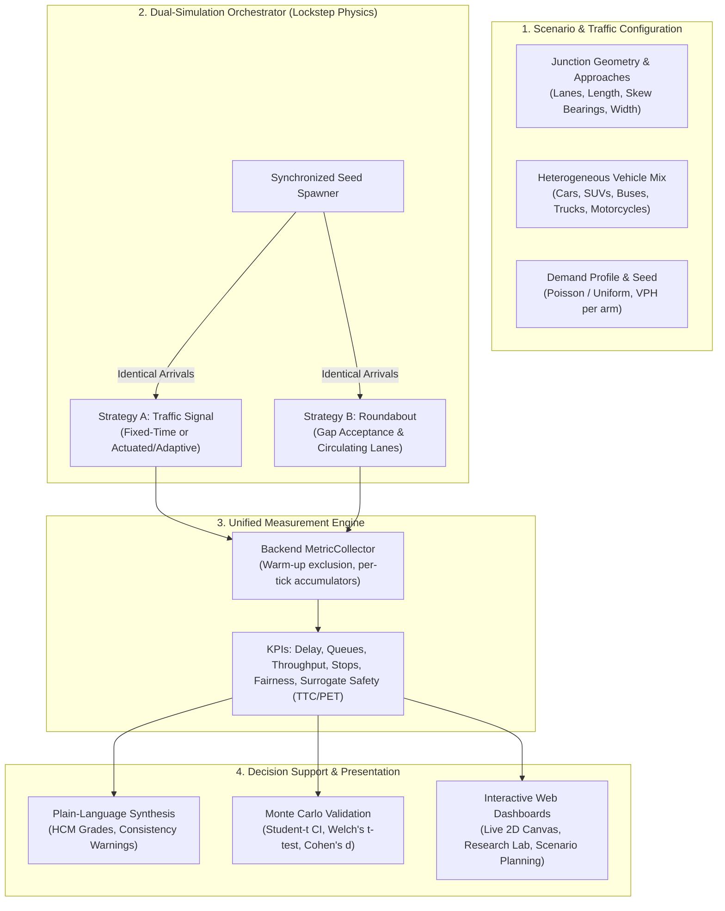
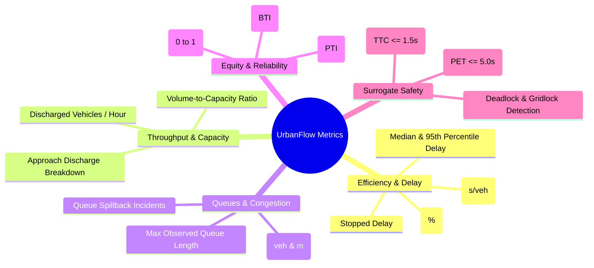
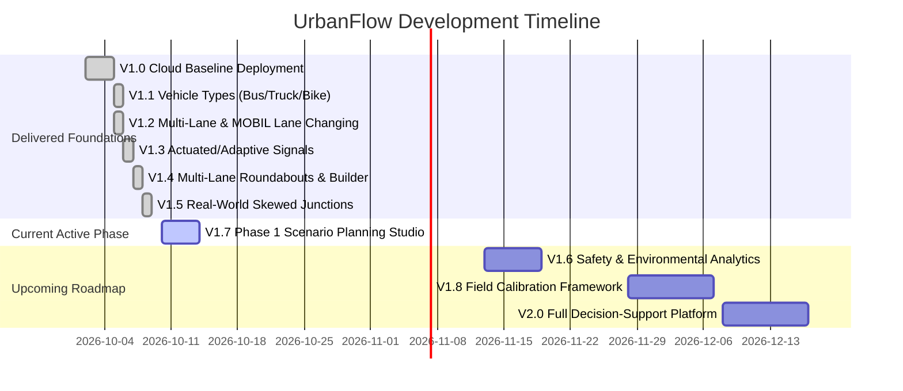

# UrbanFlow — Comprehensive Project Documentation & Technical Dossier

**Intelligent Microscopic Traffic Simulation & Evidence-Based Decision-Support Platform**

---

## 1. Project Objectives & Problem Statement

### 1.1 Problem Statement
Municipal planning departments, transport consultants, and civil engineers routinely face the critical intersection control dilemma: **"Should this junction be controlled by a traffic signal or converted into a roundabout?"**

Historically, this choice has suffered from major systemic deficiencies:
1. **Subjective & Opinion-Driven Debates:** Decisions are frequently argued from qualitative bias, political pressure, or rule-of-thumb generalizations rather than rigorous, repeatable data.
2. **Asymmetric & Confounded Comparisons:** Traditional commercial simulators (e.g., VISSIM, Aimsun, Synchro) are complex, proprietary, and often configured with disparate vehicle inputs, asymmetrical arrival times, or mismatched driver populations between alternative designs.
3. **High Barrier to Entry for Stakeholders:** Standard traffic modelling outputs consist of obscure engineering tables (LOS, delay matrices, volume-to-capacity ratios) that non-specialist city officials, planning committees, and the public cannot easily interpret.
4. **Reproducibility Deficits:** Simulations rarely preserve exact execution provenance (random seeds, engine tick state, library versions, commit hashes), making post-hoc auditing or scientific reproduction difficult.

### 1.2 Core Project Objectives
UrbanFlow addresses these challenges through an open, transparent, evidence-based simulation platform:

* **Strictly Controlled Comparative Evaluation:** Run competing intersection strategies (Fixed-Time Signals, Actuated/Adaptive Signals, and Roundabouts) under **identical traffic conditions** using synchronized random seeds—ensuring that every single vehicle arrives at the exact same millisecond, from the same direction, with the same driver characteristics.
* **Microscopic Physical Fidelity:** Model individual vehicles using industry-standard physics (Intelligent Driver Model for car-following, MOBIL for lane-changing, and gap-acceptance models for roundabout circulation) operating at a discrete-time resolution ($\Delta t = 0.1\text{ s}$).
* **Explainable Decision Support:** Translate raw engineering metrics into transparent, plain-language insights (HCM-style service grades, delay differentials, directional fairness indexes) accompanied by automated reliability confidence tests.
* **Full Computational Reproducibility:** Guarantee deterministic results across environments with full provenance tracking (Git commit, Python version, configuration snapshots, SQLite audit logging).
* **Democratized Accessibility:** Deliver an intuitive, dual-tier web application featuring interactive side-by-side 2D visualization, an advanced Research Lab for parametric volume sweeps, and a Scenario Planning Dashboard for what-if interventions.

---

## 2. Description of Proposed Solution

UrbanFlow provides an end-to-end simulation, analysis, and decision-support pipeline that models and evaluates intersections under controlled conditions.



### 2.1 The Controlled Comparison Paradigm
The core insight of UrbanFlow is **lockstep comparative isolation**:
* A single random seed initializes the vehicle generation pipeline.
* As vehicles spawn, their arrival timestamps, approach origins, turn intentions (Left, Straight, Right, U-Turn), vehicle dimensions, and driver IDM parameters are pre-determined.
* The identical vehicle stream is fed into both control topologies simultaneously.
* Any observed variation in delay, queue length, or throughput is strictly attributable to the **control strategy and geometry**, eliminating stochastic arrival noise.

### 2.2 Functional Modes
1. **Guided Comparative Workflow:** A step-by-step 3-step wizard designed for municipal planning officers to define junction demand, watch the side-by-side simulation live at ~10 Hz, and inspect plain-language findings.
2. **Scenario Planning & What-If Studio:** An experimentation dashboard allowing planners to establish a baseline scenario and evaluate multiple simultaneous interventions (varying signal timings, volume multipliers, lane policies, and driver behavior) with automated KPI deltas.
3. **Research Lab (Specialist Suite):**
   * **Traffic Volume Sweeps:** Parametric sweeps across 6 calibrated demand levels (Light to Over-Capacity) identifying the exact delay crossover bracket.
   * **Monte Carlo Statistical Validation:** Automated multi-seed runs calculating 95% Confidence Intervals, Welch’s t-tests, and Cohen's $d$ effect sizes.
   * **Model Integrity & Invariant Audits:** Dynamic verification of physical conservation laws, zero conflicting green signals, and collision audits.

---

## 3. Technology Stack

UrbanFlow is engineered with a strict separation of concerns: the frontend is purely representational and analytical; the backend owns 100% of the physics, state, metrics, and persistence.

```
┌────────────────────────────────────────────────────────────────────────┐
│                          CLIENT (BROWSER)                              │
│   React 19 · TypeScript · Vite · HTML5 Canvas · Recharts · Tailwind    │
└───────────────────────────────────┬────────────────────────────────────┘
                                    │ HTTP / WebSocket (Reverse Proxy)
┌───────────────────────────────────▼────────────────────────────────────┐
│                    EDGE LAYER (NGINX CONTAINER)                        │
│   nginx-unprivileged:1.31-alpine · Static Bundles · Port 80 / 8080    │
└───────────────────────────────────┬────────────────────────────────────┘
                                    │ Proxy Pass :8000
┌───────────────────────────────────▼────────────────────────────────────┐
│                   BACKEND LAYER (FASTAPI CONTAINER)                    │
│   Python 3.11 · FastAPI · Uvicorn · Pydantic v2 · Pure-Python Physics  │
│   concurrent.futures Worker Pool · SQLite (WAL mode)                   │
└───────────────────────────────────┬────────────────────────────────────┘
                                    │
┌───────────────────────────────────▼────────────────────────────────────┐
│                    PERSISTENCE & INFRASTRUCTURE                        │
│   Docker Compose · AWS EC2 · AWS Cognito (JWT) · SQLite Data Volume   │
└────────────────────────────────────────────────────────────────────────┘
```

### 3.1 Frontend Stack
* **Core Framework:** React 19 with modern functional hooks and Context API.
* **Language & Type Safety:** TypeScript 5.x with strict null-checks and full schema parity with backend contracts.
* **Build System & Dev Server:** Vite 8.x / Rollup for sub-second hot module replacement (HMR) and optimized multi-chunk code-splitting.
* **Rendering & Visualization:**
  * **HTML5 2D Canvas API:** Custom renderers for real-time 60 FPS vehicle rendering, vehicle sprites, multi-lane paths, roundabout circulatory rings, and signal head states.
  * **Snapshot Interpolation:** High-precision client-side linear position and angular interpolation (`snapshotInterpolator.ts`) bridging ~10 Hz WebSocket telemetry into smooth 60 FPS visual motion.
* **Analytics & Data Plotting:** Recharts for delay distributions, throughput time-series, and queue growth curves.
* **Styling & Design System:** Vanilla CSS + Tailwind CSS utilities adhering to accessible dark/light themes, glassmorphism cards, and responsive desktop-first grids.
* **Icons:** Lucide React.
* **Unit & Component Testing:** Vitest, jsdom, and React Testing Library.

### 3.2 Backend Stack
* **Language:** Python 3.11 (optimized runtime, strict typing via `mypy --strict`).
* **Web Framework:** FastAPI running on Uvicorn asynchronous server.
* **Data Validation & Serialisation:** Pydantic v2 and `jsonschema` for strict structural validation of scenario documents.
* **Simulation Engine:** Pure Python discrete-time engine with numerical updates (semi-implicit Euler integration), zero external heavy C-dependencies for maximum cross-platform reproducibility.
* **Asynchronous Jobs & Concurrency:** `concurrent.futures.ProcessPoolExecutor` (`STUDY_WORKERS`) enabling headless, multi-core parallelization of batch studies.
* **Authentication & Authorization:** Amazon Cognito JWT verification with JWKS caching and development bypass modes (`auth.py`).

### 3.3 Storage & Persistence
* **Database:** SQLite 3 utilizing:
  * **Write-Ahead Logging (WAL):** High-concurrency reads during active background simulation writes.
  * **Busy Timeout:** 5000 ms busy handler to prevent lock contention.
  * **Foreign Key Constraints:** Enforced relational integrity.
* **Schema Management:** Automated safe migrations on engine initialization (`backend/src/database/db.py`).
* **Data Access Objects (DAO):** Segregated DAO layer (`dao.py`, `replay_dao.py`) managing simulation runs, tick-by-tick time series, sweep batches, and scenario suites.

### 3.4 DevOps, Containerization & CI/CD
* **Container Architecture:** Multi-stage Docker builds separating builder artifacts from minimal runtime environments:
  * `backend`: Non-root `appuser` image running FastAPI.
  * `frontend`: `nginx-unprivileged:alpine` proxying API and WebSocket endpoints while serving static SPA assets.
* **Orchestration:** `docker-compose.yml` (production) and `docker-compose.dev.yml` (hot-reloading local development).
* **Automation:** Comprehensive PowerShell automation script (`start.ps1`) providing single-command build, health check, restart, log tailing, and smoke testing.
* **Continuous Integration:** GitHub Actions executing static linting (`ruff`, `eslint`, `prettier`), strict type verification (`mypy`, `tsc`), unit test suites (`pytest`, `vitest`), and nightly simulation regression suites.

---

## 4. System Design & Architectural Patterns

### 4.1 Modular Package Breakdown

```
Traffic-Simulation/
├── backend/
│   ├── src/
│   │   ├── main.py                     FastAPI entrypoint, REST & WebSocket routing, session state
│   │   ├── auth.py                     Cognito JWT validation and JWKS caching
│   │   ├── core/                       Simulation engine core (engine.py, clock.py, config_models.py)
│   │   ├── roads/                      Lane geometry, polyline coordinate maths, approach representations
│   │   ├── vehicles/                   IDM, stochastic IDM, MOBIL lane changing, spawning, routing
│   │   ├── controllers/                Fixed-time, actuated/adaptive signal, roundabout gap-acceptance
│   │   ├── intersection/               Conflict detection, reservations, predictive conflict manager
│   │   ├── metrics/                    MetricCollector, delay, queue, throughput, safety definitions
│   │   ├── snapshot/                   Snapshot builder, bounded replay history, dual orchestrator
│   │   ├── study/                      Batch sweeps, Monte Carlo validation, invariant verifier, reports
│   │   └── database/                   SQLite connection, schema migration, DAO repositories
│   └── tests/                          Pytest test suite (unit, integration, regression)
├── frontend/
│   ├── src/
│   │   ├── App.tsx                     Root router and layout shell
│   │   ├── components/                 ComparativeDashboard, ResearchHub, RoundaboutMap, SignalMap
│   │   ├── components/planning/        ScenarioPlanningDashboard, scenario configuration, KPI cards
│   │   ├── scenario/                   Scenario document model, presets, schema validation helpers
│   │   ├── metrics/                    Metric catalog, formatting, unit transformations
│   │   ├── services/                   API client, WebSocket streaming client, job manager
│   │   └── test/                       Vitest unit & component test specifications
│   └── templates/                      Nginx configuration template (default.conf.template)
└── shared/
    └── schemas/                        Authoritative JSON schemas (config, snapshot, scenario)
```

### 4.2 Core Domain Abstractions
1. **SimulationEngine (`core/engine.py`):**
   * Operates on a discrete time step $\Delta t = 0.1\text{ s}$.
   * Owns the master vehicle pool, road network, active controller, and metric collector.
   * Executes the strict sequential tick sequence:
     ```
     Tick Start → Spawn Pending Vehicles → Controller Update → 
     Update Vehicle Physics (Acceleration & Speed) → Update Vehicle Positions → 
     Conflict Resolution & Collision Check → Expiration & Metric Accumulation → Snapshot Emit
     ```
2. **DualSimulationOrchestrator (`snapshot/dual_orchestrator.py`):**
   * Instantiates two parallel `SimulationEngine` instances (one configured for signal, one for roundabout).
   * Drives both engines in lockstep with identical seeds.
   * Produces paired dual snapshots containing comparative telemetry for WebSocket distribution.
3. **MetricCollector (`metrics/collector.py`):**
   * Collects vehicle passage, delay, stops, and trajectories.
   * **Warm-up Exclusion:** Excludes all metrics recorded during the stabilization warm-up window ($t < t_{\text{warmup}}$) to eliminate initialization bias.
   * Calculates instantaneous, sliding-window, and cumulative statistics.

---

## 5. Development & Core Algorithmic Implementation

### 5.1 Car-Following Physics: Intelligent Driver Model (IDM)
Vehicle longitudinal acceleration is governed by the continuous Intelligent Driver Model (Treiber et al.):

$$\frac{dv}{dt} = a \left[ 1 - \left( \frac{v}{v_0} \right)^\delta - \left( \frac{s^*(v, \Delta v)}{s} \right)^2 \right]$$

Where the dynamic desired minimum headway $s^*(v, \Delta v)$ is:

$$s^*(v, \Delta v) = s_0 + v T + \frac{v \Delta v}{2 \sqrt{a b}}$$

* $v$: Current vehicle speed (m/s).
* $v_0$: Desired free-flow speed (derived from approach speed limit and vehicle class).
* $s$: Actual bumper-to-bumper distance to the leading vehicle (m).
* $\Delta v = v - v_{\text{lead}}$: Approach velocity difference (m/s).
* $s_0$: Jam distance (minimum spacing at a complete standstill, typically 2.0 m).
* $T$: Safe time headway (typically 1.2–1.5 s).
* $a$: Maximum comfortable acceleration ($2.0\text{ m/s}^2$).
* $b$: Comfortable deceleration ($3.0\text{ m/s}^2$).
* $\delta$: Acceleration exponent (standard $\delta = 4$).

Numerical integration uses a **semi-implicit Euler update**:
$$v(t + \Delta t) = \max\left(0, v(t) + \frac{dv}{dt} \Delta t\right)$$
$$x(t + \Delta t) = x(t) + v(t + \Delta t) \Delta t$$

### 5.2 Heterogeneous Vehicle Classes
UrbanFlow models five distinct vehicle classes (`vehicles/vehicle_types.py`):

| Vehicle Class | Length ($L$) | Width ($W$) | Max Accel ($a$) | Desired Decel ($b$) | Safe Headway ($T$) | Speed Factor | Cornering Cap |
| :--- | :---: | :---: | :---: | :---: | :---: | :---: | :---: |
| **Car** | 4.5 m | 2.0 m | $2.0\text{ m/s}^2$ | $3.0\text{ m/s}^2$ | 1.4 s | 1.00 | $4.5\text{ m/s}^2$ |
| **SUV** | 5.0 m | 2.2 m | $1.8\text{ m/s}^2$ | $2.8\text{ m/s}^2$ | 1.5 s | 0.95 | $4.0\text{ m/s}^2$ |
| **Bus** | 12.0 m | 2.5 m | $1.2\text{ m/s}^2$ | $2.2\text{ m/s}^2$ | 1.8 s | 0.85 | $3.0\text{ m/s}^2$ |
| **Truck** | 14.0 m | 2.5 m | $1.0\text{ m/s}^2$ | $2.0\text{ m/s}^2$ | 2.0 s | 0.80 | $2.8\text{ m/s}^2$ |
| **Motorcycle**| 2.2 m | 0.9 m | $2.8\text{ m/s}^2$ | $3.5\text{ m/s}^2$ | 1.0 s | 1.10 | $5.5\text{ m/s}^2$ |

### 5.3 Lane Changing (MOBIL)
Multi-lane approaches incorporate the MOBIL (Minimizing Overall Braking Induced by Lane Changes) model:
* **Incentive Criterion:** A vehicle initiates a lane change if the operational advantage to itself and immediate followers exceeds a politeness threshold $p$:
  $$\tilde{a}_{\text{ego}} - a_{\text{ego}} + p \left[ (\tilde{a}_{\text{new\_follower}} - a_{\text{new\_follower}}) + (\tilde{a}_{\text{old\_follower}} - a_{\text{old\_follower}}) \right] > \Delta a_{\text{th}}$$
* **Safety Criterion:** The deceleration imposed on the prospective follower must not exceed a safety limit:
  $$\tilde{a}_{\text{new\_follower}} \ge -b_{\text{safe}}$$

### 5.4 Traffic Control Implementations
1. **Fixed-Time Signal (`controllers/fixed_time_signal.py`):**
   * Configurable dual-ring or paired phase sequence (North-South Green $\rightarrow$ Yellow $\rightarrow$ All-Red $\rightarrow$ East-West Green $\rightarrow$ Yellow $\rightarrow$ All-Red).
   * Supports corridor-specific green timings, split optimization, and coordination offsets.
   * Stop-lines are enforced by dynamically placing virtual zero-velocity obstacles in the vehicle's leader search tree when the phase is red or yellow past the stopping dilemma zone.
2. **Actuated / Adaptive Signal (`controllers/adaptive_signal.py`):**
   * Uses virtual stop-line induction loop sensors (`controllers/signal_detection.py`) detecting vehicle occupancy within a detection zone (e.g., 30 m).
   * Implements minimum green guarantee, passage-based extension steps ($\Delta t_{\text{ext}} = 2.5\text{ s}$), and gap-out logic when headways exceed thresholds.
   * Forces maximum green termination when competing phases register continuous call demand.
3. **Roundabout Controller (`controllers/roundabout.py`):**
   * Based on critical gap acceptance theory (Troutbeck / HCM guidelines).
   * **Entry Condition:** An entering vehicle must find a temporal gap $t_{\text{gap}}$ on the circulating ring satisfying:
     $$t_{\text{gap}} \ge t_c \quad (t_c = 4.0\text{ s})$$
   * **Follow-up Headway:** Subsequent vehicles following an entering leader discharge at follow-up headway $t_f = 2.5\text{ s}$.
   * Multi-lane circulating rings implement strict lane assignments (inner ring for left turns, outer ring for right turns, designated exit convergence zones).

### 5.5 Comprehensive Metrics Catalog



* **Jain's Fairness Index:** Measures equity of service across the 4 approaches:
  $$\mathcal{J}(d_1, d_2, d_3, d_4) = \frac{\left( \sum_{i=1}^n d_i \right)^2}{n \cdot \sum_{i=1}^n d_i^2}$$
  Where $d_i$ is the average delay experienced on approach $i$. Values approach $1.0$ for perfectly balanced service and drop towards $0.25$ if one corridor is starved.
* **Surrogate Safety Assessment:** Real-time spatial scanning computes Time-to-Collision (TTC) for non-following intersecting trajectories and Post-Encroachment Time (PET) across conflict points.

---

## 6. Testing, Quality Assurance & Debugging

UrbanFlow enforces a five-stage quality pyramid safeguarding physical correctness, mathematical validity, and UI fidelity.

```
       ▲
      / \        Stage 5: Delivery & Smoke Checks (Docker, Nginx, Ports)
     /   \       Stage 4: Simulation Regression & Capacity Curve Pinning (Slow)
    /     \      Stage 3: Integration Tests (API, WebSockets, DB, Dual Engine)
   /       \     Stage 2: Unit Testing (IDM, MOBIL, Controllers, Metrics, Statistics)
  /_________\    Stage 1: Static Guarantees (ruff, mypy --strict, tsc, eslint, prettier)
```

### 6.1 Backend Verification Suite
* **Static Typing & Quality Gate:**
  * `mypy --strict src/`: 100% type coverage across the engine, preventing `NoneType` and serialization runtime defects.
  * `ruff check src/ tests/`: Enforces flake8, isort, and modern Python coding conventions.
  * `pytest --cov-fail-under=85`: Mandatory test coverage floor across all core modules.
* **Unit Testing:**
  * Physical verification of IDM equations under free-flow, deceleration, jam, and cornering limits.
  * Validation of signal controller phase transitions, yellow clearance, and all-red intervals.
  * Roundabout gap evaluation ensuring no vehicles enter with headway $< t_c$.
* **Integration & Invariant Tests:**
  * **Vehicle Conservation:** Invariant verified every tick:
    $$\text{Spawned}(t) = \text{Active}(t) + \text{Exited}(t)$$
  * **Non-Negativity:** Guaranteed $\forall v \in \text{Vehicles}: v \ge 0$.
  * **Zero Conflicting Greens:** Real-time audit asserting North-South and East-West green phases are mutually exclusive.
  * **Collision Audit:** Exact bounding-box intersection tests ensuring zero vehicle overlaps during calibrated runs.

### 6.2 Frontend Testing Suite
* **TypeScript Compilation:** `tsc --noEmit` verifies strict component prop and state contracts.
* **Vitest & React Testing Library:**
  * Component rendering and interaction tests (Scenario Planning Dashboard, Comparative Wizard, Research Lab).
  * Metric Catalog unit tests verifying formatting, unit conversions, and threshold badge styling.
  * WebSocket snapshot buffer and interpolation testing verifying smooth 60 FPS transitions.

### 6.3 Statistical Rigor in Research Studies
UrbanFlow rejects simplistic single-run evaluations. The Research Lab executes multi-seed Monte Carlo studies evaluating significance:
* **Student's $t$-Distribution Confidence Intervals:** Calculated at 90%, 95%, and 99% levels (avoiding normal distribution $z$-approximations for small seed counts $N \le 10$).
* **Welch’s Two-Sample $t$-Test:** Computes $p$-values for delay differences without assuming equal variances between signal and roundabout queues:
  $$t = \frac{\bar{X}_1 - \bar{X}_2}{\sqrt{\frac{s_1^2}{N_1} + \frac{s_2^2}{N_2}}}$$
* **Cohen's $d$ Effect Size:** Quantifies practical significance using pooled standard deviations:
  $$d = \frac{\bar{X}_{\text{signal}} - \bar{X}_{\text{roundabout}}}{s_{\text{pooled}}}$$
  Classified into *Negligible* ($|d| < 0.2$), *Small* ($0.2 \le |d| < 0.5$), *Medium* ($0.5 \le |d| < 0.8$), and *Large* ($|d| \ge 0.8$).

---

## 7. Project Plan, Milestones & Roadmap

### 7.1 Historical Milestones: V0.1 to V1.0 (Delivered & Deployed)

| Milestone | Codebase Deliverables | Status |
| :--- | :--- | :---: |
| **V0.1 Single Vehicle** | IDM car-following equations, single-vehicle demo routes, basic canvas | ✅ Complete |
| **V0.2 Multiple Vehicles** | Seeded arrival spawner, vehicle object pool, leader-follower routing | ✅ Complete |
| **V0.3 Control Strategies** | `FixedTimeSignalController`, single-lane `RoundaboutController`, conflict points | ✅ Complete |
| **V0.4 Simulation Outputs** | Dynamic snapshot generator, WebSocket streaming (~10 Hz), replay buffer | ✅ Complete |
| **V0.5 Metrics Engine** | `MetricCollector`, delay, throughput, queue, stop counters, warm-up clipping | ✅ Complete |
| **V0.6 Strategy Comparison**| `DualSimulationOrchestrator`, side-by-side synchronized canvas | ✅ Complete |
| **V0.7 Volume Analysis** | Parametric volume sweeps, crossover delay detection, session management | ✅ Complete |
| **V0.8 Validated Study** | Monte Carlo validation, Student-t/Welch stats, pinned capacity curve | ✅ Complete |
| **V0.9 Containerization** | Multi-stage Dockerfiles, Docker Compose stack, Nginx reverse proxy, `start.ps1` | ✅ Complete |
| **V1.0 AWS Cloud Deployment**| AWS EC2 deployment, SQLite WAL persistence, guided planner wizard, Cognition auth | ✅ Complete |

### 7.2 Capability Expansion: V1.1 to V1.7



* **V1.1 Heterogeneous Traffic (Delivered):** Introduced 5 vehicle classes with distinct IDM profiles, physical dimensions, and class-specific metrics.
* **V1.2 Multi-Lane & MOBIL (Delivered):** Added multi-lane approaches, lane turn allocations, and gradual lane-changing maneuvers.
* **V1.3 Adaptive Signal Control (Delivered):** Introduced vehicle-actuated signal controllers with stop-line detection, minimum/maximum green bounds, and extension steps.
* **V1.4 Advanced Roundabouts & Scenario Builder (Delivered):** Added multi-lane circulating rings (1–2 lanes), designated exit convergence zones, and a strategy-neutral JSON scenario specification document.
* **V1.5 Real-World Junction Geometry (Delivered):** Added support for 3-arm (T/Y) and 4-arm junctions with custom approach compass bearings, per-arm lane widths, and protected/permissive U-turns.
* **V1.7 Phase 1 Scenario Planning & Comparison Dashboard (Current):**
  * Configurable baseline vs. multiple intervention scenarios.
  * Batch simulation runner executing sequential studies via the backend job queue.
  * Comparison dashboard featuring comparative KPI cards, Recharts visualizations, and delta tables vs. baseline.
  * SQLite persistence via `scenario_suites` and export to CSV.

### 7.3 Future Frontiers: V1.8 to V2.0+
* **V1.6 Safety & Environmental Analysis:** Surrogate safety metric expansion (extended PET/TTC heatmaps) and instantaneous fuel consumption/emissions estimation (VT-Micro or COPERT models).
* **V1.8 / V1.9 Calibration & Network Foundations:** Genetic algorithm/Nelder-Mead calibration to field sensor counts and multi-intersection corridor chaining.
* **V2.0 Decision-Support Platform:** Final integrated platform with automated executive PDF reporting, scenario recommendation synthesis, and multi-criteria decision analysis (MCDA).

---

## 8. Current Progress, Empirical Outcomes & Impact

### 8.1 Empirical Findings Under Calibrated Conditions
Extensive Monte Carlo experimentation (5 seeds, 240 s runs, 30 s warm-up, $\Delta t = 0.1\text{ s}$) over single-lane symmetric configurations yielded critical evidence:

1. **Light Demand ($\le 360\text{ veh/h}$):**
   * **Roundabouts exhibit superior efficiency:** Mean delay is significantly lower ($9.9 \pm 1.0\text{ s}$ vs. $16.1 \pm 1.5\text{ s}$, $p < 0.001$).
   * *Mechanism:* Vehicles on empty roundabouts yield briefly or pass unimpeded, whereas traffic signals impose artificial stopping delays during red phases even when cross-traffic is absent.
2. **Moderate to Busy Demand ($720 - 1080\text{ veh/h}$):**
   * Roundabouts maintain lower delays and higher served throughput ($946\text{ veh/h}$ vs. $789\text{ veh/h}$, $p = 0.033$).
   * Adaptive signals close the efficiency gap by extending green phases dynamically, but remain constrained by clearance intervals (yellow + all-red).
3. **Saturation & Over-Capacity ($\ge 2160\text{ veh/h}$):**
   * Roundabouts achieve 11–18% higher discharged throughput than single-lane signals with permissive left turns.
   * However, directional equity degrades: major-flow circulating traffic can starve minor approach entries, resulting in high localized queues. Under heavy unbalanced demand, coordinated signals provide superior directional fairness.

### 8.2 Deliverable Artifacts & Project Health
* **Zero Critical Bugs:** Clean execution across both Docker containers.
* **Full Production Test Coverage:** Passing pytest test suite with coverage floor $\ge 85\%$ and passing Vitest frontend unit tests.
* **Live Deployment Ready:** Containerized multi-tier setup operating on port 80/3000 via Docker Compose, backed by automated health checks and SQLite WAL persistence.
