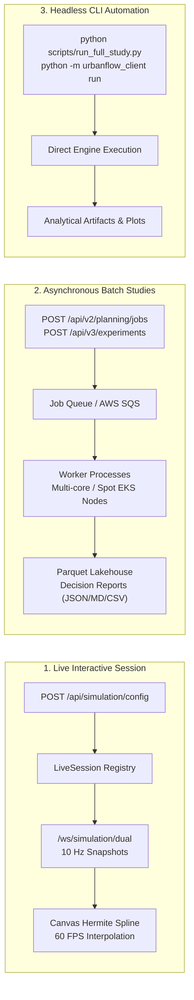

# 00 — System Overview

> **Status:** Current · Comprehensive platform architecture from V1.0 to V5.4 and Phase 7  
> **Read this first.** Documents 01–10 in this folder explore individual layers, contracts, and standards in depth. This document maps the overarching platform architecture.

UrbanFlow is an evidence-based traffic simulation and decision-support platform designed to evaluate competing intersection and arterial control strategies under identical, common-random-number vehicle arrivals. It enforces a strict architectural boundary: **the backend is the single source of truth for all physics simulation and metric computation; the browser renders telemetry snapshots and presents verified findings.**

---

## 1. High-Level Platform Architecture

```mermaid
flowchart TB
    subgraph Client["Presentation Layer (Browser)"]
        LANDING["Landing Page<br/>index.html · Canvas showcase"]
        SPA["Dashboard SPA<br/>app.html · React 19 + TypeScript 5.8 + Vite 8"]
        CANVAS["HTML5 Canvas<br/>60 FPS motion interpolation"]
        MAPLIBRE["MapLibre GL<br/>Multi-junction spatial vector map"]
        CHARTS["Recharts & Analytics<br/>Declarative SVG metrics & CIs"]
    end

    subgraph Edge["Edge Layer (nginx-unprivileged :8080)"]
        STATIC["Static Asset Server<br/>SPA route fallback"]
        PROXY["Reverse Proxy Gateway<br/>/api/ · /ws/ · /health · /metrics"]
        INJECT["Security Injection<br/>Injects internal BACKEND_API_KEY"]
    end

    subgraph Delivery["Delivery & Security Layer (FastAPI :8000)"]
        MAIN["main.py (Composition Root & Middleware)"]
        AUTH_OIDC["OIDC JWT & Cognito Verifier<br/>RBAC: viewer, planner, engineer, admin"]
        OBS_MW["Observability Middleware<br/>Request tracking & latency metrics"]
        LIMITS["Request Limits & Mutating Slot Lock<br/>1 MiB body cap on compute endpoints"]
    end

    subgraph Application["Application Layer (Use Cases)"]
        LIVE_SES["Live Interactive Sessions<br/>DualSimulationOrchestrator"]
        PLAN_SRV["Planning Studies (/api/v2/planning)"]
        EXP_SRV["Robustness Lab (/api/v3/experiments)<br/>Sobol / Latin Hypercube sampling"]
        NET_SRV["Network Graphs & Calibration<br/>OSM/SUMO import · GEH Nelder-Mead fitting"]
        DISC_SRV["AI Discovery Lab (/api/v3/discovery)<br/>NSGA-II multi-objective strategy search"]
        COP_SRV["AI Copilot (/api/v3/copilot)<br/>Grounded non-hallucinating summaries"]
        TWIN_SRV["Digital Twin Core (/api/v2/twin)<br/>Telemetry replay · What-if branching"]
        INC_SRV["Incidents, Priority & V2X (/api/v2/*)<br/>Closures · Weather · Preemption · MQTT"]
    end

    subgraph Domain["Strict Domain Stack (Microscopic Physics)"]
        SNAP["snapshot/ (Builder, buffer, streams)"]
        ENG["engine/ (SimulationEngine, vehicle pool, SAT audit)"]
        NET_DOM["networks/ & netmetrics/ (Graph model, handoff, congestion)"]
        CTRL["controllers/ (Fixed-Time, Adaptive, Roundabout, Metered)"]
        PRIO_DOM["priority/ & incidents/ (Preemption, yielding, closures)"]
        V2X_DOM["v2x/ (Publish/subscribe bus, latency, packet drop)"]
        RL_DOM["rl/ (Gymnasium environment, baselines, steppers)"]
        INT["intersection/ (ConflictManager, stop lines)"]
        VEH["vehicles/ (IDM car-following, MOBIL lanes, 5 fleet classes)"]
        ROADS["roads/ (RoadNetwork, approaches, turn geometry)"]
        CORE["core/ (Clock, limits, enums, run manifest)"]
    end

    subgraph Infra["Infrastructure & Storage Layer"]
        DB[("Transactional SQLite (WAL Mode)<br/>simulation_runs · studies · replays")]
        RUNSTORE[("Parquet Lakehouse (S3 / Local)<br/>Columnar tick telemetry · DuckDB queries")]
        QUEUE["Job Queue & SQS Adapter<br/>Background worker daemons · Cost tags"]
        PROM["Prometheus Metrics (/metrics/prom)<br/>OpenTelemetry distributed tracing"]
    end

    LANDING & SPA & CANVAS & MAPLIBRE & CHARTS --> STATIC
    SPA --> PROXY
    STATIC --> PROXY
    PROXY --> INJECT --> MAIN
    MAIN --> AUTH_OIDC --> OBS_MW --> LIMITS
    LIMITS --> Application
    Application --> Domain
    Domain --> Infra
```

---

## 2. Core Subsystems

### 2.1 Microscopic Physics Engine
- **Car-Following:** The Intelligent Driver Model (IDM) governs longitudinal accelerations with vehicle-type-specific parameters ($a, b, T, s_0$).
- **Lateral Dynamics:** MOBIL governs discretionary and mandatory lane-changing decisions, auditing politeness factors and prospective follower braking thresholds before lane transitions.
- **Collision Safety Auditing:** Oriented bounding box collisions are verified using the Separating Axis Theorem (SAT) after each tick; model failures are logged without halting the numerical loop.

### 2.2 Network Graph Model (ADR-021)
- **Topological Structure:** The network is modeled as a directed node-edge graph where nodes represent signalized or unsignalized junctions and edges represent multi-lane connecting links.
- **Vehicle Conservation & Handoff:** Vehicles crossing downstream approach stop-lines are transferred onto downstream arterial links with conservation guarantees ($\text{spawned} = \text{active} + \text{completed}$).
- **Congestion Heatmaps:** Downstream link spillback triggers upstream flow restriction, calculating propagation velocity and topological bottleneck heatmaps.

### 2.3 Control Strategies Ecosystem
- **Fixed-Time Signal Controller:** Paired stage sequencing, configurable cycle offsets, per-corridor greens, all-red clearance intervals.
- **Actuated Adaptive Signal Controller:** Stop-line loop detection, passage green extensions, gap-out timers, maximum green caps.
- **Multi-Lane Roundabout Controller:** Circulating ring reservations, critical gap acceptance ($4.0\text{ s}$), follow-up headway ($2.5\text{ s}$).
- **Signalised Roundabout Controller (`metered_entry`):** Stop-line signal metering at entry approaches gating ring entry while preserving circulating gap-acceptance rules.
- **Reinforcement Learning:** Gymnasium multi-junction signal environment supporting PPO/DQN training benchmarked against Fixed-Time and Max-Pressure baselines.

### 2.4 Incident, Weather & Priority Overlays
- **Incidents & Closures:** Dynamic road closures force real-time Dijkstra/A* path rerouting around blocked links.
- **Weather Modifiers:** Rain, snow, dense fog, and ice modify tire-road friction, driver visibility limits, and IDM reaction headways.
- **Emergency Preemption & Yielding:** Siren detection radius triggers immediate green extensions and red truncations; civilian vehicles pull aside to clear emergency green corridors.
- **V2X Messaging Bus:** Inter-vehicle pub/sub messaging simulating packet latency and packet drop models to test cooperative longitudinal driving.

### 2.5 Data Storage & Results Lakehouse
- **Transactional State:** SQLite in WAL mode with foreign keys and 5 s busy timeouts stores user accounts, run metadata, and study status.
- **Parquet Lakehouse:** High-frequency per-tick vehicle coordinates and operational metrics are serialized into Apache Parquet columnar files stored on local disk or AWS S3, queryable via DuckDB SQL in milliseconds.

---

## 3. Communication Patterns

UrbanFlow provides three operational communication modalities:

---

## 4. Security & Multi-Tenancy Architecture

- **Authentication:** Amazon Cognito / OIDC JSON Web Tokens (JWT) verified against public JSON Web Key Sets (JWKS). Local development supports `DEV_AUTH_BYPASS=1`.
- **Role-Based Access Control (RBAC):** Strict permissions enforcing 4 roles (`viewer`, `planner`, `engineer`, `admin`).
- **Tenant Isolation:** All planning studies, Robustness Lab experiments, and telemetry runs are scoped strictly by `tenant_id` and `user_id`. Access attempts across tenant boundaries return an HTTP 404 response.
- **Personal Access Tokens (PATs):** Cryptographically hashed tokens (`uf_pat_...`) with fine-grained capability scopes (`experiments:run`, `packages:read`) for Python SDK automation.
