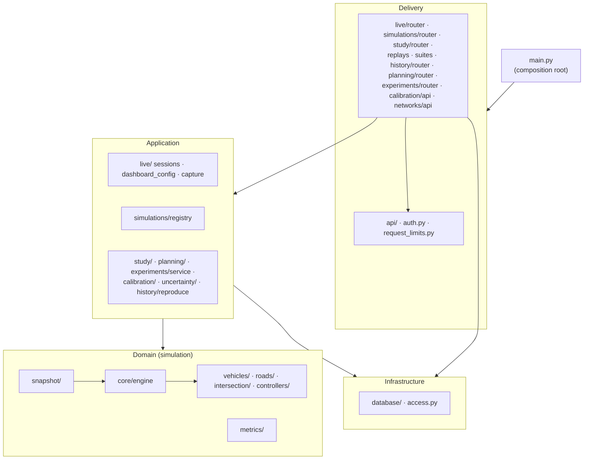
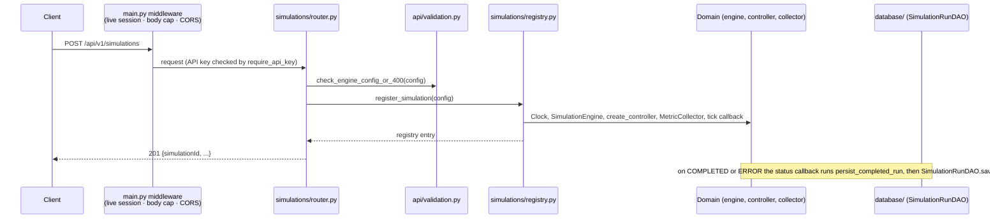
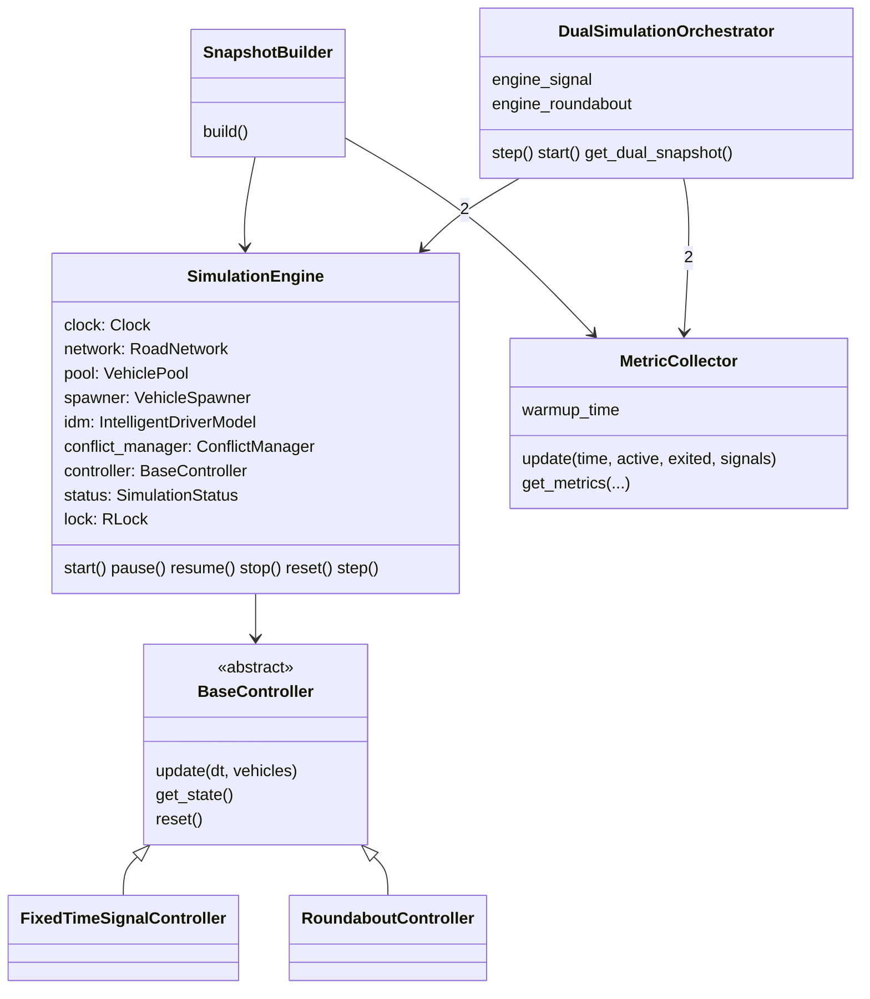

# 02 — Backend Architecture

> **Status:** Current · rewritten 2026-10-05 from the checked-in `backend/src/` tree; layers, package map and dependency rules updated 2026-10-16 when `main.py` was split into `api/`, `live/`, `simulations/`, `study/router.py`, `replays/` and `suites/`
> **Owner:** Viraj Jadhao (simulation, metrics, API)
> **See also:** [00 — System overview](00-system-overview.md) · [Simulation methodology](../simulation/methodology.md) · [API reference](../api/README.md)

The backend is a headless Python 3.11 application. It owns **all** simulation state, every metric and statistic, and all persistence; it emits JSON and never renders anything.

---

## 1. Layers and package map

The backend has four layers. Each package belongs to one of them and imports only from its own layer or the layers below it (§2).

| Layer | Owns | Packages / modules |
| --- | --- | --- |
| **Delivery** (HTTP, WebSocket) | Routes, request models, auth and API-key wiring, error envelope, origin policy, translating failures into status codes | `main.py` (composition root) · `api/` · `auth.py` · `request_limits.py` · `ws_origin.py` · every `router.py` / `api.py` inside a feature package |
| **Application** (use cases) | Running and comparing experiments, live sessions, study and planning jobs, calibration, reproduction, report generation | `live/` · `simulations/registry.py` · `study/` · `planning/` · `experiments/service.py` · `calibration/` · `uncertainty/` · `networks/` · `history/` (reproduce, export) |
| **Domain** (simulation) | Vehicles, IDM, geometry, controllers, conflicts, metrics, scenario and configuration rules, snapshots | `core/` · `roads/` · `vehicles/` · `controllers/` · `intersection/` · `metrics/` · `snapshot/` |
| **Infrastructure** | SQLite connection, schema, migrations, DAOs, the ownership rule, CSV safety | `database/` · `access.py` · `csv_safety.py` |

```
backend/src/
├── main.py                  Composition root: app, middleware, error handler, DB init, router mounting. No routes.
├── api/                     Shared HTTP plumbing
│   ├── security.py          API_KEY, require_api_key, bearer parsing
│   ├── errors.py            {"error": {code, message, details, timestamp}} envelope, iso_timestamp
│   ├── origins.py           CORS origins (CORS_ORIGINS env) and the WebSocket origin/close helpers
│   ├── validation.py        Schema + cross-field config checks and scenario checks → HTTP 400
│   └── meta.py              /health · /api/version · /api/me · /api/users
├── auth.py                  Cognito JWT verification (JWKS), dev bypass, user upsert
├── request_limits.py        Body-size middleware, pagination and study-duration bounds, compute_slot
├── ws_origin.py             Which browser origins may open a WebSocket
├── live/                    The live dashboard (/api/simulation/*, /ws/simulation/*)
│   ├── dashboard_config.py  DEFAULT_CONFIG; dashboard payload → engine config; live seeds
│   ├── sessions.py          Per-client LiveSession registry (TTL + cap), session middleware, engine/orchestrator factories
│   ├── capture.py           Exact, reproducible record of a session's run (used when saving a replay)
│   ├── single_vehicle.py    Sprint-2 single-vehicle polling state
│   └── router.py            Live, dual and single-vehicle routes and the two live WebSockets
├── simulations/             The versioned API (/api/v1/simulations, /api/simulation/new, /ws/v1/stream)
│   ├── registry.py          In-memory simulation registry (bounded), assembly, persistence on completion
│   └── router.py            Lifecycle, metrics, history, report routes; config/scenario validate + compile
├── study/                   Volume sweeps, Monte Carlo validation, control comparison, jobs, reports
│   ├── limits.py            Study workload bounds (rates, seeds, time step, batch size)
│   ├── router.py            /api/v1/study/* (synchronous and job routes)
│   └── volume_sweep.py · validation.py · control_comparison.py · runner.py · jobs.py · batch.py · …
├── replays/router.py        /api/v1/replays: saved live runs (+ their simulation_runs record)
├── suites/router.py         /api/suites: scenario suites, batch experiments, CSV export
├── history/                 /api/v1/study/history/runs: stored runs, labels, export, compare, reproduce
├── calibration/             V1.8 /api/v2/calibration: observed data vs simulated
├── networks/                V1.9 /api/v2/networks: multi-junction description (stateless)
├── planning/                V2.0 /api/v2/planning: scenario × alternatives × demand studies, findings, report
├── experiments/             V3.0 /api/v3: Robustness Lab experiments (service + router)
├── uncertainty/             V3.0 uncertainty spec, seeded sampler, analysis (pure computation)
├── core/
│   ├── engine.py            SimulationEngine — tick loop, lifecycle, locking, callbacks
│   ├── clock.py             Discrete-time clock (Δt, tick count, ticks_for_duration)
│   ├── config_models.py     Pydantic scenario model (bounds, defaults, DEFAULT_PHASE_SEQUENCE)
│   ├── config_validation.py Cross-field rules the JSON Schema cannot express
│   ├── lane_validation.py   Lane-use and geometry rules
│   ├── scenario.py          V1.4 scenario documents: parse, validate per strategy, compile
│   ├── schema.py            The one loader of shared/schemas/config.schema.json
│   └── enums.py · limits.py · provenance.py
├── roads/                   RoadNetwork, lanes, approaches, junction geometry, lane configuration
├── vehicles/                Vehicle, IDM, spawner, pool, router, lane change, speed profile, vehicle types
├── controllers/             BaseController, fixed-time, adaptive, roundabout, detection, virtual obstacle, factory
├── intersection/            Conflict manager (signal) and predictive conflict resolver
├── metrics/                 MetricCollector, readout.engine_metrics, efficiency score, deadlock detector, definitions/
├── snapshot/                SnapshotBuilder, SnapshotBuffer, DualSimulationOrchestrator
├── database/                db.py (schema, WAL, migrations) · dao.py · replay_dao.py
├── access.py                Who may see a stored record (one ownership rule)
└── csv_safety.py            Spreadsheet-formula neutralisation for exports
```

---

## 2. Dependency direction



Rules the code follows (kept by review and by the import structure; there is no import linter):

- **Nothing imports `main.py`.** It only assembles the app. The one exception is the developer tool `experiments/export_schemas.py`, which imports the app lazily to snapshot its OpenAPI document; it never runs in the server.
- **The domain imports no web, database or application code.** `core/ roads/ vehicles/ controllers/ intersection/ metrics/ snapshot/` never import FastAPI, SQLite, or any package above them.
- **Routes translate; they do not decide.** A router parses the request, calls an application function or the registry, and maps failures to status codes. Configuration rules live in `core/` (`config_validation.py`, `scenario.py`, `schema.py`); `api/validation.py` only words their failures as 400s, once, for every route.
- **SQL lives in `database/`.** Routers call DAO methods (`UserDAO`, `ReplayDAO.owner_of`, `ScenarioSuiteDAO.owner_of`, `SimulationRunDAO.owner_and_suite`, …), never `conn.execute`. Ownership checks go through `access.py`.
- **The engine has no strategy-specific branches.** `SimulationEngine.step()` calls `controller.update()` through the `BaseController` interface; `controllers/factory.py` chooses the class from `geometry.intersectionType` and `controller.signalControl`.
- **Controllers act only through virtual obstacles** (and roundabout speed caps), so vehicle physics is shared by every strategy.
- **Metrics read state; they never change it.** Safety measures (TTC/PET) are observation-only by construction. Reading an engine's metrics from outside its tick goes through `metrics/readout.engine_metrics`, which holds the engine lock.

Deliberate exceptions:

| Exception | Why |
| --- | --- |
| `live/dashboard_config.py` raises `HTTPException(400)` | The dashboard payload's error messages are part of its HTTP contract and come from the same function for the live session, the reliability check and suite batches (and are recorded verbatim as a background job's error). Translating at each caller would triple the wording. |
| `study/router.py` and `suites/router.py` import `live/dashboard_config.py` | A reliability check and a suite batch repeat exactly the scenario the dashboard ran, so they compile it the same way. |
| Domain packages import each other in both directions at package level (e.g. `core.config_validation` → `roads`, `roads` → `core.enums`) | The simulation is one cohesive model; there are no module-level import cycles, and `core/` holds both shared leaf types (`enums`, `clock`) and the top-level engine. Splitting `core/` is listed under remaining debt. |
| `vehicles/spawner.py` imports `metrics.collector.resolve_speed_threshold` | Both read the same configuration rule (where the speed thresholds live). Moving the rule into `core/` is listed under remaining debt. |

---

## 2a. How a request reaches the simulation



Studies take the same path through a different application module: `study/router.py` → `study/volume_sweep.py` / `validation.py` / `control_comparison.py` → `study/runner.py` (worker processes, `STUDY_WORKERS`) → the same engine, persisted through the DAOs. The `/api/v1/study/*/jobs` routes wrap the same function in `study/jobs.py` and return a job id. The live dashboard goes `live/router.py` → `live/sessions.py` (the caller's `LiveSession`) → `SimulationEngine` or `DualSimulationOrchestrator`, streamed by the `/ws/simulation/*` handlers.

## 3. Runtime objects



`build_tick_callback()` wires a collector (and, for the versioned API, a snapshot buffer) to an engine, so the same per-tick metric update runs in live sessions, versioned simulations and studies.

---

## 4. Key design decisions

| Decision | Why | Where |
| --- | --- | --- |
| Controller before physics in each tick | Signal changes and refused gaps take effect immediately | `core/engine.py` |
| Re-entrant engine lock held for the whole tick | Readers never see a torn tick; callbacks may re-enter | `SimulationEngine.lock` |
| Private RNG per engine; seed written back to config | Determinism and complete provenance | `vehicles/spawner.py` |
| Lockstep dual orchestrator with one seed | Fair comparison: same arrivals for both strategies | `snapshot/dual_orchestrator.py` |
| Backend is the only metric authority | Live, saved, exported and study numbers agree | ADR-005, `metrics/collector.py` |
| Studies in worker processes | Heavy studies do not block the API or live streams; results equal sequential runs | `study/runner.py` |
| Live sessions keyed per client | One visitor cannot reset another's simulation | `live/sessions.py` `LiveSession` |
| SQLite with in-place column migrations | Zero-ops persistence; older databases upgrade on start | `database/db.py` |

The full decision record: [decisions](../decisions/README.md).

---

## 5. Extending the backend

| To add… | Touch | Keep invariant |
| --- | --- | --- |
| A control strategy | A new `BaseController` subclass in `controllers/`; select it in `controllers/factory.py` (`create_controller`, and `derive_signals_state` if it shows signals); add it to the schema enum and, for scenario documents, to `core/scenario.py` (`STRATEGIES`, `JUNCTION_STRATEGY`, compilation). V1.3's adaptive signal is the worked example: it subclasses `FixedTimeSignalController` and is chosen by `controller.signalControl`. | Engine loop unchanged; metrics unchanged; same-seed runs of existing strategies unchanged |
| A metric or analysis | A module in `metrics/definitions/`, wired into `MetricCollector.get_metrics()`; describe it in `frontend/src/metrics/catalog.ts` (`metricCatalog.test.ts` enforces this) and the metrics reference. Study-level analyses (across seeds or demand) go in `study/` or `planning/` and read `get_metrics()` output. | Warm-up convention; backend-only computation; observation never changes state |
| An application workflow | A function in the owning application package (`study/`, `planning/`, …) that takes plain arguments and returns plain data; long runs take a `progress` argument so `study/jobs.py` can run them in the background. | No FastAPI imports; deterministic for a given seed |
| An API route for an existing capability | The owning package's `router.py` (a module-level `APIRouter`), with its request models beside the routes; `Depends(require_api_key)` for anything that mutates or computes, `get_current_user_id` for owned resources, `compute_slot` for synchronous simulations; `api/validation.py` for configuration errors. Mount a new router in `main.py`. | The error envelope (raise `HTTPException`); auth coverage like `tests/api/test_v2_route_auth.py` for `/api/v2` and later |
| A vehicle type | `vehicles/vehicle_types.py`, `vehicles/spawner.py`, snapshot vehicle fields, `config_models.py` + `config.schema.json` | Same-seed comparison still gives both strategies identical vehicles |
| Persistence | A DAO method in `database/`; schema changes as in-place migrations in `database/db.py` | Older databases upgrade on start; routers never hold SQL |

---

## 5a. Remaining architectural debt

- `core/` mixes leaf types (`enums`, `clock`, `limits`) with the engine and scenario compiler at the top of the domain; splitting it into a kernel and an engine package would make the domain's internal layering explicit.
- `resolve_speed_threshold` (a configuration rule) lives in `metrics/collector.py` and is imported by `vehicles/spawner.py`.
- Older feature routers (`history`, `planning`, `experiments`, `calibration`) take their auth dependencies as factory arguments, a pattern from when `require_api_key` lived in `main.py`; the newer routers import `api/security.py` directly. Both work; converging on one is a mechanical follow-up.
- `auth.py`, `request_limits.py` and `ws_origin.py` are delivery modules outside `api/`, left in place to avoid churn in their many importers.
- Several `collector.get_metrics(...)` call sites (`calibration/simulate.py`, `study/runner.py`, `study/validation.py`, `snapshot/builder.py`, `simulations/registry.persist_completed_run`) repeat the argument list of `metrics/readout.engine_metrics` without taking the engine lock; they run inside the tick or single-threaded, so their locking was deliberately left unchanged.

---

## 6. Testing

See [Testing](../testing/README.md). Every package above has a matching directory under `backend/tests/`; full-strength simulation sweeps are marked `slow` and run nightly.
