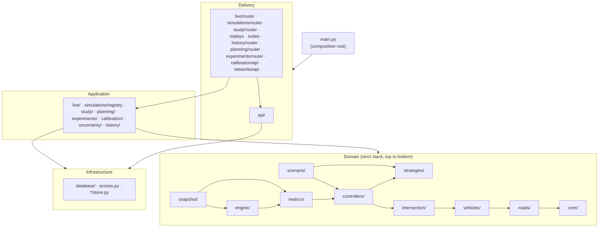
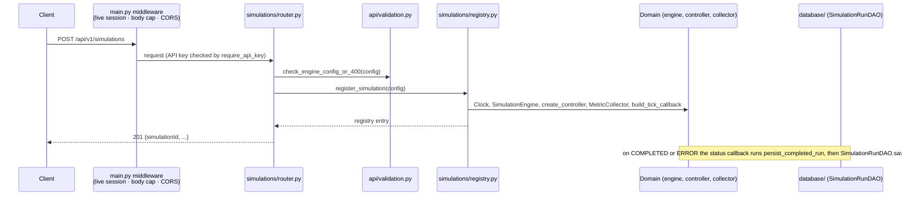
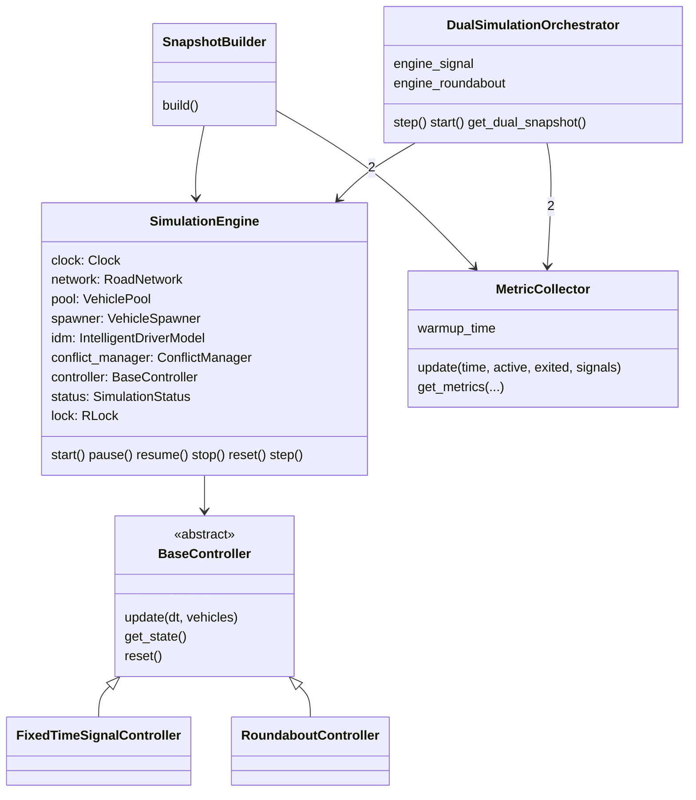

# 02 — Backend Architecture

> **Status:** Current · rewritten 2026-10-05 from the checked-in `backend/src/` tree; rewritten again 2026-10-16 for the layered structure ([ADR-018](../decisions/adr-018-backend-layering-and-resource-routers.md)). The layer rules in §2 are enforced by `backend/tests/test_architecture.py`.
> **Owner:** Viraj Jadhao (simulation, metrics, API)
> **See also:** [00 — System overview](00-system-overview.md) · [Simulation methodology](../simulation/methodology.md) · [API reference](../api/README.md)

The backend is a headless Python 3.11 application. It owns **all** simulation state, every metric and statistic, and all persistence; it emits JSON and never renders anything.

---

## 1. Layers and package map

The backend has four layers. Each package belongs to one of them and imports only from its own layer or the layers below it (§2).

| Layer | Owns | Packages / modules |
| --- | --- | --- |
| **Delivery** (HTTP, WebSocket) | Routes, request models, auth and API-key wiring, error envelope, origin policy, request limits, translating failures into status codes | `main.py` (composition root) · `api/` · every `router.py` / `api.py` inside a feature package |
| **Application** (use cases) | Live sessions, the versioned simulation registry, studies and their jobs, planning, experiments, calibration, uncertainty, run history and reproduction | `live/` · `simulations/registry.py` · `study/` · `planning/` · `experiments/` · `calibration/` · `uncertainty/` · `networks/` · `history/` (reproduce, export) · `replays/` · `suites/` |
| **Domain** (simulation) | The traffic model: geometry, vehicles, conflicts, controllers, metrics, the engine, configuration and scenario rules, strategies and registry, snapshots | `core/` · `strategies/` · `roads/` · `vehicles/` · `intersection/` · `controllers/` · `metrics/` · `scenario/` · `engine/` · `snapshot/` |
| **Infrastructure** | SQLite connection, schema, migrations, DAOs, the ownership rule, CSV safety; each feature's own table in its `store.py` | `database/` · `access.py` · `csv_safety.py` · `calibration/store.py` · `planning/store.py` · `experiments/store.py` |

```
backend/src/
├── main.py                  Composition root: app, middleware, error handler, DB init, router mounting. No routes.
├── api/                     Delivery plumbing shared by every router
│   ├── auth.py              Cognito JWT verification (JWKS), dev bypass, identity dependencies
│   ├── security.py          API_KEY, require_api_key, bearer parsing
│   ├── errors.py            {"error": {code, message, details, timestamp}} envelope, iso_timestamp
│   ├── origins.py           CORS origins (CORS_ORIGINS env) and the WebSocket origin/close helpers
│   ├── ws_origin.py         Which browser origins may open a WebSocket
│   ├── request_limits.py    Body-size middleware, pagination bounds, the synchronous-compute slot
│   ├── validation.py        Configuration and scenario failures worded as HTTP 400s
│   └── meta.py              /health · /api/version · /api/me · /api/users
├── live/                    The live dashboard (/api/simulation/*, /ws/simulation/*)
│   ├── dashboard_config.py  DEFAULT_CONFIG; dashboard payload → engine config; live seeds
│   ├── sessions.py          Per-client LiveSession registry (TTL + cap), session middleware, engine/orchestrator factories
│   ├── capture.py           Exact, reproducible record of a session's run (used when saving a replay)
│   ├── single_vehicle.py    Sprint-2 single-vehicle polling state
│   └── router.py            Live, dual and single-vehicle routes and the two live WebSockets
├── simulations/             The versioned API (/api/v1/simulations, /api/simulation/new, /ws/v1/stream)
│   ├── registry.py          In-memory simulation registry (bounded), assembly, persistence on completion
│   └── router.py            Lifecycle, metrics, history, report routes; config/scenario validate + compile
├── study/                   Volume sweeps, Monte Carlo validation, control comparison, jobs, reports
│   ├── limits.py            Study workload bounds (duration, rates, seeds, time step, batch size)
│   ├── router.py            /api/v1/study/* (synchronous and job routes)
│   └── volume_sweep.py · validation.py · control_comparison.py · runner.py · jobs.py · batch.py · …
├── replays/router.py        /api/v1/replays: saved live runs (+ their simulation_runs record)
├── suites/router.py         /api/suites: scenario suites, batch experiments, CSV export
├── history/                 /api/v1/study/history/runs: stored runs, labels, export, compare, reproduce
├── calibration/             V1.8 /api/v2/calibration: observed data vs simulated (store.py: its table)
├── networks/                V1.9 /api/v2/networks: multi-junction description (stateless)
├── planning/                V2.0 /api/v2/planning: service.py (orchestration) · store.py (its table) · runner, findings, report
├── experiments/             V3.0 /api/v3: preparation.py (validate + cost bounds) · service.py · store.py · router.py
├── uncertainty/             V3.0 uncertainty spec, seeded sampler, analysis (pure computation)
├── core/                    Leaf kernel: enums, clock, limits, schema loader, config models, speed thresholds, provenance
├── strategies/              Strategy descriptors, built-in registry, compatibility validator, resolution contracts (ADR-014)
├── roads/                   RoadNetwork, lanes, approaches, junction geometry, lane configuration
├── vehicles/                Vehicle, IDM, spawner, router (leader finding), lane change, speed profile, vehicle types,
│                            virtual obstacles (zero-speed leaders at stop and give-way lines)
├── intersection/            Conflict manager (signal) and predictive conflict resolver
├── controllers/             BaseController, fixed-time, adaptive, roundabout, stop-line detection,
│                            factory.py (create_controller, derive_signals_state)
├── metrics/                 MetricCollector, efficiency score, definitions/
├── scenario/                documents.py (V1.4 scenario documents: parse, validate per strategy, compile) ·
│                            config_validation.py · lane_validation.py (rules the JSON schema cannot express)
├── engine/                  simulation_engine.py (tick loop, lifecycle, lock) · vehicle_pool.py (moves every vehicle
│                            through the conflict layers, collision audit) · deadlock_detector.py ·
│                            tick_callback.py (feeds a collector) · readout.py (metrics under the engine lock)
├── snapshot/                SnapshotBuilder, SnapshotBuffer, DualSimulationOrchestrator
├── database/                db.py (schema, WAL, migrations) · dao.py · replay_dao.py
├── access.py                Who may see a stored record (one ownership rule)
└── csv_safety.py            Spreadsheet-formula neutralisation for exports
```

---

## 2. Dependency direction



Inside the domain each package imports only packages below it: {`core`, `strategies`} → `roads` → `vehicles` → `intersection` → `controllers` → `metrics` → {`scenario`, `engine`} → `snapshot`. `core/` and `strategies/` share rank 0 (leaf packages with no domain dependencies). `scenario/` and `engine/` are siblings and never import each other: the engine runs a compiled configuration and knows nothing of scenario documents.

Rules, each checked by `backend/tests/test_architecture.py`:

- **The simulation domain is a strict stack** (the order above); there are no cycles inside the model.
- **The domain imports no web framework or database library**, and nothing from the application or delivery layers.
- **Nothing imports `main.py`.** It only assembles the app. The one exception is the developer tool `experiments/export_schemas.py`, which imports the app lazily to snapshot its OpenAPI document; it never runs in the server.
- **Routers hold no SQL, and SQL lives only in `database/` or a feature's `store.py`.** Routers call DAO or store methods; ownership checks go through `access.py`.

Rules kept by review:

- **Routes translate; they do not decide.** A router parses the request, calls an application function or the registry, and maps failures to status codes. Configuration rules live in `scenario/` and `core/schema.py`; `api/validation.py` only words their failures as 400s, once, for every route.
- **Application code does not import the delivery layer.** A value the delivery layer owns (such as the request-body cap reported by `/api/v3/capabilities`) is passed in by the router.
- **The engine has no strategy-specific branches.** `SimulationEngine.step()` calls `controller.update()` through the `BaseController` interface; `controllers/factory.py` chooses the class from `geometry.intersectionType` and `controller.signalControl`.
- **Controllers act only through virtual obstacles** (and roundabout speed caps), so vehicle physics is shared by every strategy.
- **Metrics read state; they never change it.** Safety measures (TTC/PET) are observation-only by construction. Reading an engine's metrics from outside its tick goes through `engine/readout.engine_metrics`, which holds the engine lock.
- **Routers are module-level `APIRouter`s** importing `api/security.py` and `api/auth.py` directly. `planning/router.py` and `experiments/router.py` keep a `create_router(...)` factory because their tests mount them with an injected service and user.

Deliberate exceptions:

| Exception | Why |
| --- | --- |
| `live/dashboard_config.py` raises `HTTPException(400)` and `live/sessions.py` holds the session middleware | The dashboard payload's error messages are part of its HTTP contract and come from the same function for the live session, the reliability check and suite batches (and are recorded verbatim as a background job's error). Translating at each caller would triple the wording. |
| `study/router.py` and `suites/router.py` import `live/dashboard_config.py` | A reliability check and a suite batch repeat exactly the scenario the dashboard ran, so they compile it the same way. |
| `experiments/export_schemas.py` imports `src.main` | Developer tool that snapshots the v3 OpenAPI document; allow-listed in the architecture test. |

---

## 2a. How a request reaches the simulation



Studies take the same path through a different application module: `study/router.py` → `study/volume_sweep.py` / `validation.py` / `control_comparison.py` → `study/runner.py` (worker processes, `STUDY_WORKERS`) → the same engine, persisted through the DAOs. The `/api/v1/study/*/jobs` routes wrap the same function in `study/jobs.py` and return a job id. The live dashboard goes `live/router.py` → `live/sessions.py` (the caller's `LiveSession`) → `SimulationEngine` or `DualSimulationOrchestrator`, streamed by the `/ws/simulation/*` handlers. Planning and experiments go router → `service.py` (validation in `preparation.py` for experiments) → `study/control_comparison.py` / `uncertainty/runner.py` → the engine, with records kept by their `store.py`.

## 3. Runtime objects



`engine/tick_callback.build_tick_callback()` wires a collector (and, for the versioned API, a snapshot buffer) to an engine, so the same per-tick metric update runs in live sessions, versioned simulations and studies.

---

## 4. Key design decisions

| Decision | Why | Where |
| --- | --- | --- |
| Controller before physics in each tick | Signal changes and refused gaps take effect immediately | `engine/simulation_engine.py` |
| Re-entrant engine lock held for the whole tick | Readers never see a torn tick; callbacks may re-enter | `SimulationEngine.lock` |
| Private RNG per engine; seed written back to config | Determinism and complete provenance | `vehicles/spawner.py` |
| Lockstep dual orchestrator with one seed | Fair comparison: same arrivals for both strategies | `snapshot/dual_orchestrator.py` |
| Backend is the only metric authority | Live, saved, exported and study numbers agree | ADR-005, `metrics/collector.py` |
| Studies in worker processes | Heavy studies do not block the API or live streams; results equal sequential runs | `study/runner.py` |
| Live sessions keyed per client | One visitor cannot reset another's simulation | `live/sessions.py` `LiveSession` |
| SQLite with in-place column migrations | Zero-ops persistence; older databases upgrade on start | `database/db.py`, each `store.py` |
| Layered domain with an enforced import order | The model can be read and changed bottom-up without cycles | `tests/test_architecture.py` |

The full decision record: [decisions](../decisions/README.md).

---

## 5. Extending the backend

| To add… | Touch | Keep invariant |
| --- | --- | --- |
| A control strategy | A new `BaseController` subclass in `controllers/`; select it in `controllers/factory.py` (`create_controller`, and `derive_signals_state` if it shows signals); add it to the schema enum and, for scenario documents, to `scenario/documents.py` (`STRATEGIES`, `JUNCTION_STRATEGY`, compilation). V1.3's adaptive signal is the worked example: it subclasses `FixedTimeSignalController` and is chosen by `controller.signalControl`. | Engine loop unchanged; metrics unchanged; same-seed runs of existing strategies unchanged |
| A metric or analysis | A module in `metrics/definitions/`, wired into `MetricCollector.get_metrics()`; describe it in `frontend/src/metrics/catalog.ts` (`metricCatalog.test.ts` enforces this) and the metrics reference. Study-level analyses (across seeds or demand) go in `study/`, `planning/` or `uncertainty/` and read `get_metrics()` output. | Warm-up convention; backend-only computation; observation never changes state |
| A configuration rule | `scenario/config_validation.py` (cross-field) or `scenario/documents.py` (scenario documents); every route reports it through `api/validation.py`. | Same message on every route |
| An application workflow | A function in the owning application package (`study/`, `planning/`, …) that takes plain arguments and returns plain data; long runs take a `progress` argument so `study/jobs.py` can run them in the background. | No FastAPI imports; deterministic for a given seed |
| An API route for an existing capability | The owning package's `router.py` (a module-level `APIRouter`), with its request models beside the routes; `Depends(require_api_key)` for anything that mutates or computes, `get_current_user_id` for owned resources, `compute_slot` for synchronous simulations; `api/validation.py` for configuration errors. Mount a new router in `main.py`. | The error envelope (raise `HTTPException`); auth coverage like `tests/api/test_v2_route_auth.py` for `/api/v2` and later |
| A vehicle type | `vehicles/vehicle_types.py`, `vehicles/spawner.py`, snapshot vehicle fields, `core/config_models.py` + `config.schema.json` | Same-seed comparison still gives both strategies identical vehicles |
| Persistence | A DAO method in `database/` for shared tables, or the feature's `store.py` for its own; schema changes as in-place, additive migrations | Older databases upgrade on start; routers never hold SQL |

---

## 5a. Remaining architectural debt

- Several `collector.get_metrics(...)` call sites (`calibration/simulate.py`, `study/runner.py`, `study/validation.py`, `snapshot/builder.py`, `simulations/registry.persist_completed_run`) repeat the argument list of `engine/readout.engine_metrics` without taking the engine lock; they run inside the tick or single-threaded, so their locking was deliberately left unchanged.
- The domain's largest modules (`controllers/roundabout.py`, `intersection/predictive_conflicts.py`, `roads/network.py`, `intersection/conflict_manager.py`) are each one cohesive model and were not split; splitting them would mean touching numerical code for no structural gain.

---

## 6. Testing

See [Testing](../testing/README.md). Every package above has a matching directory under `backend/tests/`; `tests/test_architecture.py` checks the layer rules; full-strength simulation sweeps are marked `slow` and run nightly.
