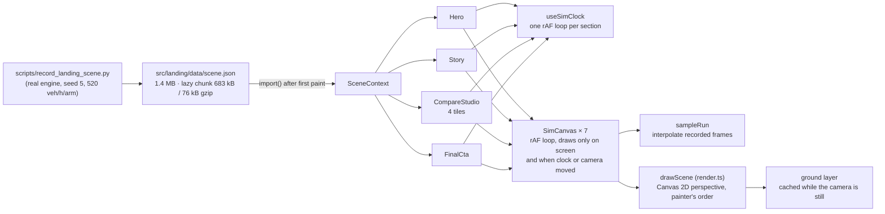

# Architecture audit

Audit of the architecture as found in the code on 2026-10-29 (`eb01213`,
branch `viraj-dev`). The authoritative architecture documents are
[docs/architecture/](../architecture/) (00 system overview, 02 backend,
03 frontend, 04–08 contracts); this file does not repeat them. It records what
was checked against the code, where the documents and the code disagree, and
the parts of the system the documents do not yet describe.

## 1. What exists

| Area | Entry point | Verified how |
| --- | --- | --- |
| Backend API (FastAPI) | `backend/src/main.py` composition root | Package layout read; dependency rules are enforced by `backend/tests/test_architecture.py` (not re-run in this pass) |
| Simulation core | `backend/src/engine/simulation_engine.py` | Not re-read in this pass |
| Landing page | `frontend/index.html` → `src/landing/main.tsx` | Read in full (scene, renderer, sections) |
| Dashboard SPA | `frontend/app.html` → `src/main.tsx` | Entry read; routes listed in nginx and `src/routing.ts` |
| Edge (nginx) | `frontend/templates/default.conf.template` | Read in full |
| Containers | `backend/Dockerfile`, `frontend/Dockerfile`, `docker-compose*.yml` | frontend Dockerfile read; others not yet |
| CI | `.github/workflows/ci.yml`, `docker.yml`, `deploy.yml` | `ci.yml` read in full |
| Contracts | `shared/schemas/*.json` | Validated by `scripts/validate_schemas.py` in CI |
| Python SDK | `sdk/python/urbanflow_client` | Not yet read |
| Legacy prototype | `landingpage/` (pnpm workspace) | Manifest read; not built, deployed or referenced |

The production topology in `docs/architecture/00-system-overview.md` §1 (nginx
container serving two documents and proxying `/api`, `/ws`, `/health` to one
FastAPI container on SQLite/WAL) matches the nginx template and the frontend
Dockerfile.

## 2. Landing-page runtime (not covered by 03-frontend-architecture.md)

The cinematic landing page added in `3568a39` replays recorded engine runs;
nothing is simulated in the browser.

Costs that follow from this design, measured in
[PERFORMANCE_BASELINE.md](PERFORMANCE_BASELINE.md): every visible canvas
redraws at display rate while its clock plays, and each redraw traces several
hundred paths (≈50 buildings and ≈40 vehicles as extruded boxes, plus the
ground). The page holds four replay clocks and seven canvas loops.

## 3. Coupling and boundaries checked

- Landing ↔ dashboard: the landing imports only `routing.ts` (URLs),
  `theme/mode`, and two UI components (`UrbanFlowLogo`, `RouteLoader`) from the
  dashboard tree; it never imports services or API clients. Verified by reading
  the landing imports.
- Backend layering is machine-checked (`test_architecture.py`); its rules are
  listed in 02-backend-architecture.md §2.
- No circular dependency was introduced by this pass: the only new import
  edges are `Hero.tsx`, `Story.tsx` and `CompareStudio.tsx` → `scene/clock.ts`
  (`useOnScreen`) and `SimCanvas.tsx` → `render.ts` (`createGroundLayer`),
  both within `src/landing/`, both pointing at modules that import neither.

## 4. Where documents and code disagree

| Document | Says | Code | Action |
| --- | --- | --- | --- |
| `scripts/README.md` | 7 scripts | 20 scripts | Fixed in checkpoint 2 (F-09) |
| `README.md`, `10-repository-bootstrap.md` | Node 20 / 18+ | Vite 8 and ESLint 10 need ≥ 20.19; image builds on Node 26 | Fixed: Node 24+, CI on 26 (F-07) |
| `shared/README.md` | 11 schemas | 13 schemas | Fixed (F-29) |
| `README.md` stack table | Python 3.11 runtime | CI and the backend image use 3.11; a local `backend/.venv` may be newer | None — the documented runtime is the deployed one |
| `03-frontend-architecture.md` | No description of the landing scene pipeline | §2 above | Fold §2 into 03 once the landing work settles |

## 5. Audit coverage

Checkpoint 2 read the request boundary in full (`main.py`, `access.py`,
`csv_safety.py`, `api/`, `database/db.py`) and every SQL construction site,
the CI/CD, container, script, schema and SDK files, and the legacy prototype;
all backend source was swept with bug and security lint rules
(`ruff --select B,S,ASYNC,BLE,PERF,…`), with the findings triaged in
REFACTOR_FINDINGS.md. The simulation domain packages (`core`, `roads`,
`vehicles`, `intersection`, `controllers`, `metrics`, `engine`), the
application packages, the backend tests, the dashboard components and most
docs are still to be read; the completion audit tracks them.

Checkpoint 3 read the simulation core (`core/`, the lane model, the vehicle
model, IDM and stochastic IDM, spawner, engine and pool loop). Facts that
constrain any change there:

- One step is: clock tick → spawner → controller update → pool update →
  tick callbacks (metrics, snapshots, deadlock detector), all under the engine
  lock.
- The pool update is sequential (Gauss–Seidel): for each active vehicle in
  order it may start a lane change, finds its leader, and moves; later
  vehicles see earlier ones already moved. Predictive braking limits are the
  exception, computed once per tick from the pre-update state.
- With `unstructuredTraffic` the spawner and the stochastic IDM share one
  random stream; anything that resets one must keep them shared (F-35).
- Determinism guards: golden roundabout fingerprints, the leader-trace pins
  (`tests/vehicles/test_leader_trace_pins.py`), `tests/core/test_determinism.py`
  and the engine reset tests.

Checkpoint 4 additions:

- Every class in the simulation domain that keeps run state clears it in
  `reset()` (checked by script and by hand); the engine reset now reproduces a
  fresh run for every control strategy (`test_reset_matches_fresh_run.py`).
- Driver models: a vehicle with a class profile drives its class's own IDM;
  the engine-wide model is used only for vehicles without a profile. Since
  checkpoint 5, `unstructuredTraffic` makes both stochastic (each class around
  its own parameters, one random stream); before, it was inert under a
  vehicle mix (F-38).
- Routes are always incoming lane → connection lane → exit lane, built by
  `RoadNetwork.generate_route` and continuous at both joins; turns into a
  missing arm are stopped by `validate_scenario`, not by the network (F-39).
- Signal phases: every phase whose time is used up ends in the same tick, so a zero-length phase is never shown (F-40, checkpoint 5); entry metering omits zero-length phases from its plan.
- Delay metrics average exited vehicles only (F-41).

Checkpoint 6 additions (controllers, conflict layers, metrics and geometry
read in full):

- Controller composition: the metered roundabout owns a plain
  `RoundaboutController` and passes its gate in; each tick it advances the
  phase cursor, lets the queue cap end a green early, applies spillback holds,
  records gate transitions, and only then runs the roundabout, whose own rules
  decide first (the gate can only add a yield). Exit-zone stop limits reach
  the pool through `vehicle_stop_limits` on either controller.
- Three arbitration layers, one per junction: at a signal the phase plan and
  `ConflictManager` (all-or-nothing admission over conflict points sampled on
  the real paths); at a roundabout the controller's gap acceptance, with the
  predictive layer arbitrating only vehicles already inside (and entry too on
  two-ring roundabouts). `find_leader` handles following everywhere.
- Collision accounting: the post-update audit skips pairs that share a lane, a
  street or any route lane, so it can only see crossing contacts;
  `tests/engine/test_no_hidden_overlaps.py` checks every pair in two busy runs
  (F-37). A counted contact stops the slower vehicle.
- Metric populations are tabulated in REFACTOR_FINDINGS.md (F-41,
  checkpoint 6); per-call cost of `get_metrics()` grows with exited vehicles
  (F-43).

Checkpoint 7 additions (snapshots, strategies, scenarios, vehicles):

- Trust boundary for scenarios: `validate_scenario` (strict document model,
  then per strategy the JSON schema and `semantic_config_errors`, including a
  finiteness check over the whole config). `compile_scenario` assumes a valid
  document. 304 random valid documents (three junction types, missing arms,
  skew, mixes, metering, zero all-red) compiled and ran without an exception,
  with strict-JSON snapshots.
- Strategy selection: `create_controller` → `resolve_strategy` (compatibility
  check, then a declared name if any, else structural inference). The live
  comparison derives each strategy's config and verifies it resolves back to
  that strategy; declared names in the source are ignored there (F-49).
- Snapshot consistency: one engine's snapshot is built under its lock, so it
  is one tick; a comparison frame is built under the orchestrator lock as well
  (F-51), the same lock order the stepping loop uses.
- Demand admission: the spawner holds one blocked arrival per approach and
  generates none behind it, so offered demand beyond what the entries accept
  is dropped (F-50); metrics see admitted vehicles only.
