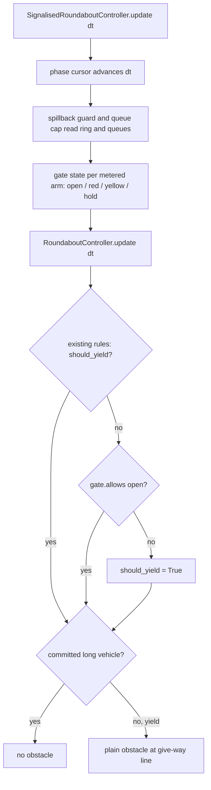

# V3.0 W2 — Signalised roundabouts (`metered_entry`): implementation plan

> **Status:** PLAN, 2026-10-19. The product owner accepted [ADR-014](../decisions/adr-014-strategy-registry-and-entry-gate-seam.md) (D-W2-0) and approved "every recommended option for D-W2-0 to D-W2-9". The decision table (§4) was first written down in this document **after** that approval, so D-W2-1 … D-W2-9 are **awaiting reconfirmation** against §4 (the S1 decisions D-S1-1 … 3 in §4.1 are approved); no step that depends on them (S2 onward) starts before that. Issue [#163](https://github.com/Viraj281105/Traffic-Simulation/issues/163). **No gate in §12 is passed by this document.**
> **Normative sources (in order):** [`docs/ROADMAP.md`](../ROADMAP.md) §7 · [ADR-014](../decisions/adr-014-strategy-registry-and-entry-gate-seam.md) · [strategy §13.3](../roadmap/V3_PRODUCT_STRATEGY.md#133-signalised-roundabouts-committed-flagship) (D-SR1) · [sprint plan §3.3 and §4 (G-SR)](../roadmap/V3_WEEKLY_SPRINT_PLAN.md#33-w2--fri-6--thu-12-nov-signalised-roundabouts-flagship). This file is an engineering plan subordinate to them; it is not a second roadmap.
> **Repository baseline:** `viraj-dev` at `e43bfec`, clean, level with `origin/viraj-dev` (checked 2026-10-19).

Labels used below: **[A]** approved requirement (source cited) · **[P]** engineering proposal, not part of the normative sources; those that depend on D-W2-1 … 9 (§4) are not approved until the PO confirms them · **[U]** unverified estimate/target.

---

## 1. Requirements and traceability

| ID | Requirement | Source | Status | Verification |
| --- | --- | --- | --- | --- |
| SR-01 | `SignalisedRoundaboutController` built by **composition**: owns a `RoundaboutController` and a phase engine; no subclassing, no multiple inheritance, no `isinstance` ladders | ADR-014 §5; strategy §13.3 | A | Code review; architecture test that the new controller does not subclass `RoundaboutController` |
| SR-02 | One narrow seam: `EntryGate.allows(approach, lane, now) -> GateDecision`, consulted where the roundabout decides whether a head vehicle may proceed | ADR-014 §5 | A | Unit tests on the seam; review of the single call site |
| SR-03 | Default gate `AlwaysOpen` | ADR-014 §5 | A | Unit test |
| SR-04 | **Bit-identity:** with `AlwaysOpen` the conventional roundabout has the same metric and snapshot fingerprints as the unmodified code | ADR-014 §7; strategy §13.3; sprint §3.3 Quality; sprint §7 "never cut" | A | Golden-fingerprint test (S1): **exact** raw-bit pins per pinned environment + **portable** pins in every environment (§13 S1); fast subset + slow corpus |
| SR-05 | Touching `controllers/roundabout.py` requires SR-04 **and a recorded reason** | ADR-014 §7; sprint §1.5 | A | Reason recorded in `docs/simulation/methodology.md` and the commit message |
| SR-06 | Mode `metered_entry`: the signal decides only whether a vehicle may proceed to the yield line; gap acceptance, exit-yield and keep-clear stay in force; red only removes entry opportunities | ADR-014 §6; strategy §13.3 | A | Structural (gate consulted only after the roundabout's own decision) + collision tests |
| SR-07 | `phased_priority` not implemented | ADR-014 §6; strategy §13.3; sprint §3.3 "Carried forward" | A | Validation rejects any other mode |
| SR-08 | Phase engine reuses the existing `Phase` structure | ADR-014 §5; strategy §13.3 | A | Import of `controllers.fixed_time_signal.Phase` |
| SR-09 | Phase plan: entries grouped into phases; each phase has minimum green, yellow, all-red, maximum green | strategy §13.3 | A | Config model + validator tests |
| SR-10 | Plan validated: every metered entry in ≥ 1 phase; no entry has zero green; cycle ≥ sum of minimums | strategy §13.3 | A | Validator unit tests, one rejecting test per rule |
| SR-11 | Optional queue-aware spillback guard: hold red on an upstream entry when the ring/downstream exit queue exceeds a declared threshold | strategy §13.3 | A (concept) / P (measure, D-W2-5) | Unit + integration tests |
| SR-12 | Optional per-entry queue cap shortens red for a long queue within bounds | strategy §13.3 | A (concept) / P (semantics, D-W2-4) | Unit + integration tests |
| SR-13 | Gate returns a decision with reason ∈ {`red`, `yellow`, `ring_spillback_hold`, `queue_cap`}; recorded as decision events in controller state | strategy §13.3; sprint §3.3 Minor; strategy §16 cand. 6 | A | Unit tests on events; snapshot contract test |
| SR-14 | Bounds on all new inputs (green/yellow/all-red/cycle/queue thresholds) | sprint §3.3 Security | A (bounds exist) / P (values, §5.3) | Validator tests at each bound |
| SR-15 | Phase-plan validator fuzz: **≥ 10,000** random plans, none crash, invalid ones rejected **with a code** | sprint §3.3 Security | A | Seeded fuzz test (fast CI) |
| SR-16 | No new network surface | sprint §3.3 Security | A | OpenAPI route list unchanged (existing route-auth tests) |
| SR-17 | Collision = 0 (`VehiclePool.collision_count`) across a seed × demand matrix; no increase over the baseline | strategy §13.3; sprint §3.3; G-SR | A (criterion) / P (matrix, §7) | Slow shard |
| SR-18 | No deadlock | strategy §13.3; G-SR | A (criterion) / P (detector, D-W2-9) | Slow shard, discharge-based |
| SR-19 | Starvation property: no metered entry waits longer than `maxRed + yellow + allRed` | strategy §13.3; sprint §3.3; G-SR | A (formula) / P (definition, D-W2-3) | Property test (fast) + slow runs |
| SR-20 | Ring-blocking events not above the conventional baseline | strategy §13.3; G-SR | A (criterion) / P (event definition, D-W2-9) | Slow shard |
| SR-21 | Low-demand mean delay vs conventional within a declared tolerance — **a reported finding, not hidden if it fails** | strategy §13.3 | A (finding, not a gate) / P (tolerance) | Baseline study report |
| SR-22 | Layouts: 3-arm, 4-arm, ring lanes, multi-lane approaches | strategy §13.3; sprint §3.3 | A / **discrepancy D-W2-7** (ring lanes 1–2, not 1–3) | Slow shard |
| SR-23 | Baselines through the paired-comparison machinery: conventional roundabout, fixed-time and adaptive signalised intersection | strategy §13.3; sprint §3.3 Major | A | Baseline study through the planner (`AlternativeSpec.patch`) |
| SR-24 | Runtime and memory per simulated second vs conventional; target **≤ 1.3×**, unverified | strategy §13.3; sprint §3.3 | A (measure) / U (target); G-SR needs it **recorded** | Benchmark script output |
| SR-25 | Slow CI job added | sprint §3.3 Quality; strategy §13.3 | A | `ci.yml` matrix + `tests/test_ci_slow_matrix.py` |
| SR-26 | `docs/simulation/signalised-roundabout.md`: movement/phase model, right-of-way modes, claims, limitations (no real-world calibration, no PET on curved paths) | sprint §3.3 Documentation; strategy §13.3 Limitations | A | Doc review |
| SR-27 | Minimal entry-control selector in the scenario setup (frontend) | sprint §3.3 Minor | A | Vitest + axe |
| SR-28 | Signal states on the canvas; demo with three strategies and the limitations banner; no `high`-aggression claim | sprint §3.3 Demo | A | Recorded demo |
| SR-29 | Weekly gate: new tests green, existing suites green, schema/OpenAPI parity, axe clean on new screens, limitations paragraph, recorded demo | sprint §1.5 | A | Gate evidence (§11) |
| SR-30 | Schema changes additive; contract changes ship with a schema diff and a test feeding the new shape (incl. absence) to every consumer | sprint §1.3, §1.5; ADR-013 | A | Parity tests |
| SR-31 | Pre-existing determinism/reproduction tests stay green and **unmodified** | sprint §1.5 | A | `git diff` on those files is empty |
| SR-32 | Coverage floor 85 % retained | strategy §17; `backend/pyproject.toml` | A | Fast CI |

---

## 2. Current architecture and integration map (verified in source)

| Path / symbol | Today | W2 change | Why here |
| --- | --- | --- | --- |
| `backend/src/controllers/roundabout.py` `RoundaboutController.update` (decision at the `should_yield` block, then `lane.virtual_obstacle`) | ≈ 1,250 lines; per entry lane computes `should_yield` from circulating gap, follow-up time, long-vehicle mouth, earlier neighbour, merging entry, keep-clear; a committed long vehicle overrides; sets a plain `VirtualObstacle(position=lane.length)` | **Only change:** optional constructor argument `entry_gate` (default `AlwaysOpen`); after the existing rules and **before** the committed-long-entry override, `if not should_yield and not gate.allows(d, lane, now).open: should_yield = True` | The single point ADR-014 names; keeps every existing rule untouched |
| `controllers/fixed_time_signal.py` `Phase` | Phase descriptor (`name`, `directions`, `allowed_turns`, `duration`, `color`) | Imported, not modified | SR-08 |
| `FixedTimeSignalController.update/_apply_signals/_mark_lane_use` | Advances the cursor **and** writes lane obstacles and lane use | **Not reused as an object** (it would overwrite the roundabout's obstacles and change lane use); its carry-over cursor arithmetic is reproduced in a small new phase cursor | Keeps fixed-time results untouched |
| new `controllers/entry_gate.py` | — | `GateDecision`, `EntryGate` protocol, `AlwaysOpen` | Seam has no dependency on signals |
| new `controllers/entry_metering.py` | — | Plan model/resolver, phase cursor, `MeteredEntryGate`, spillback guard, queue cap, decision-event log | Testable without a simulation |
| new `controllers/signalised_roundabout.py` | — | `SignalisedRoundaboutController(BaseController)` composing the two | SR-01 |
| `controllers/factory.py` `create_controller` | Branch on `intersectionType` | `roundabout` + `controller.entryControl == "metered_entry"` → new controller; otherwise unchanged | Existing factory pattern (decision D8, decisions README) |
| `factory.derive_signals_state` | `isinstance(FixedTimeSignalController)`, else all green | Metered controller exposes `signals_state()`; derive uses it when present (duck-typed), metered entries real colours, others green (D-W2-6) | Feeds `MetricCollector` (idle loss) and `history/reproduce.py` identically |
| `snapshot/dual_orchestrator.py` `DualSimulationOrchestrator.__init__` (used by `study/runner.py` `simulate_geometry`, i.e. every planner and Robustness Lab run) | **Rebuilds** the roundabout `controller` section from a fixed key list (radii, `criticalGap`, `followUpTime`, speeds) | Carry `entryControl` and `entryMetering` across when the source sets them; absent ⇒ the identical dict as today (found 2026-10-19 during S1) | Without it a metered alternative would silently run as a conventional roundabout (hazard H12) |
| `engine/vehicle_pool.py` `single_ring_roundabout` | Keyed on `intersectionType == "roundabout"` | None — the type stays `roundabout` (D-W2-1) | Avoids changing the predictive layer |
| `vehicles/router.py` `commits_through_yellow` | Dilemma-zone rule for `is_yellow` obstacles | Reused by the gate to decide yellow commitment; the roundabout never receives an `is_yellow` obstacle | Keeps the long-vehicle latch (`_note_long_entries` needs `virtual_obstacle is None`) working |
| `core/config_models.py` `ControllerSection` | Pydantic, unknown keys **ignored** on dump | Add `entryControl`, `entryMetering` | Otherwise `model_dump` would silently drop them |
| `shared/schemas/config.schema.json` controller | `additionalProperties: false` | Add the two properties | Shared contract |
| `scenario/config_validation.py` | String error lists; `_signal_control_errors` pattern | `_entry_control_errors` using the pure validator | Same path as the dashboard and versioned API |
| `scenario/documents.py` `RoundaboutSpec`, `compile_scenario`, `scenario_fingerprint` | Strategy-neutral document; unset optional fields popped from the fingerprint | `roundabout.entryControl` (optional); compiled into `controller` for the `roundabout` strategy only; popped from the fingerprint while unset | Old documents keep their fingerprints |
| `shared/schemas/v2/planning-study.schema.json`, `v3/experiment.schema.json` | Embed the document shape | Add the field | SR-30 |
| `planning/alternatives.py` `DefaultStrategyAlternatives`; `STRATEGIES` | One alternative per strategy | **Unchanged** (D-W2-1): a metered alternative is `strategy: "roundabout"` + `patch` | Default studies and `/capabilities` unchanged |
| `snapshot/builder.py` + `shared/schemas/snapshot.schema.json` controller | `type` ∈ {fixed_time_signal, roundabout}; no `additionalProperties: false` | Additive `entryControl`, `metering` object; `type` stays `roundabout` | Frontend roundabout paths unchanged |
| `engine/deadlock_detector.py` | Runs only for unstructured traffic; flags > 4 vehicles stopped > 5 s | Not used for SR-18 (would flag every red queue) (D-W2-9) | — |
| `roads/lane_config.py` `MAX_CIRCULATING_LANES = 2` | Three-lane rings rejected | None (D-W2-7) | — |
| `frontend/src/types/simulation.ts` `RoundaboutControllerState` | V1.4 fields | Optional `entryControl`, `metering` | Absent ⇒ conventional |
| `frontend/src/components/RoundaboutMap.tsx` `drawEntryYieldSigns` | Yield signs and give-way lines | Signal head beside the yield sign on metered arms only | Conventional rendering untouched |
| `frontend/src/components/IntersectionMap.tsx` `drawSignals` | Signal heads | Visual vocabulary reused (colour mapping, sizing) | Consistency |
| `frontend/src/components/scenario/AdvancedSettings.tsx` | Roundabout design fields | Entry-control selector + minimal plan editor | SR-27 |
| `.github/workflows/ci.yml` `backend-slow-tests` | Explicit per-file matrix; enforced by `tests/test_ci_slow_matrix.py` | New `signalised-roundabout` entry | SR-25 |

---

## 3. Controller and simulation design

### 3.1 Seam

```python
@dataclass(frozen=True)
class GateDecision:          # [P] field shape; ADR fixes only the signature and reasons
    open: bool
    reason: Optional[Literal["red", "yellow", "ring_spillback_hold", "queue_cap"]] = None

class EntryGate(Protocol):
    def allows(self, approach: Direction, lane: Lane, now: float) -> GateDecision: ...

class AlwaysOpen:            # stateless, draws no random numbers
    def allows(self, approach, lane, now): return OPEN   # module-level constant
```

Consulted once per entry lane per tick, only when the roundabout's own rules would let the head proceed. With `AlwaysOpen` the result is always open, so no branch, float operation or random draw changes — the structural basis of SR-04 (the test is still required).

### 3.2 Control flow



### 3.3 Signal semantics at the metering line

* **Stop line = give-way line** (`lane.length`), D-W2-2. No geometry change.
* **Green:** gate open; the roundabout decides as today.
* **Yellow:** the gate evaluates the head vehicle with `commits_through_yellow` against a virtual yellow line at `lane.length`. Committed ⇒ open, latched for that vehicle id until it leaves the lane (so red onset cannot brake it across the line); otherwise closed with reason `yellow`.
* **Red / all-red:** closed, reason `red`. Unmetered arms: always open.
* A long vehicle already across the line keeps the existing committed-entry override, which wins over the gate.
* Metering is per arm (all lanes of a metered arm share a colour) [P]; `lane` in the signature is kept for later per-lane control.

### 3.4 Phase engine

Cursor over `Phase` objects: for each plan phase, `green` (scheduled duration), then `yellow`, then `allRed`; carry-over arithmetic as in `FixedTimeSignalController.update` (`time -= duration`); optional `offset` applied at reset. No randomness.

### 3.5 Spillback guard (D-W2-5) and queue cap (D-W2-4)

* **Guard:** for each metered arm, count ring vehicles with speed < 2.0 m/s (`_KEEP_CLEAR_SPEED`) in the ring sector from that entry to the next exit downstream. When that count is at or above `ringStoppedThreshold` while the arm would be green, keep it red (`ring_spillback_hold`), for at most `maxHold` seconds per cycle. Exit lanes are sinks today, so the exit queue is not measured in v1 (documented limitation).
* **Queue cap:** optional, off by default. When a red metered arm's standing queue reaches `vehicles` and the current green phase has run at least its `minGreen`, that green ends early (yellow, then all-red, then the next phase), and the event is recorded with reason `queue_cap`. The queue cap can only shorten red; it never extends a phase.
* Interaction: the guard can only add red; the existing keep-clear, exit-zone and congestion taper rules are untouched. A red queue will latch the roundabout's own `_update_congestion` state. That is intended realism, documented, and visible only in metered mode.

### 3.6 Decision events

Recorded on **transitions** of each arm's gate state (start/end, reason, time, arm), not per tick: a bounded list of recent events (50) plus run counts by reason in `get_state()` (mirrors the adaptive controller's `recentDecisions`/`decisions`) [P].

### 3.7 Determinism

No new random stream; the gate and guard read state only. The conventional path is unchanged by construction and by SR-04. Paired runs share the arrival stream exactly as conventional-vs-signal comparisons do today.

---

## 4. Decisions (D-W2-0 accepted 2026-10-19; D-W2-1 … 9 awaiting reconfirmation)

| # | Decision | Recommended option | Alternatives |
| --- | --- | --- | --- |
| **D-W2-0** | ADR-014 status and D-SR1 | ADR-014 **Accepted** 2026-10-19; D-SR1 confirmed (`metered_entry` committed, `phased_priority` stretch) | — |
| **D-W2-1** | How `metered_entry` is selected | `intersectionType` stays `roundabout`; engine field `controller.entryControl: "metered_entry"` + `controller.entryMetering`; document field `roundabout.entryControl`; **no new value in `STRATEGIES`**; comparisons use `strategy: "roundabout"` + `patch` | New strategy `signalised_roundabout` (would change the default planner alternatives and `/capabilities`; naming deferred to the W3 registry) |
| **D-W2-2** | Metering stop-line position | Coincides with the give-way line | Upstream setback (new geometry, two stopping points, map changes) |
| **D-W2-3** | Starvation definition | Measured as continuous **signal-denied** time on a metered arm with a vehicle at the line (gap-acceptance waits excluded: they are unbounded in the conventional roundabout too). `maxRed` = the arm's planned red + `maxHold`, so the guard cannot break the bound | Excluding hold time from the property; asserting only with the guard off |
| **D-W2-4** | Queue-cap semantics | Optional, off by default; early end of the current green at its `minGreen` (§3.5) | Gate-local early green outside the plan; deferring to W3 |
| **D-W2-5** | Spillback measure | Stopped ring vehicles in the downstream sector (§3.5); threshold in vehicles | Ring occupancy fraction; exit-lane queues |
| **D-W2-6** | Signal colours reported to metrics | Real colours for metered arms, green for unmetered (idle-loss becomes meaningful for metered runs only) | All green, as for the conventional roundabout |
| **D-W2-7** | Ring-lane range (sprint plan says 1–3) | **1–2 ring lanes** (code: `MAX_CIRCULATING_LANES = 2`, three-lane rings rejected since V1.4); approaches 1–3 lanes | Validating three-lane rings in W2 (out of scope, physics work) |
| **D-W2-8** | Typed validation errors | Pure validator returns issues with stable `code` (`metering.*`); `validate_scenario` keeps its string lists, each message ending in `(code)` | A new structured error envelope |
| **D-W2-9** | Test definitions not fixed by the sources | Deadlock = discharge-based lock-up criterion as in `tests/integration/test_roundabout_lockup.py` (not `DeadlockDetector`); ring-blocking event = onset of a ring vehicle stopped (< 0.1 m/s) ≥ 1 s on a connection lane; low-demand delay tolerance 10 %, **reported** (SR-21); matrix seeds 1–8 × demand {low, medium, saturated} | — |

### 4.1 S1 decisions (approved by the product owner, 2026-10-19)

| # | Decision | Approved |
| --- | --- | --- |
| **D-S1-1** | Exact fingerprints in CI | **Portable-only checks in CI for now.** The environment-specific exact pins stay and are verified locally (Windows / 3.14.7) and in the Docker image (Linux / 3.11.16). No push or separate CI workflow is run solely to generate a CI pin |
| **D-S1-2** | H12 orchestrator fix | **Deferred to S4**, when the controller consumes the configuration. The `xfail(strict=True)` tests stay until then and must become **ordinary passing tests** (marker removed) with the fix. S4 must cover every affected path from the audit (§13 S1): planner, Robustness Lab, batch and volume sweep, validation, calibration, and dual-run reproduction / live dual comparison |
| **D-S1-3** | Slow-matrix scanner | Keep the widened marker scan in `tests/test_ci_slow_matrix.py` and its self-test |

---

## 5. Configuration and contracts

### 5.1 Engine configuration (shape)

```json
"geometry": { "intersectionType": "roundabout" },
"controller": {
  "criticalGap": 4.0, "followUpTime": 2.5,
  "entryControl": "metered_entry",
  "entryMetering": {
    "phases": [
      { "entries": ["north", "south"], "green": 20, "minGreen": 8, "maxGreen": 40 },
      { "entries": ["east", "west"],   "green": 20, "minGreen": 8, "maxGreen": 40 }
    ],
    "yellow": 3.0,
    "allRed": 2.0,
    "offset": 0.0,
    "spillbackGuard": { "enabled": false, "ringStoppedThreshold": 3, "maxHold": 10 },
    "queueCap": { "enabled": false, "vehicles": 8 }
  }
}
```

Metered arms are the union of the phases' `entries`; every other present arm is unmetered. `maxGreen` is validated now and used by queue-cap bounds; the W3 adaptive variant will use it too. The cycle length is derived (Σ green + yellow + allRed), never declared, so "cycle ≥ sum of minimums" holds when every `green ≥ minGreen`.

### 5.2 Rules and codes (D-W2-8)

`metering.mode_unknown` (any `entryControl` other than `metered_entry`/absent) · `metering.not_roundabout` · `metering.adaptive_conflict` (with `signalControl: adaptive`) · `metering.no_phases` · `metering.empty_phase` · `metering.unknown_entry` (not a compass slot) · `metering.missing_arm` (arm not present) · `metering.duplicate_in_phase` · `metering.zero_green` · `metering.green_below_min` · `metering.green_above_max` · `metering.min_above_max` · `metering.out_of_bounds` (any bound in §5.3) · `metering.offset_beyond_cycle` · `metering.unknown_field` · `metering.not_a_number` (incl. non-finite).

### 5.3 Bounds [P], reusing existing precedents

| Field | Bound | Precedent |
| --- | --- | --- |
| `green` | 5 < x ≤ 120 s | `ControllerSection.greenTime` |
| `minGreen` | 5 ≤ x ≤ 60 s | `AdaptiveSignalSection.minGreen` |
| `maxGreen` | 10 ≤ x ≤ 180 s | `AdaptiveSignalSection.maxGreen` |
| `yellow` | 2 < x ≤ 8 s | `yellowTime` |
| `allRed` | 0 ≤ x ≤ 5 s | `allRedTime` |
| `offset` | 0 ≤ x < cycle | `offset` (plus the cycle rule) |
| phases | 1 … 4 | four compass slots |
| `ringStoppedThreshold` | integer 1 … 20 | `demandThreshold` range |
| `maxHold` | 0 … 60 s | proposal |
| `queueCap.vehicles` | integer 1 … 50 | proposal |

### 5.4 Compatibility

Absent `entryControl` ⇒ conventional roundabout, the same config dump and the same document fingerprint (the field is popped while unset, the V1.5 pattern). The snapshot gains only optional fields. No migration and no database change.

---

## 6. Safety and correctness (simulation evidence, not formal proof)

| Hazard | Mechanism | Mitigation | Test → pass condition | Gate? |
| --- | --- | --- | --- | --- |
| H1 Entry conflict collision | Release while the ring is occupied | The gate only adds yields; gap acceptance is unchanged | Slow matrix: collisions = 0 and ≤ baseline | G-SR |
| H2 Red overrun / stop across the line | Red onset at the line; a yellow runner braking late; a bus not latched | Stop line = give-way line; a yellow commitment latched in the gate; the committed long-entry override wins | Unit: committed vehicle never re-held; integration: no vehicle with speed 0 and front > 2.5 m past the line on red (cars), no collisions | Proposed safeguard |
| H3 Ring spillback | Release into a stopped ring | Keep-clear unchanged + optional guard | Ring-blocking onsets ≤ baseline | G-SR |
| H4 Deadlock | Holds forming a cycle | Gate holds depend only on clock and ring state, never on other gates; the guard is bounded by `maxHold` | Discharge criterion over the matrix | G-SR |
| H5 Starvation | Guard or plan keeps an arm red | D-W2-3 bound by construction | Property test on random valid plans (cursor only, ≥ 10,000) + max denied time in the slow runs ≤ bound | G-SR |
| H6 Multi-lane / merging / 3-arm | Per-lane rules interacting with red | Per-arm colour; existing per-lane rules untouched | Layout cells in the matrix | G-SR (layouts) |
| H7 Wrong signal reporting | Snapshot ≠ gate | One source: the gate state object feeds snapshot, events and `signals_state` | Unit + snapshot contract test | Proposed |
| H8 Conventional regression | Seam changes behaviour | `AlwaysOpen` + golden fingerprints | Equality with the pinned hashes | G-SR |
| H9 Nondeterminism | New random use, dict-order effects | No randomness; ordered iteration over `Direction` | Same seed ⇒ identical fingerprint, twice | G-SR (via SR-04) / proposed |
| H10 Pathological plans | Crashes, zero green, NaN | Pure validator, 16 codes | Fuzz 10,000: no exception, every invalid plan carries a code | Sprint §3.3 Security |
| H12 Metering silently dropped on the study path | `DualSimulationOrchestrator` rebuilds the roundabout controller section (confirmed 2026-10-19) | Carry the two fields across, read from `roundaboutController` falling back to `controller` exactly as the ring keys are (S4) | `tests/integration/test_study_path_entry_control.py`: two `xfail(strict=True)` tests become ordinary passing tests (marker removed with the fix, D-S1-2); the pin of the field-less section and the golden study-path cases stay green | Proposed safeguard |
| H11 Performance | Per-tick sector scans | Cached sector geometry; scan only metered arms | Benchmark recorded; target ≤ 1.3× [U] | G-SR (recorded) |

---

## 7. Test plan

| Group | File (new unless stated) | Reuses | CI | Runtime [U] |
| --- | --- | --- | --- | --- |
| Golden fingerprints (fast subset) | `tests/controllers/test_roundabout_golden_fingerprints.py` + `tests/fixtures/roundabout_golden_fingerprints.json` | `Clock`/`SimulationEngine`/`create_controller`/`MetricCollector`/`build_tick_callback`, `SnapshotBuilder` | fast | ≈ 35 s measured |
| Golden fingerprints (full corpus) | same file, `@pytest.mark.slow` | — | slow shard `roundabout-golden` | 87 s measured |
| Seam / `AlwaysOpen` | `tests/controllers/test_entry_gate.py` | — | fast | s |
| Phase cursor, timing boundaries, yellow latch, guard, cap, events | `tests/controllers/test_entry_metering.py` | — | fast | s |
| Validation rules + codes; fuzz 10,000 (seeded `random.Random`, no new dependency) | `tests/scenario/test_entry_metering_validation.py` | `validate_scenario` | fast | < 10 s |
| Starvation property (≥ 10,000 random valid plans, cursor only) | in `test_entry_metering.py` | fuzz generator | fast | s |
| Document/compile/fingerprint compatibility | extend `tests/scenario/test_scenario.py` (new tests only) | existing fixtures | fast | s |
| Schema parity (config, snapshot, planning-study, experiment) | extend `tests/core/test_config_models.py`, `tests/integration/test_snapshot_contract.py`, `tests/planning/test_boundary_and_schema.py`, `tests/experiments/test_contract.py` | — | fast | s |
| Integration smoke (metered 1-ring 4-arm, 2 seeds) | `tests/integration/test_signalised_roundabout.py` | `test_roundabout_lockup._simulate` pattern | fast | ~1 min |
| Safety matrix (collision, discharge, starvation, ring-blocking vs baseline; 3-/4-arm; 1–2 rings; 1–3-lane approaches; mixed vehicles) | same file, `@pytest.mark.slow` | `_SEEDS` pattern of `test_roundabout_conflicts.py` | slow shard `signalised-roundabout` | 20–40 min |
| Benchmark | `scripts/benchmark_signalised_roundabout.py` | — | manual, recorded | ~5 min |
| Frontend: signal heads, colour updates, conventional unchanged, absent state, selector, axe | `frontend/src/test/signalisedRoundabout.test.tsx` | `axe.ts`, `scenarioBuilder.test.tsx` patterns | frontend CI | s |

Pre-existing determinism and roundabout tests are **not modified** (SR-31).

---

## 8. CI and performance

* After each step: the new tests plus the touched area (`pytest tests/controllers tests/scenario -m "not slow"`), `ruff`, `mypy`; the whole fast backend suite once a step lands; frontend `lint`/`tsc`/`vitest`/`build` only for S8.
* The slow shards (`roundabout-golden`, `signalised-roundabout`) run locally on their own files during development; the full slow suite runs once, on the gate-candidate commit (CI dispatch).
* `tests/test_ci_slow_matrix.py` enforces the new matrix entries. Coverage floor unchanged.
* Benchmark: wall time and `tracemalloc` peak per simulated second, conventional vs metered, same scenario and seeds, three runs each, on the presentation machine.

## 9. Frontend and explainability

Snapshot `controller.metering` (current phase, colour, time remaining, cycle number, per-arm `{direction, metered, color, reason}`, counts by reason, recent events). `RoundaboutMap` draws a head beside the yield sign on metered arms only, using `drawSignals`' colour vocabulary; colour is never the only cue (text label in the side panel). Absent `metering` ⇒ today's rendering. The live panel shows the current hold reason in plain language. The limitations banner says: "Simulation assumption — signal timings are not calibrated to real sites; no claim that signalised roundabouts are better or safer in the real world."

## 10. Documentation

`docs/simulation/signalised-roundabout.md` (new; SR-26) · `docs/simulation/methodology.md` §7 (pointer + the recorded reason for touching `roundabout.py`) · `docs/simulation/configuration.md` and `docs/architecture/06-scenario-configuration-contract.md` (fields, bounds, codes, example) · snapshot contract notes · this plan's evidence section at the gate. `ROADMAP.md` status changes only after G-SR passes and with the PO's authorisation.

## 11. Implementation sequence

| Step | Objective | Main files | Depends on | Done when | Sprint ED |
| --- | --- | --- | --- | --- | --- |
| S1 | Golden fingerprints recorded on the **unmodified** controller | test file + fixture + generator script | D-W2-0 | Fixture committed; test passes on unmodified code | part of "ADR + seam spike 0.5" |
| S2 | Seam + `AlwaysOpen` in `roundabout.py` | `entry_gate.py`, `roundabout.py` | S1 | Golden test unchanged and green; seam tests | "seam + equivalence 0.5" |
| S3 | Plan model, resolver, phase cursor | `entry_metering.py` | S2 | Cursor/timing/property tests | controller 1.25 (part) |
| S4 | Controller, gate, yellow latch, events, factory, `signals_state`, study-path carry-over (H12, D-S1-2) | `signalised_roundabout.py`, `factory.py`, `snapshot/dual_orchestrator.py` | S3 | Unit + smoke tests; conventional golden still green; the two H12 `xfail` tests pass as ordinary tests (marker removed); a metered config verified to reach the controller on each orchestrator path: planner (`control_comparison`), Robustness Lab (`uncertainty/runner`), batch and volume sweep, validation (`study/validation.py`), calibration (`calibration/simulate.py`), dual reproduction (`history/reproduce._reproduce_dual`) and the live dual comparison (`live/sessions.py`) | controller (part) |
| S5 | Spillback guard + queue cap | `entry_metering.py` | S4 | Unit tests; bound property holds | controller (part) |
| S6 | Validation, config fields, document field, schemas, fuzz | config models/validation, documents, 4 schemas | S3 | Parity + fuzz green; old fingerprints unchanged | validation 0.5 + fuzz 0.25 |
| S7 | Safety/regression matrix + slow shard | integration test, `ci.yml` | S4–S6 | Slow file green locally | regression 0.75 |
| S8 | Snapshot schema + frontend | builder schema, types, map, settings, tests | S4, S6 | Vitest/axe/build green | selector 0.25 |
| S9 | Baseline study, benchmark, docs | script, docs | S7, S8 | Report + benchmark recorded | 0.25 |
| S10 | Gate evidence | — | all | §12 checklist assembled | review |

Sprint total 4.25 ED [A]. Rollback: S2 is one revertible commit; S3–S9 add new modules and are inert until `entryControl` is set.

## 12. G-SR checklist (none passed)

**Mandatory (sprint §3.3, §4; §1.5):** ☐ bit-identity (slow suite) · ☐ collision = 0 / ≤ baseline · ☐ no deadlock · ☐ starvation property · ☐ spillback ≤ baseline · ☐ benchmark recorded · ☐ demo recorded · ☐ decision on the W3 adaptive variant · ☐ fuzz ≥ 10,000 · ☐ existing suites green and unmodified · ☐ schema/OpenAPI parity · ☐ axe clean on new UI · ☐ limitations paragraph shipped.
**Recommended safeguards:** H2 line-overrun check · H7 reporting consistency · repeated-run reproducibility of the metered mode.
**Out of W2:** `phased_priority` · adaptive signalised roundabout (W3, conditional on G-SR) · registry naming (W3) · three-lane rings · exit-queue measurement · per-lane metering · upstream coordination.

## 13. Evidence log

### S1 — golden fingerprints (2026-10-19)

* **Recording.** From the unmodified simulation source (`recordedFrom: e43bfec`; `git diff -- backend/src` empty; `sourceDigest` in the fixture) with `python -m tests.controllers.roundabout_golden --record`; pinned in `backend/tests/fixtures/roundabout_golden_fingerprints.json`. Test: `backend/tests/controllers/test_roundabout_golden_fingerprints.py`.
* **Corpus.** 9 cases: 3- and 4-arm; 1- and 2-lane rings; 1-, 2- and 3-lane approaches; a merging entry (2-lane approaches into a 1-lane ring); skewed bearings and a short arm; cars-only, urban and heavy mixes; low, medium and saturated demand; the `direct` (`create_controller`) and the `study` (`DualSimulationOrchestrator`) path. 0 collisions in every case.
* **Two pins per case.**
  * *Exact* — raw bits (`float.hex` trajectory every tick, full-precision canonical JSON of the final metrics and of a snapshot every 1 s), keyed by environment (implementation, full Python version, OS, machine, C library / OS build). Pinned for `CPython-3.14.7-Windows-AMD64-10.0.26200` (local) and `CPython-3.11.16-Linux-x86_64-glibc2.36` (Docker dev image, added with `--add-environment`, which refuses unless the source digest matches and the portable pins reproduce). Checked wherever the running environment is pinned, skipped with the reason elsewhere. This is ADR-014's bit-identity.
  * *Portable* — checked everywhere: vehicle set and lanes exact every tick, positions and speeds to 1 µm, every metric/snapshot float to 12 significant digits, exact tick/exit/collision counts.
* **Why two.** Measured: the two environments put the same vehicles on the same lanes at every tick, but ~10 % of positions and speeds differ by ≤ 6×10⁻¹⁴ m (platform `libm`/`pow`) and two aggregate metrics (`minTTC`, `averageTravelSpeed`) by ≤ 6×10⁻¹⁵ relative (Python ≥ 3.12 compensated `sum()`); exact trajectory and snapshot hashes differ between the environments in all 9 cases. The portable pin catches any changed decision (structural, or a divergence far above 1 µm) but **not** a pure rounding perturbation that stays below 1 µm and 12 significant digits for the whole run; only the exact pin catches that. The 12-digit metric policy leaves ~1,000× margin over the measured noise.
* **Results.** Windows / 3.14: 25/25 pass (15 fast + 10 slow). Linux / 3.11 (Docker): 25/25 pass. Each environment reproduces its own exact pins in a fresh process.
* **CI.** GitHub's `ubuntu-latest` + `setup-python 3.11` is a different environment key (other glibc, floating micro version), so in CI the **exact** tests skip and the **portable** tests run. Accepted by the PO as portable-only for now (D-S1-1); no CI pin is generated.
* **Shard.** `roundabout-golden` in `backend-slow-tests`: `-m slow` selects 10 tests (5 slow cases × 2 pins), 87 s locally; the 15 fast tests run in `backend-test` (largest 13.7 s). `tests/test_ci_slow_matrix.py` did **not** recognise per-case `marks=pytest.mark.slow`, so it would have passed without the matrix entry; its scan now does (self-test added), and removing the entry was checked to fail it.
* **Fast suite** (local, Windows / 3.14, `-m "not slow"`): 1529 collected, **1527 passed, 2 xfailed** (below), 0 failed, coverage 94.97 % (floor 85 %), ≈ 14 min. `ruff check`, `ruff format --check`, `mypy src/` clean.
* **H12 confirmed.** `DualSimulationOrchestrator.__init__` rebuilds the roundabout `controller` from a fixed key list, dropping `entryControl`/`entryMetering`. Affected: every `SimTask` run via `study/runner.simulate_geometry` (planner via `control_comparison`, Robustness Lab via `uncertainty/runner`, batch, volume sweep, validation), `study/validation.py`, `calibration/simulate.py`, `history/reproduce._reproduce_dual` and the live dual comparison (`live/sessions.py`). Not affected: `/api/v1/simulations` and the single-run paths (`create_controller` on the config as given). Separately, `/api/simulation/new` drops unknown controller keys through `ControllerSection` (planned in S6). Recorded by `backend/tests/integration/test_study_path_entry_control.py`: two `xfail(strict=True)` tests and one pin of today's field-less roundabout section.
