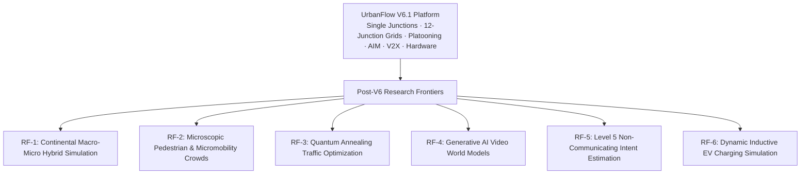

# Future Scope & Long-Term Research Frontiers

> **Authoritative Research Scope.**  
> **Status:** The capabilities originally catalogued as Future Scope (FS-1 through FS-10) in early 2026 have been successfully scheduled and delivered across Phases 3, 4, 5, and 6, or are scheduled for completion in Phase 7.  
> This document maintains the historical traceability of those items and formalizes the **genuine post-V6.1 research frontiers (RF-1 through RF-6)**.

---

## 1. Traceability of Historical Future Scope Items (FS-1 — FS-10)

The original Future Scope items were integrated into the active engineering plan ([plan/README.md](../plan/README.md)) as concrete features (F1 through F20):

| Historical Item | Research Frontier | Active Plan Mapping | Current Delivery Status | Implemented / Planned Reference |
| :---: | :--- | :---: | :---: | :--- |
| **FS-1** | Emergency Vehicle Priority & Preemption | **Feature F12** | ✅ **VERIFIED** | Implemented in Phase 6 (`backend/src/priority/`, `/api/v2/priority/`). Siren detection, green extension, red truncation, civilian yielding. |
| **FS-2** | Learned (RL) Traffic Signal Control | **Feature F18** | ✅ **VERIFIED** | Implemented in Phase 4/5 (`backend/src/rl/`, `airflow/dags/rl_retrain.py`). Multi-junction Gymnasium environment, PPO/DQN, baselines. |
| **FS-3** | Connected Vehicle (V2X) Communication | **Feature F19** | ✅ **VERIFIED** | Implemented in Phase 6 (`backend/src/v2x/`, `/api/v2/v2x/`). In-process & MQTT bus, latency/drop models, cooperative experiments. |
| **FS-4** | Vehicle Platooning & Cooperative Driving | **Feature F20** | 🗓️ **PLANNED** | Scheduled for Phase 7 (V5.5, V5.6, V5.8). Leader-follower string stability, join/leave maneuvers, aerodynamic drafting benefits. |
| **FS-5** | Autonomous Intersection Management (AIM) | **Feature F20** | 🗓️ **PLANNED** | Scheduled for Phase 7 (V5.7). Reservation manager, discrete space-time tiles, FCFS trajectory coordination, G-AIM safety gate. |
| **FS-6** | Uncertainty & Robustness Lab | **Feature F6** | ✅ **VERIFIED** | Implemented in V3.0 W1 (`backend/src/uncertainty/`, `/api/v3/experiments`). Sobol/LHS sampling, paired CRN ensembles, bootstrap CIs. |
| **FS-7** | Weather & Pavement Friction Effects | **Feature F13** | ✅ **VERIFIED** | Implemented in Phase 6 (`backend/src/incidents/weather.py`). Rain, dense fog, snow, ice adjusting friction, visibility, and reaction time. |
| **FS-8** | Incident & Disruption Simulation | **Feature F13** | ✅ **VERIFIED** | Implemented in Phase 6 (`backend/src/incidents/engine.py`). Physical crashes, lane blockages, dynamic road closures, Dijkstra rerouting, resilience scoring. |
| **FS-9** | Large-Scale Network Simulation | **Feature F5** | ✅ **VERIFIED** | Implemented in Phase 5 (`backend/src/networks/`, `netmetrics/`). Node-edge graph model (ADR-021), 12-junction arterial grid, congestion spread heatmaps. |
| **FS-10**| Digital Twin Integration | **Feature F14** | ✅ **VERIFIED** | Implemented in Phase 5 (`backend/src/twin/`, `/api/v2/twin/`). Replay adapter over recorded telemetry, real-time prediction-vs-observation API, what-if branching. |

---

## 2. Post-V6.1 Research Frontiers (RF-1 — RF-6)

Capabilities beyond the V1.0–V6.1 delivery plan represent future academic and industrial frontiers. None of these are scheduled for implementation within the current project cycle:

---

### RF-1 · Continental-Scale Macro-Micro Hybrid Simulation
- **Indicative Scope:** Integrate macroscopic continuum models (Lighthill-Whitham-Richards [LWR] partial differential equations) for regional highway corridors seamlessly with microscopic IDM/MOBIL models for urban city centers.
- **Scientific Challenge:** Defining dynamic, momentum-conserving boundary condition handoffs across the continuous-discrete transition zone without introducing shockwave reflection artefacts.

### RF-2 · Microscopic Pedestrian, Cyclist & Micromobility Crowds
- **Indicative Scope:** Expand microscopic modeling to non-vehicular vulnerable road users (VRUs). Implement Social Force Models (Helbing) for pedestrian crowds, shared-lane e-scooter swarms, and protected bike lane queue dynamics.
- **Scientific Challenge:** Multi-modal conflict resolution at uncontrolled zebra crossings and bidirectional sidewalk-to-crosswalk transitions.

### RF-3 · Quantum Annealing & Gate-Based Traffic Optimization
- **Indicative Scope:** Formulate global arterial network signal timing synchronization as a Quadratic Unconstrained Binary Optimization (QUBO) problem solvable on D-Wave quantum annealers or QAOA quantum gate circuits.
- **Scientific Challenge:** Overcoming NISQ (Noisy Intermediate-Scale Quantum) coherence limits and mapping high-cardinality cycle offset matrices into quantum hardware topologies.

### RF-4 · Generative AI Video World Models for Digital Twins
- **Indicative Scope:** Synthesize photorealistic CCTV and traffic camera video streams directly from microscopic simulation coordinate trajectories using spatio-temporal video diffusion models.
- **Scientific Challenge:** Enforcing temporal consistency across frames and eliminating geometric hallucinations of vehicle trajectories.

### RF-5 · Mixed-Fleet Autonomous Vehicle Level 5 Intent Estimation
- **Indicative Scope:** Probabilistic Bayesian and transformer-based intention recognition for non-communicating human-driven vehicles interacting with autonomous fleets in dense urban merge zones.
- **Scientific Challenge:** Online parameter estimation of surrounding human driver aggression under severe sensor occlusion.

### RF-6 · Dynamic In-Road Inductive EV Charging Optimization
- **Indicative Scope:** Model dynamic wireless power transfer (DWPT) coils embedded in arterial pavement. Optimize vehicle lane-choice, velocity profiles, and power grid substation load-balancing.
- **Scientific Challenge:** Coupled electro-thermal battery state-of-charge (SoC) dynamics interacting with traffic congestion shockwaves.
