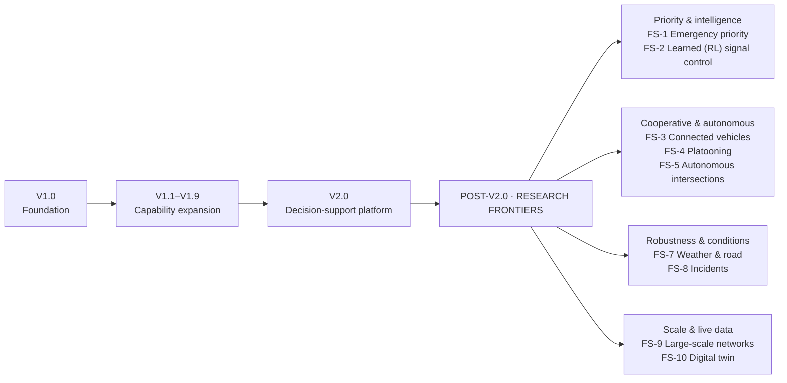

# Future Scope — Post-V2.0 Research Frontiers

> **This is the single authoritative Future Scope.** It replaces every earlier future-scope list in this repository.
> **Status:** 🔭 FUTURE SCOPE — none of these capabilities exist, and none are part of the V1.1–V2.0 roadmap or the proposed V3.0 plan ([ROADMAP §7](../ROADMAP.md#7-v30--composable-ai-assisted-traffic-control-experimentation-planned-proposed)). **Revision 2026-10-12:** FS-6 moved to V3.0; FS-2 narrowed to learned/RL controllers; FS-1 annotated. **Revision 2026-10-21:** FS-11 … FS-13 (next-generation user experience) added as planning only.
> **Boundary rule:** a capability scheduled anywhere in [the roadmap](../ROADMAP.md) is **not** listed here. Where a frontier builds on a roadmap capability, only the genuinely new extension beyond V2.0 is described.

## Summary

| # | Frontier | Indicative effort | Builds on (roadmap, ≤ V2.0) | Genuinely new beyond V2.0 |
| ---: | --- | :-: | --- | --- |
| FS-1 | Emergency Vehicle Priority *(V3.0 readiness gate G-E expected to defer it)* | 1–2 months | Vehicle types (V1.1), adaptive control (V1.3) | Priority vehicles, signal pre-emption, yielding/clearance, response metrics |
| FS-2 | Learned (RL) Traffic Signal Control *(search-based strategy discovery moved to V3.0)* | 2–3 months | Adaptive control (V1.3), batch experiments (V1.7), V3.0 strategy registry and Discovery Lab | Learning-based controllers trained in simulation |
| FS-3 | Connected Vehicle Communication | 2–3 months | Network foundations (V1.8/V1.9) | V2V/V2I messaging with latency, loss and imperfect information |
| FS-4 | Vehicle Platooning & Cooperative Driving | 2–3 months | Vehicle types (V1.1), lanes (V1.2) | Coordinated groups with cooperative longitudinal control |
| FS-5 | Autonomous Intersection Management | 3–4 months | Conflict management (V1.0), signals & roundabouts (V1.0–V1.4) | Reservation/negotiation-based, signal-free passage |
| FS-6 | ~~Uncertainty & Robust Traffic Simulation~~ — **moved to the roadmap (V3.0 Robustness Lab, ROADMAP §7)** | — | — | — |
| FS-7 | Weather & Road-Condition Effects | 1–2 months | IDM and curve-speed model (V1.0) | Weather scenarios, friction and visibility effects |
| FS-8 | Incident & Disruption Simulation | 2–3 months | Lane model and routing (V1.2) | Crashes, blockages, closures, rerouting and recovery |
| FS-9 | Large-Scale Traffic Network Simulation | 3–6 months | Network-level foundations (V1.8/V1.9) | City-scale networks, corridors, congestion propagation |
| FS-10 | Digital Twin Integration | 4–6+ months | Real-world inputs and calibration (V1.8/V1.9) | Continuously updated, live representation of real junctions/networks |
| FS-11 | Guided Scenario Builder *(planning only; [series](next-generation-requirements.md))* | relative M | Junction builder (V1.4/V1.5), planner (V2.0), V3.0 strategy registry | Guided lens, recipes and round-trip/parity guarantees over the existing scenario document |
| FS-12 | Visual City Studio *(planning only)* | relative M + M (+ L, separate decision) | Network document and endpoints (V1.8/V1.9) | Visual editing model, accessible projection, stable network validation codes; running a network only after its own decision |
| FS-13 | AI Traffic Analyst *(planning only)* | relative M + M | V3.0 Copilot, validation boundary, Robustness Lab | Network-derived assessment with a six-class evidence taxonomy and reproducible candidate scenarios |

Effort figures are indicative planning estimates, not commitments.

---

## FS-1 · Emergency Vehicle Priority

**Indicative effort:** 1–2 months

| | |
| --- | --- |
| **Core** | Ambulances · fire trucks · emergency vehicle priority · signal priority phases · surrounding vehicle yielding / clearance |
| **Value** | Emergency response analysis · traffic-control evaluation under emergency conditions · public-safety planning |
| **Deliverables** | Emergency vehicle models · priority logic · signal pre-emption · yield/clearance behaviour · emergency response metrics |
| **Boundary** | V1.1 introduces ordinary vehicle classes. Priority status, pre-emption and the behaviour of other road users towards an emergency vehicle are new here. |
| **V3.0 note** | The proposed V3.0 strategy registry reserves a *priority overlay* layer, and a readiness gate (G-E, needs at least 4.5 unallocated engineer-days) is **expected to defer** this work. Simulated response times would be model outputs, not predictions. |

## FS-2 · Learned (RL) Traffic Signal Control

**Indicative effort:** 2–3 months

| | |
| --- | --- |
| **Core** | Learning-based signal control · simulated training · DQN/PPO or other reinforcement-learning approaches · comparison against existing controllers |
| **Value** | AI traffic-optimisation research · identifying conditions where learning-based control helps · an intelligent traffic-control research platform |
| **Deliverables** | RL environment · training pipeline · trained controllers · policy evaluation · fixed-time vs adaptive vs AI comparison |
| **Boundary** | V1.3 delivers rule-based adaptive control; the proposed V3.0 Discovery Lab (ROADMAP §7) delivers *search-based* strategy discovery (evolutionary optimisation, not a learned model). Learned policies and their training infrastructure remain new here; they would enter through the V3.0 strategy registry as `experimental` types, evaluated on disjoint seeds. |

## FS-3 · Connected Vehicle Communication

**Indicative effort:** 2–3 months

| | |
| --- | --- |
| **Core** | V2V · V2I · traffic/infrastructure information sharing · communication latency · imperfect information · cooperative decisions |
| **Value** | Connected-vehicle research · traffic-flow and safety analysis · intelligent transport research |
| **Deliverables** | V2V/V2I communication model · message system · communication delay/loss modelling · cooperative behaviour metrics |
| **Boundary** | Nothing in V1.0–V2.0 models communication between vehicles or with infrastructure. |

## FS-4 · Vehicle Platooning & Cooperative Driving

**Indicative effort:** 2–3 months

| | |
| --- | --- |
| **Core** | Vehicle groups · leader/follower behaviour · platoon formation · merging · splitting · coordinated acceleration/braking |
| **Value** | Road-capacity research · autonomous/cooperative vehicle research · fuel and traffic-flow analysis |
| **Deliverables** | Platoon controller · formation/merging logic · cooperative longitudinal control · stability analysis · throughput analysis |
| **Boundary** | Up to V2.0 every vehicle follows its own IDM; vehicles never coordinate. |

## FS-5 · Autonomous Intersection Management

**Indicative effort:** 3–4 months

| | |
| --- | --- |
| **Core** | Reservation/coordination-based intersection control · connected autonomous vehicles · negotiated intersection passage · crossing times and trajectories · conflict handling |
| **Value** | Signal-free intersection research · reduced stopping/delay investigation · future autonomous infrastructure research |
| **Deliverables** | Intersection reservation system · conflict-resolution algorithm · trajectory coordination · safety validation · performance comparison |
| **Boundary** | V1.0's `ConflictManager` reserves conflict zones *inside* signal and roundabout control. Replacing signals and give-way rules with negotiated passage is new here. |

## FS-6 · Uncertainty & Robust Traffic Simulation — moved to the roadmap

This frontier is no longer Future Scope: it is the **Robustness Lab** in the proposed V3.0 plan ([ROADMAP §7](../ROADMAP.md#7-v30--composable-ai-assisted-traffic-control-experimentation-planned-proposed); contract in the [V3 product strategy](../roadmap/V3_PRODUCT_STRATEGY.md) §5). Kept as a stub so that existing FS-6 references resolve and the item is not duplicated.

## FS-8 · Incident & Disruption Simulation

**Indicative effort:** 2–3 months

| | |
| --- | --- |
| **Core** | Crashes · blocked lanes · stalled vehicles · road closures · capacity reduction · rerouting · recovery |
| **Value** | Junction resilience · traffic-management analysis · emergency/contingency planning |
| **Deliverables** | Incident generator · lane/blockage modelling · rerouting behaviour · recovery-time metrics |
| **Boundary** | V1.2 adds lane changes and routing under normal operation. Injected disruptions, dynamic rerouting around them and recovery measurement are new here. |

## FS-9 · Large-Scale Traffic Network Simulation

**Indicative effort:** 3–6 months

| | |
| --- | --- |
| **Core** | Larger road networks · connected corridors · network interactions · congestion propagation |
| **Value** | City-scale planning experiments · network-level effects · larger infrastructure decisions |
| **Deliverables** | Scalable network engine · network routing · congestion propagation · large-scale performance analysis |
| **Boundary** | V1.8/V1.9 lays network-level *foundations*. Scaling to city-size networks with propagation analysis is new here. |

## FS-10 · Digital Twin Integration

**Indicative effort:** 4–6+ months

| | |
| --- | --- |
| **Core** | Continuously updated real-world traffic data · digital representation of real junctions/networks · predicted vs observed traffic · live scenario testing |
| **Value** | Operational planning · continuous monitoring · data-driven infrastructure decisions |
| **Deliverables** | Real-world data connectors · digital-twin model · continuous calibration · live scenario analysis · prediction-vs-observation dashboard |
| **Boundary** | V1.5 models real layouts and V1.8/V1.9 calibrates from real traffic inputs. A *continuously* synchronised, live model is new here. |

---

## Next-generation user experience — FS-11 · FS-12 · FS-13

*Added 2026-10-21 as **planning only**; none exists and none is scheduled. They are one progression — describe or build a network → configure → validate → simulate → compare → understand → refine — over one set of documents, so they are specified together: [requirements](next-generation-requirements.md) · [architecture and dependencies](next-generation-architecture.md) · [phased roadmap, gates and parallel-work policy](next-generation-roadmap.md).*

## FS-11 · Guided Scenario Builder

**Indicative effort:** relative **M** (unverified; see the roadmap's sizing assumptions)

| | |
| --- | --- |
| **Core** | A guided, plain-language path to a valid study — purpose, junction, traffic, controls, summary — that edits the same scenario document the expert builder edits |
| **Value** | Non-specialists reach a valid comparison without learning every parameter; experts lose nothing |
| **Deliverables** | Choice-to-document recipes · plain-language summary · deterministic one-click fixes · guided↔expert round trip |
| **Boundary** | The junction builder, presets, planner and V3.0 strategy registry are roadmap work (V1.4/V1.5, V2.0, V3.0 W3). New here: the guided lens, its recipes and the round-trip/parity guarantees. It adds **no** scenario field. |

## FS-12 · Visual City Studio

**Indicative effort:** relative **M + M**, with multi-junction execution a separate decision (**L**, unverified)

| | |
| --- | --- |
| **Core** | A visual editor whose saved form is the existing `urbanflow-network` document: place junctions and gates, connect edges, set lanes and demand, validate, compile |
| **Value** | Build and inspect a layout graphically; the same documents work from the API and the UI |
| **Deliverables** | Editing model with undo/redo · accessible table projection · canvas · round-trip `studio ↔ network` · stable network validation codes |
| **Boundary** | V1.8/V1.9 deliver the network document, validation, compile and fingerprint (API only; multi-junction simulation and a network viewer were **not** delivered — [ROADMAP V1.9](../ROADMAP.md)). New here: the editor and, only after a separate decision, running a network. GIS import stays out of scope. |

## FS-13 · AI Traffic Analyst

**Indicative effort:** relative **M** (deterministic part) + **M** (model layer), unverified

| | |
| --- | --- |
| **Core** | An assessment layer over the V3.0 Copilot: derive facts from a network, state what is missing, propose a few validated candidate configurations, run them, and explain the measured trade-offs with every statement labelled as fact, derived, assumed, recommended, measured or uncertain |
| **Value** | Helps users explore alternatives with transparent assumptions and simulation evidence — **never** a claim of an optimal or safe model |
| **Deliverables** | Assessment schema and rule table · class-labelled output · reproducible candidate scenarios · grounded explanation |
| **Boundary** | The Copilot, Discovery Lab, validation boundary and Robustness Lab are V3.0 work (strategy §15, ADR-017). New here: the network-derived assessment and its evidence taxonomy. It adds no provider, model dependency or backend by itself. |

---

## Duplication check

Every V1.1–V2.0 scope item was compared with this list. None of the following appear here, because they are roadmap work: vehicle classes (V1.1) · multi-lane traffic and lane changes (V1.2) · adaptive signal control (V1.3) · multi-lane/spiral roundabouts (V1.4) · real-world junction layouts and a junction builder (V1.5) · safety proxies and fuel/emissions (V1.6) · scenario engine and batch experiments (V1.7) · calibration framework, real-world traffic inputs and network foundations (V1.8/V1.9) · integrated planner workflow (V2.0).
