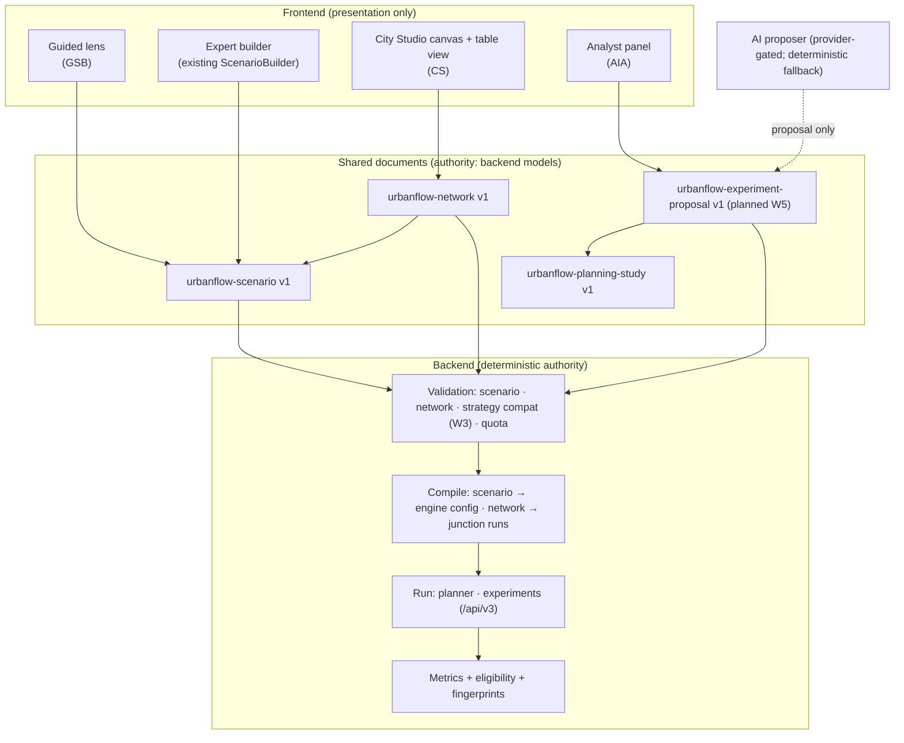

# Next-generation UrbanFlow — architecture and dependency plan

> **Status:** 🔭 PLANNING — proposals for review; **no ADR is created here** (an ADR is written only when a decision below is ready to be taken, §8). Nothing in this document is implemented or scheduled.
> **Series:** [Requirements](next-generation-requirements.md) · [Architecture and dependencies](next-generation-architecture.md) (this) · [Phased roadmap and parallel-work policy](next-generation-roadmap.md)
> **Labels:** **[V]** verified in the repository on 2026-10-21 · **[P]** proposal · **[U]** unverified. Requirement IDs (`GSB-`, `CS-`, `AIA-`, `XC-`) are defined in the requirements document.

---

## 1. What the repository already provides

The architectural finding of this planning pass is that **most of the shared representation already exists**; the next generation is mainly new *front ends and orchestration* over existing documents, not new models.

| Concern | Existing capability [V] | Source |
| --- | --- | --- |
| Single-junction scenario definition | `urbanflow-scenario` v1: 4 compass slots (arms may be absent), arm bearings within 30° of slot, per-arm lanes/lane use/demand/turning/vehicle mix, roads, signal, adaptive, roundabout (incl. W2 `entryControl`/`entryMetering`), simulation (duration, warm-up, seed, arrival pattern, time step). Strict (`extra="forbid"`), fingerprinted | `backend/src/scenario/documents.py`, `frontend/src/scenario/scenarioTypes.ts` |
| Scenario validation | `POST /api/v1/scenarios/validate` → `{valid, errors, warnings, design}`; stable `metering.*` codes appended to messages | `backend/src/simulations/router.py:84`, `controllers/entry_metering.py` |
| Network definition | `urbanflow-network` v1: nodes (junction \| origin \| destination), one-way edges (1–8 lanes, bounded length/speed), routes, demand per route, simulation block; canonical form + 16-hex fingerprint; `serialize_network` round-trips | `backend/src/networks/models.py` |
| Network endpoints | `POST /api/v2/networks/{validate, compile, fingerprint, scenario, result-structure, from-scenario}` | `backend/src/networks/api.py` |
| Network execution | Composition logic and result structure for a `one-way-coupled-sequential` model behind a `JunctionExecutor` protocol; **no network run is exposed**, no multi-junction simulation | `backend/src/networks/execution.py`, [ROADMAP V1.9](../ROADMAP.md) |
| Study definition | `urbanflow-planning-study` v1: subject scenario, alternatives (`strategy` + RFC 7386 merge `patch`), demand scales, repetitions | `backend/src/planning/{models,alternatives}.py` |
| Experiments | `/api/v3/experiments` (Robustness Lab), `/api/v3/capabilities` (feature flags, strategy list) | `backend/src/experiments/` |
| Strategy descriptors / registry | **Not built** (ADR-014 accepted; W3) — three strategies are chosen by `intersectionType`/`signalControl`; metering is a roundabout controller option | [ADR-014](../decisions/adr-014-strategy-registry-and-entry-gate-seam.md), [sprint plan §3.4](../roadmap/V3_WEEKLY_SPRINT_PLAN.md) |
| AI contracts | **Not built** (ADR-017 *Proposed*; W5/W6); capability flags `aiCopilot`, `discoveryLab` are `false` | `service.py:361` |
| Frontend | React 19 + Vite + TypeScript; hand-rolled routing (`routing.ts`); component-local state with `useScenarioValidation` as the one validation hook; vitest + Testing Library + axe-core | `frontend/package.json`, `frontend/src/routing.ts` |
| Rendering | Canvas maps (`IntersectionMap`, `RoundaboutMap`) and an SVG junction preview; none is an editor | `frontend/src/components/` |

**Reuse decision [P]:** introduce **no new top-level document type** for any of the three initiatives. Guided mode edits `urbanflow-scenario`; City Studio edits `urbanflow-network` (+ optional layout companion, §4.3); the Analyst emits the Copilot's `urbanflow-experiment-proposal`.

---

## 2. Component boundaries



### 2.1 The six separations asked for, and where each lives

| Concern | Owner | Notes |
| --- | --- | --- |
| **Visual editing** (canvas, selection, drag, snap, viewport) | Frontend City Studio only | Never imported by simulation code or validators. Produces edits to a network document; holds layout state separately. |
| **Network topology** (nodes, links, connections, graph validity) | Backend `networks/` (`validate.py`, `models.py`) | The client may prevent *impossible gestures*; it does not own validity (CS-F-04). |
| **Traffic semantics** (lanes, permitted movements, control types, supported road properties) | `urbanflow-scenario` + the strategy registry (W3) | One definition for guided, expert and studio. |
| **Scenario configuration** (demand, timing, duration, options) | `urbanflow-scenario.simulation` / `traffic`, planner `demand`/`repetitions` | Guided metadata (visited steps) is client-local. |
| **Simulation compilation / serialisation** | Backend `compile.py`, `scenario_to_network`, fingerprints | Single compile path; the studio calls it, never re-implements it. |
| **Validation** (unsupported, incomplete, inconsistent) | Backend; frontend renders results and offers deterministic one-click fixes only | Parity tests: no client-only rule that rejects what the backend accepts, or vice versa. |

### 2.2 Guided lens (GSB) [P]

A pure module `guided/` that maps *choices → document patches* (a table of "recipes" keyed by control and purpose) and *document → plain-language summary*. It holds no state beyond the document it is given, so the guided and expert views cannot diverge. The summary generator already exists in embryo (`describeScenario`, `describeRoads`, `describeDemand`) [V]. The "customised" indicator (GSB-F-08) is computed by re-applying the recipe to the base and diffing — a function, not stored state.

### 2.3 City Studio [P]

Three layers with one-way dependencies: **(1) editing model** — an in-memory network document plus a layout map, with command objects for undo/redo; **(2) projection** — the same model rendered as canvas and as an accessible table/list (CS-U-02); **(3) services** — calls to `/api/v2/networks/validate|compile|from-scenario`. A pure `studioToNetwork()` / `networkToStudio()` pair is the only serialisation code and is covered by a round-trip property test (CS-F-10) using the backend's `canonical_network` as the oracle.

### 2.4 AI Traffic Analyst [P]

```
network/scenario ─► deterministic assessment (derived facts + missing-information rules)
                          │
objective & constraints ──┤
                          ▼
              proposer (rule-based ► model, ADR-017 boundary)
                          ▼
         urbanflow-experiment-proposal ► validation boundary ► confirm
                          ▼
         reproducible scenarios ► /api/v3/experiments or planner ► evidence object
                          ▼
         comparison against objective ► grounded explanation (class-labelled)
```

**Deterministic vs. AI boundary.** Deterministic (always, never a model): derived facts, missing-information rules, strategy catalogue membership, validation, scenario generation from a validated proposal, seeds, quota, eligibility, all numbers. Model-generated (optional, provider-gated): proposing among *catalogue-valid* options, phrasing assumptions, interpreting the evidence object. The model has no tools, files or network ([ADR-017](../decisions/adr-017-ai-validation-boundary.md) §3).

### 2.5 Proposed structured recommendation format [P]

Extends the Copilot's proposal rather than replacing it; shown as a schema sketch, not a contract:

```json
{
  "format": "urbanflow-analyst-assessment", "version": 1,
  "subject": { "scenarioFingerprint": "…", "networkFingerprint": "…|null" },
  "items": [
    { "class": "derived",       "text": "4 arms; total demand 940 veh/h", "source": "backend.derive" },
    { "class": "missing",       "text": "No observed counts supplied",   "ruleId": "MISS-03" },
    { "class": "assumption",    "text": "Stationary demand",            "basis": "assumed", "editable": true },
    { "class": "recommendation","proposalRef": "<experiment-proposal id>", "validated": true,
      "fieldProvenance": { "alternatives": "rule" } }
  ],
  "generator": { "id": "rules", "version": "1", "catalogueHash": "…" }
}
```

`validated` is set only by the backend (AIA-F-04). Every item has exactly one `class` (AIA-F-01). Proposed schema lives under `shared/schemas/` only when a phase reaches build.

---

## 3. Shared contracts across the three initiatives

| Contract | Shared by | Rule |
| --- | --- | --- |
| Scenario definition | Guided · Studio (junction nodes) · Analyst · planner · experiments | Same document; guided adds no field (GSB-F-02) |
| Network definition | Studio · Analyst (network input) | Same document; layout is a companion (CS-F-01, OQ-4) |
| Validation | All | One call per document type; one error vocabulary with stable codes |
| Execution contract | All | Planner studies and `/api/v3/experiments`; network execution only when the backend exposes it |
| Metric definitions | All | The existing catalogue; backend authoritative ([ADR-005](../decisions/adr-005-metric-contract-design.md)) |
| Provenance and reproducibility | All | Scenario/network fingerprints; manifest and replay classes from [ADR-013](../decisions/adr-013-v3-integration-contract-and-versioning.md); generator id + version for generated content |
| Results and comparison | All | Planner comparison and experiment evidence object; no new comparison model |
| Explanations | All | Written once (glossary, control descriptions, limitations) and reused (XC-03); the audit found a contradicting copy ([audit O4](../product/ux-audit-v3-w2-followup.md#2-observed-problems)) |

---

## 4. Integration points, potential breaking changes, and what each requirement needs

### 4.1 Classification of future requirements

| Class | Meaning | Items |
| --- | --- | --- |
| **A — fits a stable existing extension point** | Can be built without changing a V3.0 contract | Guided lens over `ScenarioDocument` · per-alternative control in planner via the existing merge `patch` (frontend only) · studio over `urbanflow-network` v1 endpoints · single-junction composer using `scenario_to_network` · Analyst deterministic assessment reading validated documents · reuse of `describeScenario` and `useScenarioValidation` |
| **B — needs a deliberate architectural decision (ADR candidate)** | Would materially touch a V3.0 interface or add a contract | Layout companion for network documents (OQ-4) · exposing scenario-level capabilities (e.g. supported entry controls) in `/api/v3/capabilities` (additive; ADR-013 rules) · a network *run* endpoint and result shape (needs the `JunctionExecutor` implementation and a multi-junction validity argument) · `urbanflow-analyst-assessment` schema · alternative-level control selection semantics (OQ-7) · whether guided "recipes" are server-owned or client-owned |
| **C — speculative; must not influence current implementation** | No repository evidence yet | Free-form/curved geometry · GIS import · real-time data · time-varying demand and incidents as *inputs to guidance* (engine lacks them) · learned/RL control proposals · collaborative editing · automatic network generation from text |

### 4.2 Interfaces that a future requirement could affect — flagged early

| V3.0 interface | Possible future pressure | Position |
| --- | --- | --- |
| `urbanflow-scenario` v1 (frozen additive) | Guided metadata, studio layout | **Do not add fields.** Keep metadata client-local or in a companion. |
| Strategy registry (W3) | Guided control list and Analyst catalogue both read it | Design the registry's *descriptor* to carry the one-sentence description and "not modelled" note (GSB-F-04) — a cheap hook to request **before W3 is built**; otherwise the copy is duplicated in the frontend. Raise with the integration owner. |
| `/api/v3/capabilities` | Scenario-level options | Additive extension only. |
| `ExperimentProposal` (W5) | Analyst items | Reuse unchanged; the assessment is a separate document that *references* proposals. |
| Fingerprints | Layout, guided metadata | Must not enter existing fingerprints (parity tests exist for scenarios). |
| Planner request | Per-alternative control | Frontend `AlternativeSpec` gains optional `patch` (already accepted by the backend) — no schema change. |

### 4.3 Potential breaking changes to avoid

Changing a scenario or network fingerprint; adding required fields; making `strategy`-only alternatives invalid; changing validation message text that clients match (the new hint in the UI matches on the stable `(metering.missing_arm)` code, **not** on prose); coupling studio layout into saved-network equality.

---

## 5. Technical risks

| # | Risk | Mitigation |
| --- | --- | --- |
| R-1 | Multi-junction simulation is not available; a "city" editor may promise more than the engine does | CS-F-08: primary output is validation/topology/compile until network execution exists; single-junction composer MVP |
| R-2 | A canvas editor is large and is the first use of pointer-heavy UI here | Table projection first (CS-U-02); spike the editing model without a canvas library; no second UI framework |
| R-3 | Guided mode drifts from expert semantics | Recipes are data applied to the shared document; parity and round-trip tests (GSB-F-01, -07) |
| R-4 | Copy contradicts features as controls are added (observed once already) | Single explanation source (XC-03); tests that every control has description + limitation |
| R-5 | AI text overstates evidence | ADR-017 boundary; class-labelled output; grounding check; fallback; evaluation before any "AI" claim |
| R-6 | Performance of large networks in the browser | Not assessed [U]; define node/edge limits at the studio spike; virtualise the table view |
| R-7 | Accessibility of a canvas | Non-canvas equivalent mandatory; axe on table/forms; canvas semantics specified before build (CS-U-06) |
| R-8 | Privacy: network/demand sent to a model provider | Provider decision D-AI1 includes data handling; list data sent; consent (AIA-F-10) |
| R-9 | Cost and latency of model calls | Caps and kill switch from ADR-017; deterministic path is the default |
| R-10 | Parallel planning drifts into parallel implementation | Gates and policy in the [roadmap](next-generation-roadmap.md#3-parallel-work-policy) |

### 5.1 Validation requirements for networks [P]

Every item is a backend rule that either exists today or would be added to `networks/validate.py`; the studio only displays them. **Today [V]** (read from `validate.py`): format and version; duplicate node and edge ids; a junction needs a valid scenario or reference, and that scenario's own validation errors surface per node; declared junction type must match; gates take no arm and no scenario; edges must reference existing nodes and **existing arms**, an arm takes one inbound and one outbound edge, no self-loops, no edges leaving a destination or entering an origin; a lane-count mismatch between an edge and the arm it feeds (warning); `laneMetadata` index rules; routes must be connected chains from origin to destination; all nodes must be connected; demand vehicle classes and mix sums (warning). Messages are prose without stable codes (unlike `metering.*`). **Candidate additions [P]:** stable codes for these messages (so the studio can anchor them without matching prose, CS-F-04), an origin with no route, a junction arm with demand but no edge, and a route turning movement the junction's lane use does not permit. Each addition needs a rejecting test.

### 5.2 Performance and scalability [U]

No measurement exists for network editing or compile at scale. The compile endpoints are request/response over documents with bounded sizes (edges ≤ 20 km, lanes ≤ 8, demand ≤ 7,200 veh/h per route); node/edge counts have a request-size cap only. A node/edge budget and a canvas frame-rate target should be set at the Phase 2 spike, not assumed.

---

## 6. Serialisation and round-trip compatibility

1. **Network:** `network → studio → network` equals the original under `canonical_network` (CS-F-10). Layout is ignored by the fingerprint.
2. **Scenario:** `scenario → guided summary → scenario` is the identity (the lens never writes unless the user chooses).
3. **Single-junction bridge:** `scenario_to_network(scenario)` followed by studio edit followed by compile must reproduce the original scenario's fingerprint when no junction field was changed — the existing function embeds the scenario unchanged by design [V] `from_scenario.py` docstring.
4. **Backward compatibility:** a conventional scenario never gains `entryControl`/`entryMetering` through any new path (the follow-up UI work already pins this with a test).
5. **Old studies and packages** must load unchanged; new fields are optional and ignorable by old readers (ADR-013 §2: unknown minor accepted with a warning).

---

## 7. Accessibility and usability architecture

Every visual editor surface has: a table/list projection, form-based editing, keyboard shortcuts for placement and connection, programmatic names, visible focus, status by text as well as colour, undo/redo, and a screen-reader description of topology. These are requirements on the *editing model* (so any renderer inherits them), not on one canvas library.

---

## 8. Decisions that need an ADR — and decisions that can be deferred

| Decision | ADR now? | Reason |
| --- | --- | --- |
| Registry descriptor carries user-facing description and "not modelled" note | **Raise before W3 starts** (amend ADR-014's descriptor, cheap now, costly later) | Avoids duplicated copy and gives guided mode its data source |
| Layout companion for `urbanflow-network` | Before Phase 2 build | Contract decision (OQ-4) |
| Network run endpoint and `JunctionExecutor` implementation | Before any multi-junction claim | Reproduction-critical, physics-adjacent |
| Analyst assessment schema | Before Phase 3 build | New shared document |
| Capability extension for scenario-level options | With the first guided build | Additive |
| Per-alternative control UX in the planner (OQ-7) | UX decision; ADR only if the patch contract changes | Backend already supports it |
| Canvas library vs. SVG/DOM | **Defer** to the Phase 2 spike | Needs evidence (performance, accessibility) |
| State management for the editing model | **Defer** | Component-local state suffices today; revisit with the spike |
| AI provider | **Defer** (D-AI1) | Owned by V3.0 W5 |
| Real-world data import | **Defer** (Class C) | No repository support |

An ADR is **not** written for any of these now: none is ready for decision, and the project's rule is to use ADRs for consequential decisions that are ready (ADR process in [decisions/README](../decisions/README.md)).
