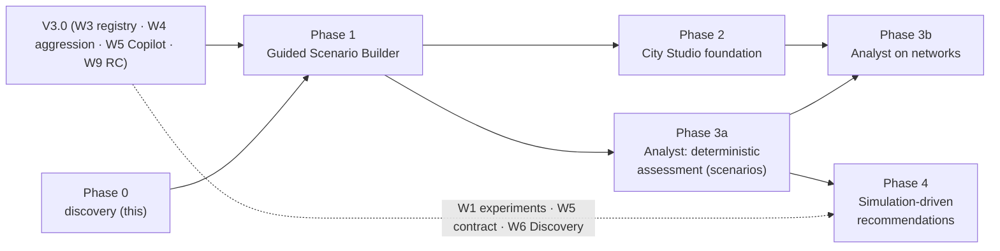

# Next-generation UrbanFlow — phased roadmap, gates and parallel-work policy

> **Status:** 🔭 PLANNING — proposals for the product owner. **This is not a second roadmap:** [`ROADMAP.md`](../ROADMAP.md) stays authoritative, and nothing here is scheduled until a gate in §4 is passed and the owner approves a scope. No dates and no day-estimates are given; sizes are **relative** (S/M/L) with the assumptions stated in §2.
> **Series:** [Requirements](next-generation-requirements.md) · [Architecture and dependencies](next-generation-architecture.md) · [Phased roadmap and parallel-work policy](next-generation-roadmap.md) (this)
> **Labels:** **[V]** verified in the repository on 2026-10-21 · **[P]** proposal · **[U]** unverified.

---

## 1. Dependency order (from repository evidence)

Findings that change the order from the example sequence in the brief:

1. **Guided first** is confirmed: it needs only the scenario contract, but that contract is **still moving** — V3.0 W4 adds the driver-aggression profile at every authoring boundary ([ADR-016](../decisions/adr-016-driver-aggression-profile.md), *Proposed*), and W3's registry should carry the user-facing control descriptions ([architecture §4.2](next-generation-architecture.md#42-interfaces-that-a-future-requirement-could-affect--flagged-early)). Starting before both settle would build on a moving contract.
2. **The Analyst's deterministic part does not need City Studio.** It reads validated *scenarios* (a network of one junction already exists as `scenario_to_network`). Phase 3a can therefore precede Phase 2 if the owner values assessment over visual editing; Phase 3b adds networks once Phase 2 exists. This splits the brief's Phase 3 into 3a/3b.
3. **City Studio's first useful slice is a single-junction composer**, because multi-junction networks are validated and compiled but **not simulated** [V]. A multi-junction run is a separate, explicitly decided step (Phase 2c), not an assumption.
4. **Phase 4 depends on V3.0 items that are not built yet** — the Copilot proposal contract and validation boundary (W5, ADR-017 *Proposed*, provider decision D-AI1 open) and the Robustness/experiment runner (W1, built).

---

## 2. Phases

Size key (relative, **[U]**): **S** < one V3.0 feature-week; **M** ≈ one; **L** > one. Assumptions: one engineer who is also integration owner; reviews, tests and docs included; no measured velocity for this work exists, so a first-slice measurement re-baselines every later phase (same practice as the V3.0 re-forecast at G-R1).

### Phase 0 — Product discovery and architectural preparation *(this planning pass)*

| | |
| --- | --- |
| **Objective** | Make the three initiatives plannable without rediscovering product problems or contract constraints |
| **Scope** | [UX audit](../product/ux-audit-v3-w2-followup.md) · requirements with stable IDs · architecture and dependency analysis · gates and parallel-work policy · FS-11…13 registered in [Future Scope](future_scope.md) |
| **Non-goals** | Any production code for the larger initiatives; new schemas; ADRs not ready for decision; AI integration; a canvas or network schema |
| **Dependencies** | None (documentation only) |
| **Deliverables** | The four documents in this series and the audit |
| **Acceptance** | Documents grounded in repository evidence (**[V]** labels); open questions listed; gates defined; no change to any contract or production behaviour from the planning itself |
| **Risks** | Plans go stale as V3.0 lands — mitigated by re-checking **[V]** facts at each gate (§4) |
| **Exit** | Product owner reviews the series and decides OQ-1…OQ-8 relevant to the next phase (NG-G0) |

Optional low-cost artifacts that fit existing conventions and carry no production risk: static wireframes or HTML mock-ups kept under `docs/` and **not** imported by `frontend/`; moderated walkthroughs of the *current* UI against the audit.

### Phase 1 — Guided Scenario Builder (GSB)

| | |
| --- | --- |
| **Objective** | A guided path to a valid single-junction study that stays a view of the same scenario document |
| **Scope** | GSB-F-01…12 and GSB-U-01…06: purpose → junction → traffic → controls → summary; deterministic fixes for the known invalid states; the J-X round trip; control descriptions sourced once (registry descriptor if W3 provides it) |
| **Non-goals** | Multi-junction; time-varying demand; free text; AI suggestions; new metrics; a persisted "guided session"; a new navigation model (needs approval); removing or hiding any expert control |
| **Dependencies** | V3.0 W3 registry and W4 aggression contract settled; the scenario contract frozen for the phase; ADR-014 descriptor amendment (§8 of architecture); OQ-2 decided |
| **Deliverables** | `guided/` module (recipes + summary) · guided entry in the existing views · parity and round-trip tests · accessibility tests on new screens · a limitations paragraph |
| **Acceptance** | Zero change to scenario schema/fingerprints (schema-diff and fingerprint tests); every control has description + "not modelled"; guided↔expert round trip loses nothing; axe clean; no guided-only validation rule; moderated test: a first-time participant reaches a valid run without opening Advanced **and** an expert reaches every parameter |
| **Risks** | Contract drift (R-3); copy drift (R-4); scope creep into a wizard |
| **Exit** | MVP acceptance met; measured velocity recorded; NG-G2/NG-G3 inputs assembled |
| **Size** | **M** [U] |

### Phase 2 — Visual City Studio foundation

Staged so each step is useful and none promises more than the engine does.

| Step | Content | Non-goals |
| --- | --- | --- |
| **2a Single-junction composer** | Visual placement of one junction, arms (present/absent), edges to gates, lanes, demand; table projection; compile via `scenario_to_network` shape and the existing endpoints; templates | Multi-junction runs; free geometry |
| **2b Network viewer and validation** | Multi-node networks authored and validated with anchored backend messages (stable codes added additively); compile output shown; **no result fabricated** | Network simulation |
| **2c Multi-junction execution** *(separate decision)* | Implement the `JunctionExecutor` and a network run endpoint | Only after an ADR and a validity argument; may never be approved |

| | |
| --- | --- |
| **Objective** | Establish the network editing model and its round-trip contract |
| **Dependencies** | Phase 1 exit; OQ-3, OQ-4; ADR for the layout companion; a spike (editing model without a canvas library, performance and accessibility findings) |
| **Deliverables** | Editing model with undo/redo · accessible table projection · canvas renderer · `studioToNetwork`/`networkToStudio` · stable codes for network messages |
| **Acceptance** | CS-F-01…10 and CS-U-01…06 for 2a/2b; round-trip property test against `canonical_network`; fingerprint unchanged by layout; every canvas operation has a non-pointer equivalent; axe clean on non-canvas surfaces |
| **Risks** | R-1, R-2, R-6, R-7 (architecture §5) |
| **Exit** | 2a/2b acceptance met; 2c either approved as its own phase with an ADR or recorded as deferred |
| **Size** | 2a **M**, 2b **M**, 2c **L** [U] |

### Phase 3 — AI-assisted network analysis (Analyst, assessment only)

| | |
| --- | --- |
| **Objective** | State what the network is, what is missing, and a short list of candidate configurations — transparently and without claiming optimality |
| **Scope** | **3a** deterministic assessment over a validated scenario (derived facts, missing-information rules, ≤ 3 rule-based candidates validated by the backend, class-labelled output AIA-F-01…05, 09, 11). **3b** the same over a network, after Phase 2. A **model-written** layer only after the Copilot passed its evaluation |
| **Non-goals** | Claims of optimality or safety; executing without confirmation; any change to engine physics or seeds; provider integration unless V3.0 W5 delivered it |
| **Dependencies** | Phase 1; for the model layer: V3.0 W5 gate G-AI-A, ADR-017 accepted, D-AI1 (provider, budget, data handling); for 3b: Phase 2 |
| **Deliverables** | Assessment schema (ADR first) · rule table with unit tests · assessment panel · extension of the adversarial evaluation set · privacy statement |
| **Acceptance** | AIA-F-01…05, 09, 11 for 3a; every item has one evidence class; `validated` set only by the backend; invalid-stub test; provider-off path works; unclassified text not rendered |
| **Risks** | R-5, R-8, R-9; a "recommendation" read as a finding |
| **Exit** | 3a acceptance met; evaluation report recorded; decision on 3b/model layer |
| **Size** | 3a **M**, 3b **S–M**, model layer **M** [U] |

### Phase 4 — Simulation-driven recommendations

| | |
| --- | --- |
| **Objective** | Run the candidates reproducibly and explain the measured trade-offs against the stated objective |
| **Scope** | Generate reproducible scenarios from validated proposals; evaluate through `/api/v3/experiments` or the planner; compare using the existing indicators and eligibility rules; grounded, class-labelled explanation (AIA-F-05, 07, 08) |
| **Non-goals** | New metrics; automatic selection of a "winner"; strategies the registry does not list; learned/RL control |
| **Dependencies** | Phase 3a; V3.0 W1 (built), W5 contract and grounding check, optionally W6 Discovery Lab |
| **Deliverables** | Proposal → scenarios generator (deterministic) · evidence-object consumer · comparison and trade-off view · limitations statement |
| **Acceptance** | Same proposal + catalogue hash + seed policy ⇒ identical scenario fingerprints; unfavourable findings always shown; ineligible comparisons labelled; fallback complete without a model |
| **Risks** | Quota/cost; over-reading of results |
| **Exit** | Reproducibility and grounding tests green; claims review passed |
| **Size** | **M** [U] |

---

## 3. Parallel-work policy

### 3.1 Safe to do alongside V3.0 (no production-contract risk)

Product discovery · UX audits of the current UI · user-journey documentation · requirements with stable IDs · architecture research and dependency analysis · identification of extension points and risks · testable acceptance criteria (as text; tests are not written until a phase is open) · low-cost design artifacts kept under `docs/` that nothing imports · moderated walkthroughs of the shipped UI · spikes that live **outside** `frontend/src` and `backend/src` (scratch branches or the scratchpad) and change no contract.

Small UI improvements to the *existing* workflow are allowed when each addresses a verified usability problem, adds no field or endpoint, preserves fingerprints and ships targeted tests — recorded in the [UX audit](../product/ux-audit-v3-w2-followup.md). They are a separate workstream from planning and are committed separately.

### 3.2 Requires explicit approval or a later phase

A new application-wide navigation model · a major scenario-creation rewrite · the City Studio canvas or editing engine · any new production schema (assessment, layout) · AI provider integration or any AI backend · AI-generated production scenarios · any change to simulation execution, physics, seeds, time step or existing fingerprints · changes that threaten V3.0 determinism or regression compatibility · edits to `ROADMAP.md` (owner authorisation per the sprint plan).

### 3.3 How planning and delivery share knowledge without sharing unstable dependencies

1. **Documents, not code.** Planning exchanges requirement IDs and facts; no planning artifact is imported by production code.
2. **Read-only use of released contracts.** Planning reads the documents and endpoints as they ship; it never assumes an unmerged shape. Each **[V]** fact carries its source so it can be re-checked.
3. **Extension-point requests go through the integration owner**, as a small, reviewed change (e.g. the registry-descriptor description field, architecture §4.2) *before* the V3.0 feature is built — the cheap moment.
4. **A contract watchlist** — scenario format, network format, strategy descriptor, proposal, capabilities, fingerprints, validation messages with stable codes. Any V3.0 change to these is checked against the requirement IDs here, and the affected IDs are updated, not worked around.
5. **Separate commits and PRs.** Planning documents are committed apart from production code; a UI usability change is committed apart from both.
6. **Traceability.** Requirement IDs map to tests only when a phase opens; until then they are acceptance text.

---

## 4. Gates

Default rule: **production work on any phase starts only after V3.0's own acceptance (gate G-RC) is satisfied**, unless the product owner approves an earlier start of a *named* phase in writing and the conditions below are met.

| Gate | Passes when | Evidence |
| --- | --- | --- |
| **NG-G0** Planning accepted | Product owner has reviewed this series, decided the open questions the next phase needs (OQ-1/-2 for Phase 1), and approved or amended the sizing assumptions | Dated decision recorded on the umbrella issue |
| **NG-G1** Start Phase 1 | V3.0 G-RC satisfied (or an explicit early-start approval naming W3/W4 as settled) · no open P1 defect · scenario contract stable for the phase · ADR-014 descriptor amendment decided · Phase 1 scope and acceptance approved | Gate record; schema-diff baseline captured |
| **NG-G2** Start Phase 2 | Phase 1 exit · OQ-3/OQ-4 decided · layout-companion ADR accepted · spike accepted | ADR; spike report |
| **NG-G3** Start Phase 3 (model layer) | V3.0 G-AI-A passed or the owner accepts a deterministic-only Phase 3a · ADR-017 *Accepted* · D-AI1 decided for any provider use · assessment-schema ADR accepted | Evaluation report; ADRs |
| **NG-G4** Start Phase 4 | Phase 3a exit · V3.0 experiment and proposal contracts stable · quota capacity confirmed | Gate record |
| **NG-G5** Start Phase 2c | An ADR and validity argument for multi-junction execution, approved separately | ADR |

Each gate re-verifies the **[V]** facts it depends on, and a failed gate leaves the phase unstarted; it never passes by omission.
