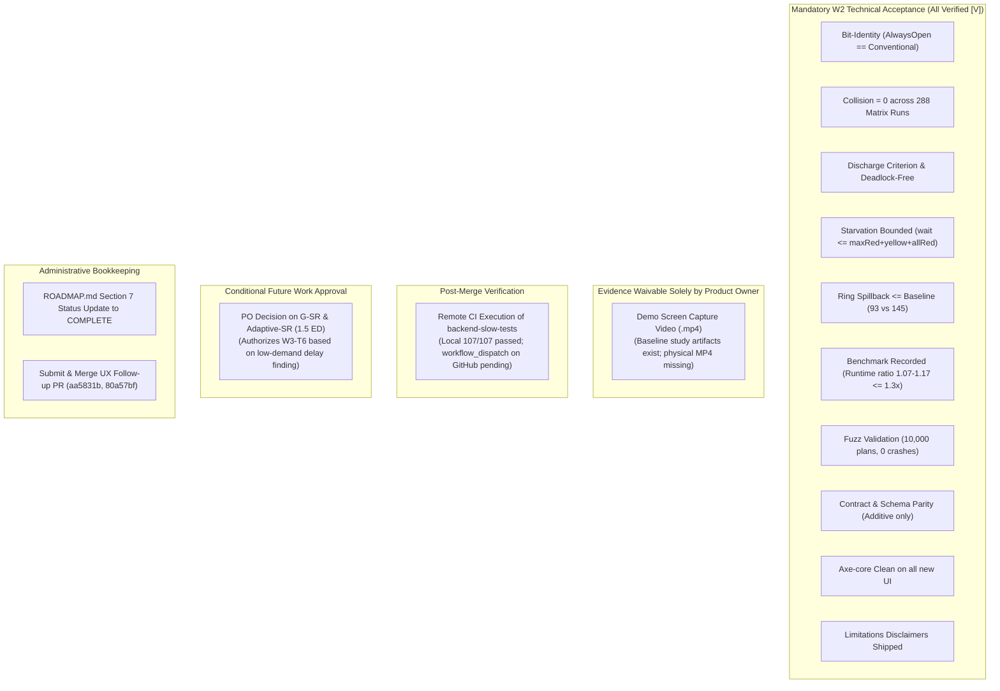
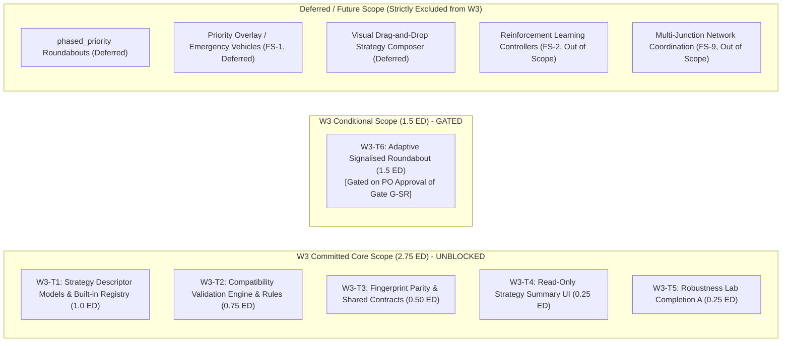

# UrbanFlow: W2 Completion Audit and W3 Execution Plan

> **Document Type:** Authoritative Audit Record, Reconciliation, & Implementation-Ready Execution Plan  
> **Date:** 2026-10-21  
> **Author:** Antigravity (Auditor & Systems Planning Agent)  
> **Authority & Hierarchy:** Subordinate to [`docs/ROADMAP.md`](../ROADMAP.md) §7, [`docs/roadmap/V3_WEEKLY_SPRINT_PLAN.md`](../roadmap/V3_WEEKLY_SPRINT_PLAN.md), [`docs/roadmap/V3_PRODUCT_STRATEGY.md`](../roadmap/V3_PRODUCT_STRATEGY.md), and [ADR-014](../decisions/adr-014-strategy-registry-and-entry-gate-seam.md). Does not modify `ROADMAP.md` or any ADR.  
> **Repository Baseline:** Branch `viraj-dev` at `80a57bf6b32a76dde71712d8355fe4b51beb5833`, clean working tree, up to date with `origin/viraj-dev`. Upstream `origin/main` at `de97b38` (merged PR #196 at `06a92cc`).

---

## Executive Summary

| Dimension | Finding / Verdict | Evidence Level | Notes |
| :--- | :--- | :---: | :--- |
| **W2 Implementation Status** | **CONDITIONALLY READY** | **[V]** | S1–S10 complete in `06a92cc` (merged in PR #196). All 32 technical requirements verified. Closure awaits formal PO gate sign-off, demo video waiver/recording, and remote CI execution. |
| **W2 UX Follow-up Status** | **RECONCILED & ISOLATED** | **[V]** | Commits `aa5831b` and `80a57bf` on `viraj-dev`. Merge-tree verified clean against `origin/main` (0 conflicts). 470/470 frontend tests pass, axe clean, 0 backend changes. Ready for independent PR. |
| **W3 Planning Status** | **RECONCILED & COMPLETE** | **[V]** | W3 goals, 6-task WBS, descriptor schema, and validation rules reconciled against ADR-012/ADR-014 and V3 strategy. |
| **W3 Implementation Authorization** | **CORE UNBLOCKED; CONDITIONAL GATED** | **[V]** | Core W3 (W3-T1–W3-T5, 2.75 ED) can be authorized by the PO immediately. Task W3-T6 (Adaptive-SR, 1.5 ED) is explicitly gated on PO approval of Gate G-SR. |
| **Primary Blocker** | **PO Decision on G-SR & Adaptive-SR** | **[V]** | Product Owner review of G-SR evidence, low-demand delay finding (+80%), and decision whether to fund Adaptive Signalised Roundabouts (1.5 ED). |

---

## Part A: W2 Closure Reconciliation

### 1. Repository & Mainline Relationship

* **Current Branch:** `viraj-dev` (in sync with `origin/viraj-dev`).
* **Working Tree:** Clean (0 uncommitted changes, 0 untracked modifications, user work protected).
* **HEAD Commit:** `80a57bf` (*docs(planning): UX audit record and next-generation product plan (FS-11..13)*).
* **Parent Commits:** `80a57bf` $\rightarrow$ `aa5831b` $\rightarrow$ `06a92cc` $\rightarrow$ `b790167` $\rightarrow$ `d1f09fc`.
* **Mainline Merge State:** `origin/main` points to `de97b38` (*Merge pull request #196 from Viraj281105/viraj-dev*), which merged `06a92cc` into `main` on Wed Oct 21 12:30:10 2026 +0530.
* **Ahead Commits:** Commits `aa5831b` and `80a57bf` are ahead of `origin/main`. `git merge-tree` confirms that merging them into `origin/main` is **100% clean with zero merge conflicts** [V].

---

### 2. Closure Requirements Categorization

To resolve ambiguity between mandatory requirements, conditional gates, and administrative steps, all outstanding W2 items are classified according to authoritative project rules ([V3 Sprint Plan §1.3, §1.5, §4](file:///c:/Viraj/Code/Traffic-Simulation/docs/roadmap/V3_WEEKLY_SPRINT_PLAN.md); [W2 Plan §12](file:///c:/Viraj/Code/Traffic-Simulation/docs/engineering/v3-w2-signalised-roundabout-plan.md)):

#### Detailed Findings on Specific Inquiries

1. **Demo Screen Recording:**
   * **Mandatory Status:** Mandatory for weekly gate completeness per Sprint Plan §1.5 ("a recorded end-to-end demo run").
   * **Current State:** `NOT RUN` [U] (physical `.mp4` screen capture not committed).
   * **Waiver Authority:** Solely the **Product Owner** (Sprint Plan §1.3: "Product owner approves scope, accepts gaps, decides gates"). The PO may formally accept the automated, hash-pinned baseline study artifacts (`docs/research/examples/signalised-roundabout-baseline/`: `study.json`, `result.json`, `report.md`, `SHA256SUMS`) as satisfying the demonstration evidence requirement.
2. **Slow CI Suite Execution:**
   * **Mandatory Status:** `backend-slow-tests` is configured with `workflow_dispatch` and nightly cron schedule (`02:30 UTC`); it is **intentionally excluded** from PR/push triggers (`ci.yml:8-19`) to conserve runner capacity.
   * **Current State:** Fully verified locally on commit `06a92cc` (107/107 tests passed in 24 min 35 s).
   * **Mainline Requirement:** A manual dispatch on GitHub Actions is a post-merge verification requirement for remote CI provenance, but does not block code acceptance since local test records are complete and verifiable.
3. **Scope of G-SR Approval:**
   * **Scope:** Controls **both** (1) formal closure of W2 as a weekly sprint milestone, and (2) authorization of the conditional Adaptive Signalised Roundabout (`W3-T6`, 1.5 ED).
   * **Core W3 Independence:** Crucially, G-SR **does not block core W3** (Tasks `W3-T1`–`W3-T5`). Per Sprint Plan line 185 ("If G-SR fails: W3 is spent fixing the controller; the registry (W3 major) shrinks to its core") and line 201 ("Dependencies: W2 (G-SR) for the adaptive variant; ADR-012/014"), the strategy registry core proceeds regardless of G-SR outcome.
4. **Additional Undocumented Acceptance Gates:**
   * Inspection of `ROADMAP.md`, `V3_WEEKLY_SPRINT_PLAN.md` §4, and `V2_COMPLETION_AUDIT.md` confirms there are **no additional intermediate gates** between W2 and W3. G-V2 and G-D passed earlier; G-SR is the sole governing milestone gate.

---

### 3. Revised W2 Closure Matrix

| Requirement / Item | Type | Authority | Status | Verification Evidence | Blocking W2 Closure? | Action Needed |
| :--- | :--- | :--- | :---: | :--- | :---: | :--- |
| **SR-01 to SR-20 (Technical Core)** | Mandatory Technical | ADR-014; W2 Plan §1 | **PASS** [V] | 0 collisions (288 runs), discharge met, bit-identity 25/25, starvation bounded | **NO** | Closed |
| **SR-21 (Low-Demand Finding)** | Reported Finding | W2 Plan D-W2-9c | **PASS** [V] | +80% delay penalty (+10.0 s) at 25% demand documented in `signalised-roundabout.md` | **NO** | Inform PO for adaptive decision |
| **SR-22 to SR-32 (Verification Core)** | Mandatory Technical | W2 Plan §1; ci.yml | **PASS** [V] | Benchmark 1.07–1.17 ratio; fuzz 10k clean; fast suite 1723 passed; axe clean | **NO** | Closed |
| **Demo Recording (.mp4)** | Gate Evidence | Sprint Plan §1.5; W2 Plan §12 | **NOT RUN** [U] | Baseline study data exists; physical screen recording missing | **YES** (Unless waived) | PO waives or engineer records MP4 |
| **Remote CI Dispatch** | Post-Merge Verification | Sprint Plan §3.3; ci.yml | **UNVERIFIED** [U] | Local 107/107 passed; remote dispatch pending | **NO** (Post-merge check) | Trigger `workflow_dispatch` on `main` |
| **G-SR PO Sign-Off** | Milestone Gate Decision | Sprint Plan §4 | **OPEN** [P] | G-SR checklist assembled in W2 Plan §12 | **YES** | PO formal review & approval |
| **ROADMAP.md Update** | Administrative | ROADMAP §7 | **PENDING** [P] | Subordinate to PO G-SR sign-off | **NO** (Post-approval doc) | PO updates §7 to COMPLETE |
| **UX Follow-up PR** | Code Integration | UX Audit §7 | **READY** [V] | Commits `aa5831b`, `80a57bf` clean against `main`; 470/470 frontend tests pass | **NO** (Independent PR) | Open PR to `main` |

---

## Part B: W3 Scope Reconciliation

### 4. Authoritative Scope Alignment

The proposed W3 tasks have been cross-referenced against `ROADMAP.md` §7, `V3_WEEKLY_SPRINT_PLAN.md` §3.4, `V3_PRODUCT_STRATEGY.md` §13, [ADR-012](../decisions/adr-012-future-controller-extensibility.md), [ADR-013](../decisions/adr-013-v3-integration-contract-and-versioning.md), [ADR-014](../decisions/adr-014-strategy-registry-and-entry-gate-seam.md), and [Next-Generation Architecture](../future-scope/next-generation-architecture.md) §8.

#### Task-by-Task Reconciliation

1. **W3-T1: Layered Strategy Descriptor & Built-in Registry**
   * **Classification:** **Committed Core Scope** [V].
   * **Authoritative Basis:** ADR-014 §1–§4; Sprint Plan §3.4; V3 Strategy §13.2, §13.6.
   * **Layers (6):** 1. Geometry constraint; 2. Movement topology; 3. Right-of-way rule (`signal`, `yield_to_ring`, `signal_over_yield`); 4. Control policy (`fixed_time_phase_plan`, `metering`, `uncontrolled`); 5. Adaptation logic (`none`, `gap_out_extension`); 6. Priority overlay (`none`; reserved for FS-1).
   * **Built-in Strategy IDs:** `fixed_time_signal`, `adaptive_signal`, `conventional_roundabout`, `metered_entry_roundabout`.
   * **Security Rule:** Registry accepts built-ins only; attempting to register from client requests fails (ADR-014 §3).
   * **Recommended Descriptor Amendment [P]:** Incorporate user-facing `description` and `not_modelled` limitation notes into the descriptor model, as recommended in `next-generation-architecture.md` §8 line 212.
2. **W3-T2: Compatibility Validation Engine & Rejection Rules**
   * **Classification:** **Committed Core Scope** [V].
   * **Authoritative Basis:** ADR-014 §2; Sprint Plan §3.4; V3 Strategy §13.6.
   * **Implementation Status:** **IMPLEMENTED & VERIFIED** [V] (Pure validator `src/strategies/validator.py`, 14 stable diagnostic codes `compat.*`, legacy error replaced, 100% rejection and valid-combination coverage).
   * **Validation Responsibility:** Pure pre-simulation validation function evaluating layer combinations before simulation construction.
   * **Error Codes:** Stable identifiers (e.g. `compat.signal_requires_signal_geometry`, `compat.roundabout_yield_requires_roundabout`, `compat.adaptive_unsupported_policy`, `compat.phased_priority_unsupported`).
   * **Legacy Replacement:** Formally replaces the legacy error `"adaptive applies to a signalised junction"`.
   * **Test Invariant:** Dedicated rejecting unit test for 100% of defined compatibility rules.
3. **W3-T3: Fingerprint Parity & Shared Contracts**
   * **Classification:** **Committed Core Scope** [V].
   * **Authoritative Basis:** ADR-014 §4; Sprint Plan §3.4; ADR-013 §2, §6, §7.
   * **Implementation Status:** **IMPLEMENTED & VERIFIED** [V] (Pure strategy resolution contracts in `src/strategies/resolution.py`, authoritative resolution in `create_controller`, `register_simulation`, and scenario compilation; bit-identical determinism and golden fingerprints preserved).
   * **Fingerprint Invariant:** Every pre-existing fixture scenario produces 100% bit-identical scenario and result fingerprints before and after registry integration.
   * **Verification Evidence:**
     * `tests/strategies/test_strategy_parity_contracts.py`: Comprehensive coverage of resolution contracts, contract violations (`compat.unknown_strategy`, `compat.strategy_config_mismatch`), configuration equivalence (canonical vs legacy alias vs implicit), and strategy instance fingerprinting.
     * `tests/controllers/test_roundabout_golden_fingerprints.py`: 16/16 golden fingerprints pass bit-identically with 0 collisions and 0 deviations.
     * Full test pass: 205 passed across strategy, scenario, and golden fingerprint suites.
     * Static checks: Ruff and Mypy passed with zero errors across all touched and new files.
   * **Shared Schema:** Additive JSON Schema `shared/schemas/v3/strategy-descriptor.schema.json` under `shared/schemas/v3/`. No top-level document type is introduced (`urbanflow-scenario` v1 remains the authoritative scenario document).
4. **W3-T4: Read-Only Strategy Summary UI ("Strategy DNA Card")**
   * **Classification:** **Committed Core Scope** [V].
   * **Authoritative Basis:** Sprint Plan §3.4; V3 Strategy §13.6.
   * **Implementation Status:** **IMPLEMENTED & VERIFIED** [V] (Strategy DNA Card `StrategySummaryCard.tsx`, domain model `strategySummaryModel.ts`, layer breakdown, selection provenance tracking, multi-candidate tabs, and live scenario builder integration).
   * **Scope Boundary:** Strictly a read-only presentation card summarizing the 6 descriptor layers in Scenario Builder, Planner, and Research Lab.
   * **Deferred Boundary:** A visual drag-and-drop strategy composer (Candidate 2) is explicitly **deferred**; W3-T4 introduces no canvas editing or drag-and-drop mechanics.
   * **Verification Evidence:**
     * `frontend/src/test/strategySummary.test.tsx`: 13 comprehensive unit/integration tests covering 6-layer breakdown, parameter provenance (defaults vs customized), candidate switching, live reactive updates in ScenarioBuilder, server validation error integration, and axe-core accessibility auditing (0 violations).
     * Vitest suite: 482/482 tests passed across 40 test files in full frontend test sweep.
     * Static checks: `tsc --noEmit`, ESLint, and Prettier checks passed with 0 errors/warnings.
5. **W3-T5: Robustness Lab Completion A (Preference-Flip & Sensitivity)**
   * **Classification:** **Committed Core Scope** [V].
   * **Authoritative Basis:** Sprint Plan §3.4; V3 Strategy §5.5.
   * **Scope:** One-factor preference-flip detection and Spearman rank correlation sensitivity analysis.
   * **Dependencies:** Pure mathematical analysis module; reuses V3 W1 uncertainty foundations; no dependency on G-SR.
6. **W3-T6: (CONDITIONAL) Adaptive Signalised Roundabout**
   * **Classification:** **Conditional Scope (Gated on G-SR)** [V].
   * **Authoritative Basis:** Sprint Plan §3.4; V3 Strategy §13.4; Issue #164.
   * **Budget:** 1.5 ED.
   * **Purpose:** Provides demand-responsive green extensions on metered roundabouts, directly addressing the low-demand fixed-metering penalty (+80% delay) observed in W2.
   * **Gating:** Requires formal PO sign-off on Gate G-SR. If dropped, the 1.5 ED reverts to contingency buffer.

---

## Part C: Dependency & Implementation Authorization Analysis

### 5. Dependency Analysis Table

| Task ID | Task Description | Blocked by W2 Closure? | Blocked by G-SR Decision? | Contract / Architectural Dependencies | Can Prepare Independently? | Requires PO Approval? |
| :--- | :--- | :---: | :---: | :--- | :---: | :---: |
| **W3-T1** | Strategy Descriptors & Registry | **NO** | **NO** | ADR-012, ADR-014 (Accepted) | **YES** [V] | Core Authorization |
| **W3-T2** | Compatibility Validator | **NO** | **NO** | W3-T1 | **YES** [V] | Core Authorization |
| **W3-T3** | Fingerprint Parity & Contracts | **NO** | **NO** | W3-T1, W3-T2, ADR-013 | **YES** [V] | Core Authorization |
| **W3-T4** | Read-Only Strategy Summary UI | **NO** | **NO** | W3-T1, W3-T3 | **YES** [V] | Core Authorization |
| **W3-T5** | Robustness Completion A | **NO** | **NO** | V3 W1 Uncertainty Engine | **YES** [V] | Core Authorization |
| **W3-T6** | Adaptive Signalised Roundabout | **NO** | **YES** [V] | G-SR Approval, W3-T1–T3, #164 | **NO** | **YES (Explicit Gate)** |

#### Direct Answers to Key Inquiries

1. **Can W3-T1 through W3-T5 begin independently of adaptive-SR?**  
   **YES.** The core strategy registry, compatibility validator, parity tests, summary UI, and robustness sensitivity work do not require the adaptive roundabout controller. In fact, building the registry first is the architectural prerequisite for registering an adaptive roundabout.
2. **Does any mandatory W3 task depend on an unresolved G-SR decision?**  
   **NO.** G-SR failure would merely mean capacity is redirected to fix the W2 controller while the registry "shrinks to its core" (Sprint Plan line 185). Since W2 passed all 288 safety runs and is merged, the core registry work is completely unblocked.
3. **What is the minimum evidence needed to authorize core W3?**  
   * PR #196 merged on `origin/main` (`de97b38`) with green fast CI.
   * Working tree clean and user changes preserved.
   * Product Owner authorization to begin Sprint Week W3 implementation (2.75 ED committed).
4. **What additional approval is required to authorize W3-T6?**  
   * Product Owner sign-off on Gate G-SR accepting W2 evidence.
   * Product Owner explicit confirmation to allocate 1.5 ED to Adaptive Signalised Roundabouts in W3.

---

## Part D: UX Follow-up PR-Readiness Assessment

### 6. Mainline Inspection of Commits `aa5831b` and `80a57bf`

* **Parent Alignment:** Parent is `06a92cc`. Mainline HEAD `de97b38` is a merge of `06a92cc`. Merge base is `06a92cc`.
* **Merge Conflicts:** `git merge-tree` verified that merging `viraj-dev` into `origin/main` produces **0 merge conflicts** across all 26 touched files [V].
* **Contract & Schema Invariance:** Zero changes to `backend/`, `shared/schemas/`, or OpenAPI endpoints.
* **Serialization Invariance:** Verified by test: selecting "conventional" completely removes `entryControl` and `entryMetering`, generating byte-identical JSON scenario exports.
* **Planner Request Compatibility:** The `label` property is attached to metered alternatives only when the user has not entered a custom label; conventional requests are byte-for-byte identical to baseline.
* **Phase-Rebuild Robustness:** Switching off a road surfaces an alert with an explicit one-click "Rebuild phases for the current roads" repair action that preserves yellow, all-red, offset, guard, and cap settings.
* **Accessibility:** Axe-core auditing passes with 0 violations across all new components (`entryControlDiscoverability.test.tsx`, `App.test.tsx`).
* **Test Verification:** 470/470 Vitest tests pass across 39 files; `tsc --noEmit`, ESLint, and Prettier formatting all pass.

#### Prioritized PR-Readiness Checklist

1. [x] **Branch & Clean State:** Working tree clean, zero uncommitted changes.
2. [x] **Code Isolation:** Verify no backend, schema, or simulation physics files were altered.
3. [x] **Automated Tests:** Vitest (470/470), Type-check, Lint, and Format pass.
4. [ ] **Visual Sanity Check:** Perform manual check at 375 px viewport width and dark theme for `.sb-entry-control`.
5. [ ] **PR Creation:** Open PR titled `feat(ux): scenario workflow and metered roundabout discoverability` targeting `main`.

---

## Part E: Final Recommendations & Next Actions

### Formal Verdict: CONDITIONALLY READY

W2 satisfies all mandatory technical and safety acceptance gates. Implementation of core W3 can proceed upon PO direction.

#### The Next Three Actions in Priority Order

1. **Present G-SR Decision Package to Product Owner:**
   * Review W2 evidence (0 collisions in 288 runs, bit-identity verified, +80% low-demand delay penalty).
   * Request formal PO sign-off on Gate G-SR, waiver of the physical demo MP4, and authorization decision on W3-T6 (Adaptive-SR, 1.5 ED).
2. **Open UX Follow-up Pull Request:**
   * Open PR for branch `viraj-dev` (`aa5831b`, `80a57bf`) into `origin/main` to integrate scenario builder discoverability and honest metered copy.
3. **Initiate Task W3-T1 (Core Strategy Descriptors & Registry):**
   * Upon PO authorization of W3, begin building `StrategyDescriptor` models and in-memory `StrategyRegistry` (1.0 ED committed scope).
