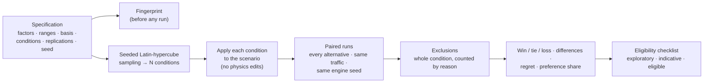

# Robustness under uncertainty

> **Status:** Current · V3.0 W1 · verified against `backend/src/uncertainty/` (`spec.py`, `sampler.py`, `apply.py`, `runner.py`, `stats.py`, `analysis.py`), `backend/src/experiments/` and `backend/tests/uncertainty/`. Normative sources: [ADR-015](../decisions/adr-015-robustness-lab-uncertainty-design.md) and [V3 strategy §5](../roadmap/V3_PRODUCT_STRATEGY.md).
> **Rule for this page:** every number the Robustness Lab shows is computed by the server from simulations; every claim below is backed by a test or by the source, and where a part is not built yet the page says so.
> **One sentence to remember:** the Robustness Lab tells you whether a comparison *survives the uncertainty you declared*; it cannot tell you whether the declared uncertainty, or the simulation, matches any real junction.

---

## 1. The question

A planning study (V2.0) repeats each alternative over several random seeds. That measures **seed-to-seed noise**: how much one control option's result wobbles when only chance changes. It does not answer the planner's real worry: *"if demand is 20 % higher, or drivers keep shorter gaps, or more trucks arrive, would I still prefer the same option?"* That is **parameter uncertainty**, and the Robustness Lab is built for it.

It works like this: you declare which inputs are uncertain and over what range; the lab draws many plausible "worlds" from those ranges; in each world it runs every alternative on identical traffic; and it reports how often, and by how much, each alternative beats, ties or loses to the baseline.

---

## 2. Three words that are never mixed up

| Term | Meaning | Shown as |
| --- | --- | --- |
| **Condition** | One draw of all factors from the specification, for example "demand ×1.12, headway ×0.94, 7 % more heavy vehicles" | **N conditions** |
| **Replication** | An independent random seed on the same condition; it averages out chance *inside* a condition | **r replications** |
| **Run** | One simulation: (condition, alternative, replication) | **Total runs = N × alternatives × r** |

**The unit of inference is the condition, not the run.** Within a condition the replications of an alternative are averaged into one outcome. Replications make each condition's outcome less noisy; they do **not** add conditions. So whatever the lab says about uncertainty in demand or driver behaviour rests on the number of **valid conditions**, never on the number of runs. A screen that shows "600 runs" always shows "100 conditions × 3 alternatives × 2 replications" beside it.

---

## 3. The specification

A specification (`urbanflow-uncertainty-spec` v1) lists up to 12 **factors**. Each factor has an id, a kind, a distribution with bounds, a **basis** (`assumed`, `observed` or `user`) and, when the basis is `assumed`, a mandatory written reason. The specification is fingerprinted **before** any run, so the question cannot be quietly changed after the answer is known.

| Factor kind | Value *s* | What it changes in the scenario |
| --- | --- | --- |
| `demand_scale` | multiplier, 0.05 to 10 | Vehicles per hour on every arm × *s* |
| `turning_shift` | −1 to +1 | Moves share between *straight* and *turning* (left + right); *s* > 0 moves the fraction *s* of the straight share into turns, *s* < 0 the fraction \|*s*\| of the turns into straight; U-turns untouched |
| `mix_shift` | −1 to +1 | Moves share between *light* (car, SUV, motorcycle) and *heavy* (bus, truck) vehicles; needs a vehicle mix declared in the scenario |
| `headway_scale` | multiplier, 0.05 to 10 | The IDM desired time headway of every vehicle class × *s*. A **proxy** for driver behaviour: the engine has no explicit reaction delay |
| `desired_speed_scale` | multiplier, 0.05 to 10 | Every class's desired-speed range × *s* |
| `max_acceleration_scale` | multiplier, 0.05 to 10 | The IDM maximum acceleration of every class × *s* |

The exact mapping, the cases it refuses and the evidence that each factor moves the simulation are in the [factor mapping note](../engineering/v3-w1-factor-mapping.md). Three rules matter here:

* **No physics is edited.** A condition produces a new scenario document through inputs the scenario already has; the engine, the car-following model and the constants are untouched. Existing determinism tests stay green and unmodified.
* **An invalid result is rejected, never repaired.** If a perturbed scenario fails validation (demand above an arm's limit, say) the condition is excluded and counted. A vehicle mix is never rescaled to make it sum to one.
* **All factors are global in this version.** A factor acts on every arm and every vehicle class alike. Per-approach factors are not part of v1.

### Distributions and sampling

Distributions can be uniform, triangular, truncated normal or lognormal, always cut to the stated bounds. Conditions are drawn by **seeded Latin-hypercube sampling**: for each factor the range is split into N slices of equal probability, one point is drawn in each slice, and the slices are shuffled independently per factor. Every part of the range is therefore visited evenly even with few conditions, and the same specification gives exactly the same conditions. Sampled values are rounded to six decimals so a fingerprint never depends on how a float was printed.

The engine seed of each run is a fixed function of (specification seed, condition index, replication): the first 31 bits of SHA-256 of `urbanflow-uncertainty-v1:<seed>:<condition>:<replication>`. Nothing depends on the order in which workers finish.

---

## 4. The paired comparison

In every condition, **all alternatives run the same perturbed scenario with the same engine seed**; they differ only in how the junction is controlled. This is the method of *common random numbers*: because both sides see the same arrivals, the difference between them reflects the control and not luck. It is tested two ways: the compiled configurations of two alternatives differ only in their control section, and the same strategy run twice under the same specification gives identical outcomes in every condition.

The comparison uses **one pre-declared primary indicator**, chosen before the run: mean delay (`averageDelay`, the default), median delay or 95th-percentile delay, always in seconds, always lower-is-better. Delay is the time a vehicle loses against driving its route at its desired speed, counted for vehicles that finish a trip after warm-up ([metrics reference](metrics-reference.md)). Other indicators may be reported but are never used to decide eligibility, so there is no room for picking the indicator that flatters a result.

For alternative *a* and the baseline in condition *i*, the paired difference is **D(i, a) = Y(i, a) − Y(i, baseline)**, where *Y* is the primary indicator averaged over the replications.

---

## 5. What is computed

**Win, tie, loss.** With the tie tolerance (by default the existing presentation rule: two delays are "about the same" when they differ by at most 1 s **or** at most 5 % of the larger one; a specification may set its own absolute value), each valid condition is a *win* (the alternative is clearly lower), a *loss* (clearly higher) or a *tie*. A tie is a result, not a missing value, and it counts in every share. Each share is shown with a **95 % Wilson interval**, which behaves sensibly at 0 % and 100 % where the textbook formula does not.

**The size of the difference.** The mean, median, 5th and 95th percentile of *D* are reported with **95 % bootstrap intervals**: the valid conditions are resampled 2 000 times with a seeded generator and the central 95 % of each statistic is read off. The percentile rule is linear interpolation between ordered values.

**Regret.** In each condition, an alternative's regret is how much worse it is than the best alternative *in that condition* (never negative). The page shows the mean regret, the 95th percentile and the largest regret in the sample (labelled as a sample maximum, because it depends on N). Regret depends on which alternatives were compared, so the set is displayed with it.

**Preference share.** The share of valid conditions in which an alternative is within the tolerance of the best. Shares can add up to more than 100 % and are described as "not ranked".

**Nothing is ranked.** There are no p-values, no "winner" and no "best option". With K alternatives the K−1 comparisons against the baseline are descriptive.

All of these functions are pure and were checked against a hand-computed dataset: a ten-condition, three-alternative example whose every count, interval, regret and share was worked out on paper and is asserted exactly in `backend/tests/uncertainty/test_analysis.py`. The Wilson values are the standard published ones. The tests are also *known to fail*: deliberately breaking the win/loss direction or the Wilson formula makes them fail.

---

## 6. Exclusions: nothing is quietly dropped

A condition is excluded **for every alternative** if any one of its runs is unusable, so the pairing is never broken. Exclusions are counted by reason and by position in each factor's range:

| Reason | Meaning |
| --- | --- |
| `validation_failed` | the scenario was invalid after the change (rejected, never repaired) |
| `run_failed` | a simulation raised an error |
| `vehicle_limit` | a run hit the vehicle limit |
| `no_completed_vehicles` | no vehicle finished a trip after warm-up. The simulator reports a delay of 0.0 for an empty sample (see "No data yet" in the [metrics reference](metrics-reference.md)); scored as a measurement it would make every alternative look identical, so it is excluded instead. `POST /api/v3/experiments/validate` warns when fewer than 60 s are measured after warm-up |
| `non_finite` | the indicator is missing or not a number |
| `timeout`, `deadlock` | reserved; simulations run a fixed number of ticks and the engine has no deadlock flag yet |

If more than **10 %** of the conditions are excluded, or more than **20 %** in any fifth of a factor's range, the result is **not eligible**: the surviving conditions no longer represent the declared ranges evenly.

---

## 7. When may a result be called "robust"?

There is no universal "enough conditions", and 100 is not automatically enough. The page computes and shows a checklist instead:

| Class | When |
| --- | --- |
| **Exploratory only** | fewer than 30 valid conditions. No statement about robustness of any kind |
| **Indicative** | 30 or more valid conditions, but at least one criterion is not met or not yet assessed |
| **Eligible for robustness statements** | **all** criteria below are met |

1. **Precision:** the 95 % Wilson half-width of every reported P(win) and P(loss) is at most 0.10. In the worst case (a 50/50 split) that needs about 97 valid conditions; fewer suffice when proportions are extreme.
2. **Stability (split-half):** the estimates barely change when the conditions are split into random halves. **Not computed yet** (scheduled for W4).
3. **Replications:** at least 2 per condition, so within-condition noise can be estimated.
4. **Exclusions:** within the limits of §6.
5. **Pre-declaration:** the specification, the primary indicator and the tolerance were fingerprinted before the run.

**Status today:** because criterion 2 is not computed, the lab honestly reports it as *not assessed*, and **no result can currently be classed "eligible"**. The best a result can be today is "indicative". This is deliberate: it is better to under-claim than to display a status the method cannot yet support.

**What "eligible" will mean, and not mean.** It will mean the evidence statement is *adequately sampled for the declared assumptions*. It will **not** mean that the preference is large, that the simulator is correct, or that any real junction behaves this way.

---

## 8. What this does not claim

* **Real-world validity: none — assumptions only.** This line is on every result. Every input range is an assumption of the person who wrote the specification; it is an estimate from data only where the basis says `observed` and an observation record is attached, which V3.0 does not yet support. The word "calibrated" is not used for these results.
* **The simulator is not calibrated to observed traffic.** The result says how the alternatives compare *inside the simulator under the declared assumptions*.
* **Headway is a proxy.** The engine has no explicit reaction delay; `headway_scale` stands in for "drivers behave differently".
* **Not modelled:** time-varying demand (peak build-up and decay), incidents and lane closures, weather as an effect (it could only enter as a labelled sensitivity factor), per-approach uncertainty, and interactions between factors. The result does not resolve interactions and says so.
* **Intervals are approximate.** They treat the sampled conditions as exchangeable draws. With Latin-hypercube stratification they are approximate and slightly conservative.
* **Not yet computed:** one-factor preference-flip detection ("at what demand does the preference change?"), rank sensitivity of each factor, split-half stability and the split of variance between and within conditions. They are scheduled (W3, W4) and absent from the result rather than faked.
* **Run time is unverified outside the one development machine it was measured on.** The demo records its own wall time and worker count; treat them as an example, not a promise.

---

## 9. Reproducibility

The same specification, scenario and seed give the same `resultFingerprint`: a hash of the scenario, the alternatives, the specification and the whole analysis, but not of timestamps, worker counts or wall time. Results are aggregated by condition index, so the order in which workers finish cannot change them. The demo verifies this by running the experiment twice (`scripts/v3_demo.py --verify`).

Two precautions apply. A fingerprint match is *exact replay* only on the same code revision, the same Python minor version and dependency pins, and the same kind of machine; on anything else, expect statistically comparable results rather than identical ones. And the full reproducibility manifest (environment, dependency hash, replay classes `exact` / `comparable` / `differs`) and portable packages arrive in a later release; today a result carries the commit, the Python version and the fingerprints.

---

## 10. How to run one

* **From the browser:** open `/app/experiments/<id>` for an experiment submitted through the API; it follows the run and then shows the limitations, the counts, the eligibility checklist, the comparison tables, the assumptions and the provenance.
* **From a script:** [`scripts/v3_demo.py`](../../scripts/v3_demo.py) submits a 24-condition × 3-alternative study through `/api/v3`, follows it and prints the report; `--offline` prints a precomputed result, so a demonstration never depends on a live run ([worked example](examples/robustness-demo/README.md)).
* **The API:** [`/api/v3` reference](../api/README.md#11-robustness-lab-api--apiv3-v30-in-development); contract files in [`shared/schemas/v3/`](../../shared/schemas/v3/).
