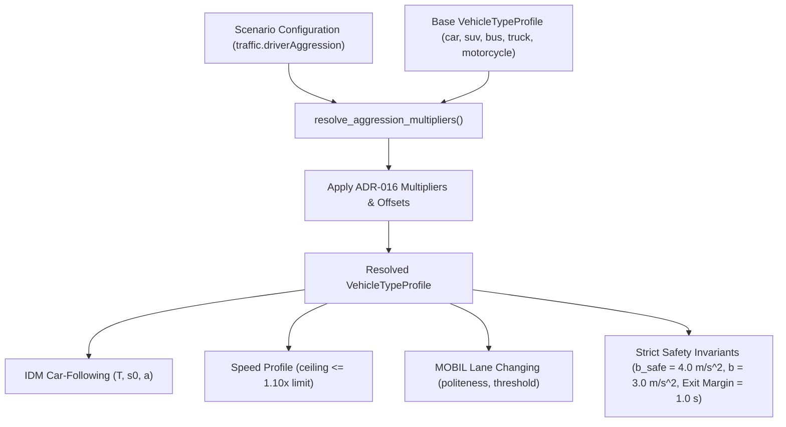

# Driver Aggression Profiles

> **Scientific Disclaimer:**  
> **"driver aggression — a simulation assumption, not a measurement of real-world driver behaviour"**  
> *V3.0 simulation results under `high` aggression are not comparable to V2.0 baseline reports unless the profile is explicitly stated.*

**Status:** Accepted in V3.0 W4 ([ADR-016](../decisions/adr-016-driver-aggression-profile.md), [Product Strategy §14](../roadmap/V3_PRODUCT_STRATEGY.md#14-driver-aggression-as-a-profile), issue [#165](https://github.com/Viraj281105/Traffic-Simulation/issues/165)).

---

## 1. Overview and Core Concept

There was previously no global driver aggression setting in UrbanFlow. Related features addressed different phenomena: `traffic.unstructuredTraffic` introduces random per-tick kinematic noise via `StochasticIDM`, and `traffic.aggressiveTwoWheelers` affects only motorcycle lane-filtering when unstructured traffic is active.

In V3.0, driver aggression is modelled as a **named profile**:
$$\text{traffic.driverAggression} \in \{\text{"standard"}, \text{"moderate"}, \text{"high"}\}$$

A driver aggression profile is a deterministic set of **calibrated multipliers and offsets applied on top of each vehicle class's base properties**. It is not a flag flip, not random noise, and not a replacement of unrelated vehicle dynamics.



### Key Conceptual Distinctions

1. **Systematic Profile vs Random Noise:** Aggression is a systematic behavioural assumption (`driverAggression`), whereas unstructured traffic is stochastic noise (`unstructuredTraffic`). Both can be enabled independently.
2. **Decision D-AG2:** `high` aggression does **not** implicitly enable `aggressiveTwoWheelers`.
3. **Reproducibility Invariant:** Stored configurations and frozen API endpoints (`/api/v1`, `/api/v2`) omitting `driverAggression` resolve to `standard`, producing bit-for-bit identical results and unchanged fingerprints.

---

## 2. Definitive Profile Multipliers and Levers

The multipliers below were proposed in Product Strategy §14, validated empirically in Spike AG-1 ([`test_aggression_spike.py`](file:///c:/Viraj/Code/Traffic-Simulation/backend/tests/vehicles/test_aggression_spike.py)), and ratified in [ADR-016](../decisions/adr-016-driver-aggression-profile.md):

| Lever | Baseline (`standard`) | `moderate` | `high` | Behavioral Effect |
| :--- | :---: | :---: | :---: | :--- |
| **Desired Time Headway $T$** | $\times 1.00$ | $\times 0.85$ | $\times 0.70$ | Tighter following distance at cruising speed; drives higher saturation flow. |
| **Minimum Standstill Gap $s_0$** | $\times 1.00$ | $\times 0.875$ | $\times 0.75$ | Shorter distance between stopped vehicles in queues; compacts queue footprint. |
| **Max Launch Acceleration $a$** | $\times 1.00$ | $\times 1.075$ | $\times 1.15$ | Faster launch from stop lines; reduces startup lost time per phase. |
| **Desired Speed Factor** | $+0.000$ | $+0.025$ | $+0.050$ | Higher speed choice relative to speed limit; bounded by strict ceiling $\le 1.10 \times \text{limit}$. |
| **MOBIL Politeness $p$** | $\times 1.00$ | $\times 0.75$ | $\times 0.50$ | Lower altruism; drivers accept lane changes advantageous to ego even if imposing minor follower braking. |
| **MOBIL Threshold $\Delta a_{th}$** | $\times 1.00$ | $\times 0.75$ | $\times 0.50$ | Lower acceleration advantage required to trigger a lane change. |

### Strict Invariants (Preserved Across All Profiles)

* **Safe Deceleration $b_{safe} = 4.0\text{ m/s}^2$ (Strictly Unchanged):** The MOBIL safety criterion is not weakened. A lane change that forces an approaching follower to brake harder than $4.0\text{ m/s}^2$ is rejected $100\%$ of the time.
* **Comfort Deceleration $b = 3.0\text{ m/s}^2$ (Strictly Unchanged):** IDM braking interaction dynamics are untouched to prevent conflating aggression with vehicle braking mechanics.
* **IDM Exponent $\delta = 4.0$ (Strictly Unchanged):** Free-road acceleration curvature is preserved.
* **Roundabout Internal Safety Margins (Strictly Unchanged):** `_EXIT_SAFETY_HEADWAY` and `_EXIT_COMMIT_MARGIN` remain fixed at $1.0\text{ s}$ in [`src/controllers/roundabout.py`](file:///c:/Viraj/Code/Traffic-Simulation/backend/src/controllers/roundabout.py). Spike AG-1 confirmed that approach headway and launch acceleration provide $+11\%$ to $+25\%$ entry flow without altering internal ring conflict buffers.

---

## 3. Parameter Values by Vehicle Class

Aggression multipliers scale base parameters across all five supported vehicle classes while strictly maintaining physical ordering (heavy vehicles accelerate slower and maintain longer headways than cars):

| Vehicle Class | Parameter | Standard | Moderate | High |
| :--- | :--- | :---: | :---: | :---: |
| **Car** | Time headway $T$ | $1.50\text{ s}$ | $1.275\text{ s}$ | $1.050\text{ s}$ |
| | Standstill gap $s_0$ | $2.00\text{ m}$ | $1.750\text{ m}$ | $1.500\text{ m}$ |
| | Max acceleration $a$ | $2.00\text{ m/s}^2$ | $2.150\text{ m/s}^2$ | $2.300\text{ m/s}^2$ |
| | Desired speed factor | $[0.90, 1.05]$ | $[0.925, 1.075]$ | $[0.950, 1.100]$ |
| | Politeness $p$ | $0.30$ | $0.225$ | $0.150$ |
| **SUV** | Time headway $T$ | $1.60\text{ s}$ | $1.360\text{ s}$ | $1.120\text{ s}$ |
| | Standstill gap $s_0$ | $2.20\text{ m}$ | $1.925\text{ m}$ | $1.650\text{ m}$ |
| | Max acceleration $a$ | $1.80\text{ m/s}^2$ | $1.935\text{ m/s}^2$ | $2.070\text{ m/s}^2$ |
| | Desired speed factor | $[0.85, 1.00]$ | $[0.875, 1.025]$ | $[0.900, 1.050]$ |
| | Politeness $p$ | $0.40$ | $0.300$ | $0.200$ |
| **Bus** | Time headway $T$ | $2.20\text{ s}$ | $1.870\text{ s}$ | $1.540\text{ s}$ |
| | Standstill gap $s_0$ | $3.00\text{ m}$ | $2.625\text{ m}$ | $2.250\text{ m}$ |
| | Max acceleration $a$ | $1.20\text{ m/s}^2$ | $1.290\text{ m/s}^2$ | $1.380\text{ m/s}^2$ |
| | Desired speed factor | $[0.75, 0.90]$ | $[0.775, 0.925]$ | $[0.800, 0.950]$ |
| | Politeness $p$ | $0.60$ | $0.450$ | $0.300$ |
| **Truck** | Time headway $T$ | $2.40\text{ s}$ | $2.040\text{ s}$ | $1.680\text{ s}$ |
| | Standstill gap $s_0$ | $3.00\text{ m}$ | $2.625\text{ m}$ | $2.250\text{ m}$ |
| | Max acceleration $a$ | $1.00\text{ m/s}^2$ | $1.075\text{ m/s}^2$ | $1.150\text{ m/s}^2$ |
| | Desired speed factor | $[0.70, 0.85]$ | $[0.725, 0.875]$ | $[0.750, 0.900]$ |
| | Politeness $p$ | $0.70$ | $0.525$ | $0.350$ |
| **Motorcycle** | Time headway $T$ | $1.10\text{ s}$ | $0.935\text{ s}$ | $0.770\text{ s}$ |
| | Standstill gap $s_0$ | $1.00\text{ m}$ | $0.875\text{ m}$ | $0.750\text{ m}$ |
| | Max acceleration $a$ | $3.00\text{ m/s}^2$ | $3.225\text{ m/s}^2$ | $3.450\text{ m/s}^2$ |
| | Desired speed factor | $[0.95, 1.10]$ | $[0.975, 1.100]$ | $[1.000, 1.100]$ |
| | Politeness $p$ | $0.10$ | $0.075$ | $0.050$ |

---

## 4. Default Semantics and Authoring Boundaries

To preserve backward compatibility, reproducibility, and existing golden fingerprints while making high aggression the default for new investigations, the system enforces strict authoring boundary rules:

| Boundary | Ingestion / Processing Rule | Stored Representation |
| :--- | :--- | :--- |
| **Stored Scenarios & V2.0 Fixtures** | Absent `traffic.driverAggression` implicitly resolves to `standard`. Existing fingerprints are bit-for-bit preserved. | Stored JSON omits `driverAggression` or contains `"standard"`. |
| **Frozen APIs (`/api/v1`, `/api/v2`)** | Absent parameter resolves to `standard`. No stored scenario changes meaning. | Legacy schema contract intact. |
| **New Authoring: Frontend UI & Presets** | Authoring UI (e.g. `ScenarioSetup.tsx`, `AdvancedSettings.tsx`) defaults to `high`. | Explicitly written as `"driverAggression": "high"`. |
| **New Authoring: Builder & Client SDK** | `create_scenario()` and Python SDK helpers write `"driverAggression": "high"` by default. | Explicitly written as `"driverAggression": "high"`. |
| **New Authoring: `/api/v3` Experiments** | New experiment specifications write `"driverAggression": "high"` if unspecified. | Explicitly stored in manifest assumptions. |
| **User Selection (Any Boundary)** | Explicit selection (`standard`, `moderate`, or `high`) is **always preserved**; never overridden. | Selected value recorded verbatim. |

---

## 5. Reproducibility, Manifests, and Fingerprinting

1. **Fingerprint Sensitivity:**
   - When `driverAggression` is omitted or `"standard"`, `scenario_fingerprint()` produces the identical 16-hex hash as V2.0, preserving golden fixtures.
   - When set to `"moderate"` or `"high"`, scenario fingerprints change deterministically to distinguish differing behaviour.
2. **Experiment Manifest Tracking:**
   Every `/api/v3` experiment manifest includes the resolved profile name and its parameter hash in the `assumptions` block:
   ```json
   {
     "assumptions": {
       "driverAggression": "high",
       "driverAggressionHash": "7f8b92b6...",
       "disclaimer": "driver aggression — a simulation assumption, not a measurement of real-world driver behaviour"
     }
   }
   ```
3. **Deterministic Replay:**
   Identical scenario specification, random seed, and profile guarantee bit-identical trajectories and performance metrics.

---

## 6. The 108-Cell Factorial Interaction Matrix

W4-T5 validated profile behavior across a complete $3 \times 3 \times 4 \times 3 = 108$ factorial matrix:
* **Profiles (3):** `standard`, `moderate`, `high`
* **Vehicle Mixes (3):** `car-only`, `mixed` (urban), `heavy-vehicle` (70% bus/truck)
* **Strategies (4):** `fixed_time_signal`, `adaptive_signal`, `conventional_roundabout`, `metered_entry_roundabout`
* **Densities (3):** `low` (200 vph/arm), `medium` (500 vph/arm), `saturated` (1000 vph/arm)

### Empirical Findings

1. **Zero Collisions and Zero Deadlocks:**
   $100\%$ of the 108 configurations ran collision-free and deadlock-free with longest stalls $\le 40.8\text{ s}$ (limit $70.0\text{ s}$).
2. **Throughput Scaling:**
   Mean throughput rose monotonically from $8.00\text{ veh}$ (`standard`) to $8.19\text{ veh}$ (`moderate`, $+2.4\%$) and $8.67\text{ veh}$ (`high`, $+8.4\%$). Under saturated demand, throughput increased by $+10.7\%$.
3. **Control Strategy Synergy:**
   `adaptive_signal` benefited most strongly ($+13.8\%$ throughput under `high`), as shorter time headways allowed platoons to clear through green phases before gap-out timers expired.
4. **Queue Footprint Compression:**
   In saturated regimes, the physical queue count increased from $2.99$ to $3.41$ vehicles. Tighter standstill spacing ($s_0 \times 0.75$) compressed queues, accommodating more vehicles within approach lanes before entry lines.

Full tabular data is archived in [`w4_t5_factorial_matrix_report.md`](../brain/ce28a29a-ef51-4385-a46d-5eee0cca129f/w4_t5_factorial_matrix_report.md).

---

## 7. Limitations and Scientific Boundaries

* **Simulation Assumption, Not Reality:** Driver aggression profiles are theoretical modeling parameters designed to study junction sensitivity under varying driving styles. They are not empirical distributions fitted to naturalistic driving or telematics data.
* **No Homogeneous Calibration:** Real drivers exhibit heterogeneous distributions of headways and reaction times; UrbanFlow applies uniform class-specific multipliers per profile.
* **Non-Comparability:** Experiments executed under `high` aggression must not be directly compared against V2.0 baseline publications without explicitly declaring the profile difference.
