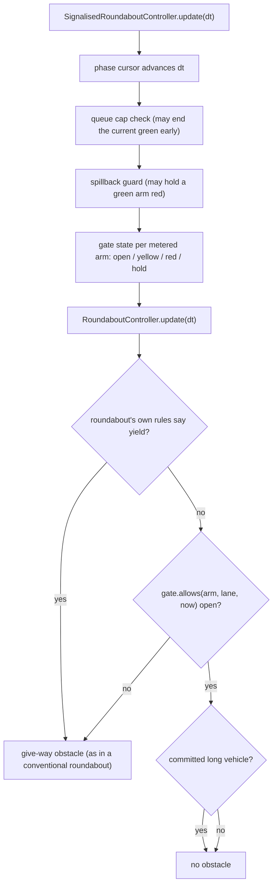

# Signalised roundabout — `metered_entry`

> **Status:** implemented in V3.0 W2 ([ADR-014](../decisions/adr-014-strategy-registry-and-entry-gate-seam.md), [plan](../engineering/v3-w2-signalised-roundabout-plan.md), issue [#163](https://github.com/Viraj281105/Traffic-Simulation/issues/163)). Everything on this page is a **simulation model with assumed, uncalibrated timings**. It makes no claim that a signalised roundabout is better or safer than a conventional one in the real world.

A conventional roundabout lets a vehicle enter whenever the circulating gap is long enough. `metered_entry` adds one thing in front of that rule: a traffic signal on chosen entries that can say *not yet*. It never says *go*. Every other rule — gap acceptance, follow-up time, exit-yield, keep-clear, the long-vehicle mouth rules — stays in force, so red can only remove entry opportunities.

## 1. Model

### 1.1 Where the signal acts

The signal acts at the roundabout's own give-way line (`lane.length`). There is **one line**, not a stop line upstream of a separate yield line: the strategy document describes the upstream arrangement, the simulation does not model storage between two lines (approved deviation D-W2-2). A vehicle held by the signal waits at the give-way line, exactly where a vehicle waiting for a gap waits.



The gate is consulted only after the roundabout's own rules have said "proceed", and before the committed-long-vehicle override, so a long vehicle already across the line still completes its entry. `SignalisedRoundaboutController` *owns* a `RoundaboutController` (composition, not inheritance) and hands it the gate through the `entry_gate` argument introduced in S2. With the default `AlwaysOpen` gate the conventional roundabout is bit-identical to the pre-seam code ([§5.3](#53-determinism-and-compatibility)).

### 1.2 Phase plan

A plan is a cycle of **phases**. Each phase releases a set of entries and expands into `green → yellow → all-red`:

| Interval | Metered arm in the phase | Metered arm not in the phase | Unmetered arm |
| --- | --- | --- | --- |
| green | open | red | open |
| yellow | closed unless the head vehicle is in the dilemma zone (§1.3) | red | open |
| all-red | red | red | open |

The cycle length is derived (Σ green + one yellow and one all-red per phase), never declared. The cursor reuses `controllers.fixed_time_signal.Phase` and the carry-over arithmetic of `FixedTimeSignalController` (surplus time is subtracted, not discarded). Measured over 300,000 ticks with an offset that is not a multiple of the step: the cursor is never early and at most one 0.1 s tick late per boundary, with no accumulation (`test_cursor_has_no_timing_drift_over_a_long_run`). It uses no random numbers.

Metered arms are the union of the phases' `entries`; every other present arm is unmetered and always open. One colour per arm (all lanes of an arm share it).

### 1.3 Yellow commitment

On yellow the gate evaluates the head vehicle with the existing `vehicles.router.commits_through_yellow` rule against a virtual yellow line at the give-way line. A vehicle that cannot stop comfortably is **latched** as committed and may proceed (still subject to gap acceptance); the latch lasts until that vehicle has left the approach lane. Otherwise the gate stays closed with reason `yellow`.

**Known behaviour of the single line (measured, not hidden).** A latched vehicle that then has to wait for a ring gap keeps its latch, so it can enter during the following all-red and — rarely — during the opposing green. In 16 saturated runs (4 layouts × seeds 1–4, 90 s) every entry made while the arm was yellow or red was by a latched vehicle (zero uncommitted entries; asserted in `test_h2_nongreen_entries_are_only_yellow_committed_vehicles`), but latched entries up to 10.6 s into the opposing green occurred (e.g. merging layout, seed 4). These entries still passed gap acceptance (no collision in any run). Bounding the latch to the clearance interval is a possible refinement that has not been made, because the approved design (plan §3.3) specifies "latched until it leaves the lane".

### 1.4 Spillback guard (optional, off by default)

For each metered arm that would otherwise be green, the guard counts stopped vehicles (speed < 2.0 m/s) in the ring sector from that entry to the next exit downstream, plus the first 30 m of that exit lane. When the count reaches `stoppedThreshold` the arm is held red (`ring_spillback_hold`) for at most `maxHold` seconds **per cycle**. The hold budget is what bounds starvation (§1.6). Vehicles leave the simulation at the end of their exit lane, so the exit-lane term is ≈ 0 in today's engine; it is kept so the guard stays correct if downstream blocking is ever modelled.

### 1.5 Queue cap (optional, off by default)

When a red metered arm's standing queue (vehicles < 2.0 m/s on its approach lanes) reaches `queueCap.vehicles` and the current green has run at least its `minGreen`, that green ends early (yellow and all-red follow, then the next phase). The cap only shortens red; it never extends a phase. It is recorded as a `queue_cap` decision event, not as an arm state.

### 1.6 Starvation bound

No metered arm is continuously denied (yellow or red, including guard holds) longer than: its own yellow + all-red, plus every other phase's green + yellow + all-red (its planned red), plus `maxHold`. For the default two-phase 20/20 s plan with 3 s yellow and 2 s all-red that is 30 s planned denial + 10 s hold = **40 s**. Vehicle waiting for a *gap* at the line is not covered: it is unbounded in a conventional roundabout too.

### 1.7 Decision events and state

Gate state changes (not every tick) are recorded: a bounded list of the 50 most recent events and run counts by reason (`red`, `yellow`, `ring_spillback_hold`, `queue_cap`, plus `yellow_commit`, `spillback_exhausted`, `entry_denials`) in `controller.metering` of the snapshot. Snapshot arm colours, `signals_state()` (used by the metric collector and run reproduction) and the events all come from one source (the cursor plus the guard's hold set).

## 2. Configuration

Engine configuration (`controller.entryControl`, `controller.entryMetering`) and scenario document (`roundabout.entryControl`, `roundabout.entryMetering`):

```json
"roundabout": {
  "entryControl": "metered_entry",
  "entryMetering": {
    "phases": [
      { "entries": ["north", "south"], "green": 28, "minGreen": 8, "maxGreen": 40 },
      { "entries": ["east", "west"],   "green": 14, "minGreen": 8, "maxGreen": 40 }
    ],
    "yellow": 3.0,
    "allRed": 2.0,
    "offset": 0.0,
    "spillbackGuard": { "enabled": false, "stoppedThreshold": 2, "maxHold": 10 },
    "queueCap": { "enabled": false, "vehicles": 8 }
  }
}
```

Absent `entryControl` is a conventional roundabout with an unchanged config dump and an unchanged scenario fingerprint. `intersectionType` stays `roundabout`; there is no new strategy value, so a metered alternative in a planning study is `strategy: "roundabout"` plus a `patch`. Only `metered_entry` exists; `phased_priority` (suspending circulating priority) is not implemented and is rejected.

| Field | Bound |
| --- | --- |
| `green` | 5 < x ≤ 120 s |
| `minGreen` | 5 ≤ x ≤ 60 s (default min(green, 8)) |
| `maxGreen` | 10 ≤ x ≤ 180 s (default max(green, 40)); `minGreen ≤ green ≤ maxGreen` |
| `yellow` | 2 < x ≤ 8 s |
| `allRed` | 0 ≤ x ≤ 5 s |
| `offset` | 0 ≤ x < cycle |
| phases | 1 … 4; every entry a present compass arm, once per phase |
| `stoppedThreshold` | whole number 1 … 20 |
| `maxHold` | 0 … 60 s |
| `queueCap.vehicles` | whole number 1 … 50 |

Invalid plans are rejected by a pure validator with a stable code appended to each message — `metering.mode_unknown`, `not_roundabout`, `adaptive_conflict`, `no_phases`, `empty_phase`, `unknown_entry`, `missing_arm`, `duplicate_in_phase`, `zero_green`, `green_below_min`, `green_above_max`, `min_above_max`, `out_of_bounds`, `offset_beyond_cycle`, `unknown_field`, `not_a_number` (non-finite included). The validator is fuzzed with 10,000 random plans per run (none crash; every invalid plan carries a code). `build_metering_plan`, which builds a plan from a raw dict, applies the same type rules (no NaN, infinity, booleans or strings as numbers; real booleans for flags), because `float(True)`, `float("20")` and `bool("false")` all succeed silently.

Ring lanes: **1–2**, approaches 1–3 lanes (approved deviation D-W2-7: the engine rejects three-lane rings, whose middle-lane weave is unvalidated; the strategy documents say 1–3).

## 3. In the interface

*Scenario builder, step 1 → How do vehicles enter the roundabout?* (shown whenever a roundabout is part of the run): a conventional / metered choice, with the roads that are signalled, the roads that are not (a road in no phase enters as at a conventional roundabout, §1.2) and a one-click **Rebuild phases for the current roads** when the junction's roads have changed since the plan was made. *Advanced → Roundabout entry control* keeps the same switch and holds the details: green per phase, yellow, all-red, and the optional guard and cap. Wherever the roundabout is named — the readiness line, the comparison call to action, planner and Research Lab labels, the live "what to look for" tip, the results explanation and the configuration list — a metered one is called a *roundabout (metered entry)* and is not described as having no signal ([UX audit](../product/ux-audit-v3-w2-followup.md)). The live view draws a signal head beside the yield sign on metered arms only (colour is never the only cue: the side panel names each arm's state in text, and gives the current reason in plain language), shows the status panel in the single and comparison views, and always shows: *"Simulation assumption — signal timings are not calibrated to real sites; no claim that signalised roundabouts are better or safer in the real world."* Conventional roundabouts render exactly as before.

## 4. What it can and cannot claim

It can say: under these assumed timings and this engine's driver model, the metered roundabout produced these delays, queues and throughput relative to the other strategies on the same seeded traffic, and no collisions in the tested matrix.

It cannot say: that any real roundabout would behave this way; that signals make roundabouts safer (collisions are a simulated count of overlapping vehicle bodies, not a calibrated crash model); that any timing plan is good (the 20/20 and 28/14 s plans are hand-chosen, not optimised); or anything about pedestrians, cyclists, public-transport priority or signal detection hardware. Surrogate safety (PET) is not computed on curved paths for any roundabout.

## 5. Evidence (G-SR)

Reproduce every number below with the commands given. Environment: Windows 11, CPython 3.14.7 (the CI image is Linux / 3.11).

### 5.1 Safety matrix (SR-17 … SR-22)

`backend/tests/integration/test_signalised_roundabout.py` (slow shard `signalised-roundabout`: `pytest -m slow`) and `python scripts/w2_safety_matrix.py` (writes `docs/research/examples/signalised-roundabout-baseline/safety_matrix.json`). Seeds 1–8 × demand {low, medium, saturated} × four layouts (one-lane ring 4-arm, two-lane ring 4-arm, 3-arm, merging two-lane approaches into a one-lane ring), 90 s, each cell paired with a conventional run, plus a protections-on row (guard and queue cap enabled): 288 simulations.

| | runs | collisions | ring-blocking onsets | longest stall (s) | longest signal denial (s) | uncommitted non-green entries |
| --- | --- | --- | --- | --- | --- | --- |
| conventional | 96 | 0 | 145 | 56.4 | — | — |
| metered | 96 | 0 | 93 | 56.6 | 30.0 | 0 |
| metered + guard + cap | 96 | 0 | 99 | 56.6 | 30.0 | 0 |

Bounds: stall ≤ 70 s (starvation bound 40 s + 30 s), signal denial ≤ 40 s (+ 1 s tick slack), at least one exit in the closing minute in every cell (minimum observed: 2). Ring-blocking totals are compared strictly (D-W2-9b adds no tolerance): 93 ≤ 145 (1-ring 39 → 22, 2-ring 71 → 46, 3-arm 35 → 25, merging 0 → 0). The slow shard: **97 passed** in 21 min 52 s. These are simulation counts over 90 s runs, not a proof of safety.

### 5.2 Baseline study through the planner (SR-21, SR-23)

`python scripts/w2_baseline_study.py` → `docs/research/examples/signalised-roundabout-baseline/` (`study.json`, `result.json`, `report.md`, `SHA256SUMS`). One junction with uneven peak demand (north/south 800, east/west 400 veh/h per arm at scale 1.0, mixed vehicles), scales 0.25 / 0.5 / 1.0, 12 seeds, 240 s, four alternatives run through `planning.runner.run_study`. Mean delay, seconds per vehicle (95 % half-width), and paired difference from the conventional roundabout:

| Alternative | ×0.25 | ×0.5 | ×1.0 |
| --- | --- | --- | --- |
| conventional roundabout | 12.5 (±1.3) | 24.4 (±3.3) | 52.9 (±3.7) |
| metered 28/14 s | 22.5 (±2.8) · +10.0 s, worse | 37.6 (±3.5) · +13.2 s, worse | 65.3 (±3.3) · +12.4 s, worse |
| fixed-time signal | 22.0 (±3.1) · +9.5 s, worse | 41.8 (±2.8) · +17.4 s, worse | 57.9 (±3.6) · +5.0 s, worse |
| adaptive signal | 18.8 (±3.8) · +6.3 s, worse | 36.2 (±3.1) · +11.8 s, worse | 53.2 (±4.2) · +0.2 s, tie |

**Low-demand finding (SR-21, D-W2-9c): the 10 % tolerance is exceeded** — at about 25 % of capacity the metered roundabout adds 10.0 s (+80 %) mean delay over the conventional one, and serves fewer vehicles at every tier. This is expected of a fixed-time meter that holds arms red when the ring is empty; it is reported, not gated, and the plan was not tuned. Collisions: 0 in all 144 runs. Reproducibility: re-running the script on the final code gives the same result fingerprint (`678783e6bbf53d53`). Two cautions: the signal strategies are not capacity-calibrated for multi-class traffic (the planner flags this), and the 28/14 s split is one hand-chosen plan.

### 5.3 Determinism and compatibility

* Conventional roundabout, `AlwaysOpen` gate: the golden fingerprints recorded on the unmodified code (`backend/tests/fixtures/roundabout_golden_fingerprints.json`, recorded from `e43bfec`) still match — exact raw-bit pins on the two pinned environments and portable pins everywhere; see the evidence log in the plan.
* Metered runs use no random numbers: two runs with one seed give identical snapshot hashes (`test_metered_roundabout_deterministic_reproduction`).
* Always-green metered ≡ conventional exit-zone behaviour (`exitYieldEvents`, exits) — hazard H13.
* A metered configuration reaches the controller on the study paths (hazard H12): `test_study_path_entry_control.py`, and the baseline study above, whose metered alternative differs from the conventional one.

### 5.4 Cost (SR-24, H11)

`python scripts/benchmark_signalised_roundabout.py` — wall time and `tracemalloc` peak per simulated second, conventional vs metered with the guard and cap enabled, 2 seeds × 90 s, median of 3 repeats (timing and memory in separate passes):

| Layout (2 seeds × 90 s) | Variant | Time ratio | Memory ratio |
| --- | --- | --- | --- |
| one-lane ring, medium demand | metered plan | 1.09 | 1.15 |
| | always-green (same traffic) | 0.99 | 1.20 |
| two-lane ring, medium demand | metered plan | 1.17 | 0.93 |
| | always-green (same traffic) | 1.07 | 1.00 |
| two-lane ring, saturated | metered plan | 0.90 | 1.11 |
| | always-green (same traffic) | 1.00 | 1.02 |

Conventional baseline: 7.7, 24.4 and 66.2 ms of wall time per simulated second; 4.1, 9.9 and 9.9 KiB/s tracemalloc peak. "Always-green" is a single 120 s phase for every arm, so the gate never closes and the traffic equals the conventional run's: it isolates the controller's own cost (guard and cap enabled, so their per-tick scans are in the path). The "metered plan" rows also change the traffic (red holds vehicles back), so a ratio below 1 there means a lighter network, not a cheaper controller. Wall time is the minimum of 5 interleaved repeats; memory ratios compare peaks that are a few KiB apart and carry corresponding quantisation noise. Absolute timings are not stable between sessions on this machine (an earlier, non-interleaved run measured the same conventional runs up to 2× apart), so only the same-session ratios are meaningful.

The sprint target (≤ 1.3×) is an unverified estimate; measured worst ratios are **1.17** (metered plan) and **1.07** (same traffic), inside it, with the noise caveat above.

## 6. Limitations

* No real-world calibration: timings, gaps and driver behaviour are model inputs. No claim about real-world safety or capacity.
* One line only (no storage between a stop line and the give-way line); per-arm control (no per-lane signals); no setback; no upstream coordination.
* Yellow-latched vehicles can enter after the clearance interval (§1.3).
* Rings of 1–2 lanes; three-lane rings are rejected.
* The spillback measure's exit-lane term is ≈ 0 in this engine; the ring sector term is what acts.
* `phased_priority`, an adaptive signalised roundabout (W3, conditional on G-SR) and registry naming (W3) are not part of W2.
* Idle opportunity loss and the master efficiency score are now also computed for metered roundabouts (previously structurally zero for a roundabout); the formula is unchanged.
