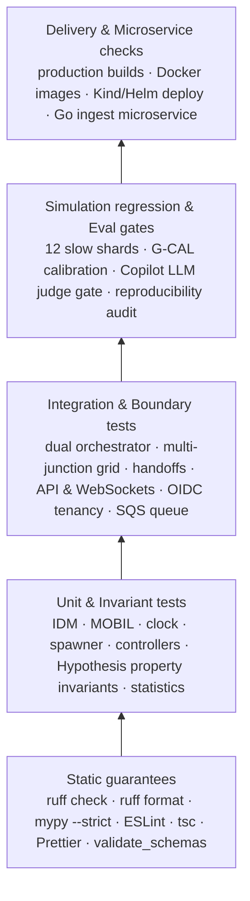
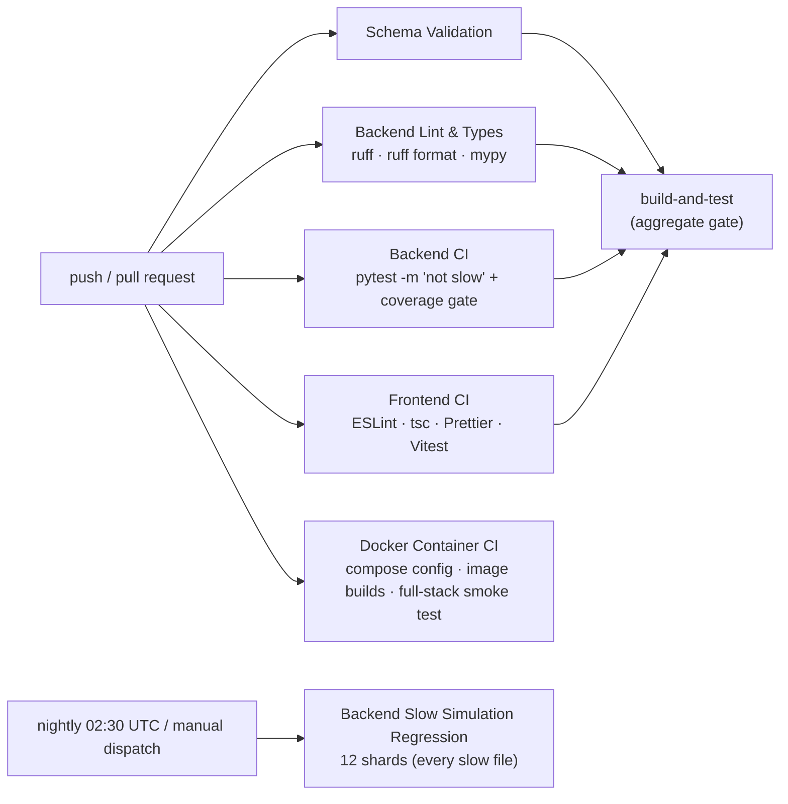

# Testing & Quality Gates

> **Status:** Current · Comprehensive testing guide across V1.0–V5.4 · verified against `.github/workflows/ci.yml`, `backend/pyproject.toml`, and `frontend/package.json`

UrbanFlow's tests exist to protect **four core pillars**: that microscopic and network simulation physics are numerically correct and invariant, that results and statistical intervals are bit-identical and reproducible, that the API and delivery layers are secure and multi-tenant isolated, and that the browser interface renders an exact, accessible reflection of backend metrics.

---

## 1. The quality pyramid



| Layer | Protects against | Runs |
| --- | --- | --- |
| Static | Type errors, unsafe refactors, formatting drift, malformed schemas | Every push / PR; lint also on pre-commit |
| Unit | A formula or rule silently changing meaning | Every push / PR |
| Integration | Subsystems disagreeing (engine ↔ controller ↔ collector ↔ API ↔ DB) | Every push / PR |
| Simulation regression | **Results** drifting: capacity, lock-ups, collisions, the published curve | Nightly and on demand |
| Delivery | A green test suite that cannot be built or started | Every push / PR |

---

## 2. Backend

Stack: **pytest**, **pytest-cov**, **ruff**, **mypy** (strict). Configuration: `backend/pyproject.toml`.

```bash
cd backend
pytest -m "not slow"          # the CI gate: everything except full-strength sweeps
pytest -m slow --no-cov       # full-strength simulation regression sweeps (long)
pytest                        # everything — the marker selects, it never hides
ruff check src/ tests/
ruff format --check src/ tests/
mypy src/
```

| Gate | Setting | Why |
| --- | --- | --- |
| Coverage floor | `--cov-fail-under=85` (in `addopts`) | Catches a large module shipped without tests; never set back to 0 |
| Ruff rules | `E`, `F`, `I`, `N` | Correctness, imports, naming |
| mypy | `strict = true` | The engine is large and stateful; types catch interface drift |

### Markers

Every test carries exactly one layout marker, applied by path in
`backend/tests/conftest.py` (no per-file edits; an explicit marker on a test
wins): `integration` under `tests/integration/`, `tests/api/` and
`tests/v2_integration/`; `architecture` for `test_architecture.py`; `unit`
everywhere else. `slow` is separate and combines with any of them.
`--strict-markers` is on, so a misspelt marker fails collection instead of
silently selecting nothing. `pytest -m unit`, `-m integration` and
`-m architecture` partition the suite (3172 collected: 1983 / 1184 / 5).

### What each test area protects

| Directory | Protects |
| --- | --- |
| `tests/vehicles/` | IDM equations, vehicle state updates, spawner seeding and safe insertion, routing and leader finding, speed profiles |
| `tests/controllers/` | Signal phase plans, asymmetric greens, offsets, roundabout gap acceptance, signalised roundabouts, adaptive actuation |
| `tests/intersection/` | Conflict-point geometry and predictive conflict resolution (including lock-up cases) |
| `tests/roads/` | Lane geometry; cached lookups equal to uncached trajectories |
| `tests/core/` | Clock, configuration models, provenance, snapshots, determinism, Hypothesis property tests |
| `tests/engine/` | Engine lifecycle and reset, vehicle pool, deadlock detector, SAT collision audit |
| `tests/scenario/` | Scenario documents, lane configuration, cross-field configuration rules |
| `tests/metrics/` | Every metric definition, warm-up clipping, fuel/CO2 emissions, TTC/PET safety proxies |
| `tests/study/` | Statistics (CI, Welch, Cohen's d), sweep verdict direction and crossover, report generation, CLI |
| `tests/database/` | Persistence, run reproducibility, history/labels, sweep persistence batching |
| `tests/api/` | Routes, API-key auth, development auth bypass, replay ownership, study jobs, route-auth sweeps |
| `tests/networks/` & `tests/netmetrics/` | Multi-junction graph model, 12-junction arterial grid, vehicle handoffs, congestion spread |
| `tests/calibration/` | Turning-count loader, GEH/RMSE/MAPE statistics, Nelder-Mead fitting, continuous recalibration |
| `tests/rl/` | Gymnasium environment wrappers, fixed-time and max-pressure baselines, PPO/DQN training |
| `tests/observability/` | Tracing, Prometheus metrics (/metrics/prom), SLO evaluation, database failure resilience |
| `tests/twin/` | Digital twin telemetry replay, prediction-vs-observation comparison, what-if branching |
| `tests/incidents/` | Physical vehicle crashes, lane blockages, closures with Dijkstra rerouting, weather, resilience |
| `tests/priority/` | Emergency signal pre-emption, civilian yielding, transit signal priority, audit logging |
| `tests/v2x/` | Vehicle messaging channel, in-process and MQTT pub/sub bus, latency/drop models, cooperation |
| `tests/tenancy/` | OIDC JWT verification, RBAC roles, tenant data isolation sweeps, quotas and rate limits |
| `tests/jobs/` | Background task queue, AWS SQS adapter, worker daemon, cost allocation tags |
| `tests/experiments/` & `tests/uncertainty/` | Robustness Lab, Sobol/LHS parameter uncertainty, bootstrap paired difference intervals |
| `tests/copilot_eval/` | Copilot LLM evaluation score gate on gold question datasets |
| `tests/integration/` | Full runs, dual simulation, WebSocket integration, snapshot contract, DB concurrency |
| `tests/test_architecture.py` | Layer rules: the domain is a strict import stack, uses no web/DB library, nothing imports `main.py` |

### Fixed-seed golden fingerprints

`tests/controllers/signal_golden.py` (signals) and `roundabout_golden.py` (roundabout) run a corpus of seeded scenarios and hash every tick's vehicle positions and speeds, the final metrics and periodic snapshots. Two pins per case: **exact** (raw bits, for one interpreter and platform) and **portable** (1 µm, 12 significant digits, checked everywhere). A changed fingerprint means behaviour changed; do not re-record to make a test pass. Re-record only on purpose:

```bash
cd backend
python -m tests.controllers.signal_golden --record --force      # new baseline; update BASELINE_DIGEST in the same diff, state why
python -m tests.controllers.signal_golden --add-environment     # add this machine's exact pins (same source as the recording only)
```

The signal baseline was recorded on Windows / Python 3.14.7. CI (Linux / Python 3.11) enforces the portable pins; add its exact pins with `--add-environment` from the recording commit.

### Slow simulation regression

Marked `@pytest.mark.slow`; excluded from the PR gate, run nightly (02:30 UTC) and by manual dispatch, one CI shard per file:

| Shard | File | Guards |
| --- | --- | --- |
| signal-capacity | `tests/integration/test_signal_capacity.py` | Signal capacity never falls as demand rises |
| roundabout-conflicts | `tests/integration/test_roundabout_conflicts.py` | Conflict/contact budgets across lanes and demand |
| roundabout-lockup | `tests/integration/test_roundabout_lockup.py` | Former lock-ups keep discharging without collisions |
| calibrated-capacity | `tests/integration/test_calibrated_capacity_regression.py` | The published one-lane capacity curve stays pinned |
| signal-lockup | `tests/vehicles/test_router.py` | Saturated-signal lock-up regression |
| calibration-pass | `tests/integration/test_calibration_pass.py` | Gap acceptance, free-flow delay, lane capacity, collision-free calibrated levels |
| adaptive-signal-runs | `tests/integration/test_adaptive_signal_runs.py` | Adaptive control across demand and lanes |
| real-world-junctions | `tests/integration/test_real_world_junctions_v15.py` | V1.5 safety matrix (3–4 arms, bearings, U-turns) |
| roundabout-multilane | `tests/integration/test_roundabout_multilane_v14.py` | V1.4 multi-lane ring: contacts and standstill |
| vehicle-types-and-lanes | `tests/integration/test_vehicle_types_and_lanes.py` | Mixed classes and lanes |
| roundabout-lane-capacity | `tests/integration/test_roundabout_lane_capacity.py` | Multi-lane roundabout capacity scaling across demand |
| randomized-invariants | `tests/integration/test_randomized_invariants.py` | 48 random valid scenarios: conservation, speeds, greens, collisions, bit-identical rerun |
| signal-golden | `tests/controllers/test_signal_golden_fingerprints.py` | Fixed-seed whole-run fingerprints of the fixed-time and adaptive signals (6 saturated / long cases; the 13 fast cases run in the PR job) |

The last seven were added to the CI matrix during the V2.0 release-gate audit. `tests/test_ci_slow_matrix.py`, which runs in the ordinary PR job, now fails if any file with `@pytest.mark.slow` tests is missing from this matrix.

---

## 3. Frontend

Stack: **Vitest** + Testing Library (jsdom), **TypeScript** (`tsc`), **ESLint**, **Prettier**, **Vite** build.

```bash
cd frontend
npm run test          # vitest run
npm run test:ci       # vitest run --coverage (what CI runs; thresholds below)
npm run type-check    # tsc --noEmit
npm run lint          # eslint .
npm run format        # prettier --check .
npm run build         # tsc && vite build
```

| Test area (`frontend/src/test/`) | Protects |
| --- | --- |
| `GuidedComparison.test.tsx`, `App.test.tsx`, `routing.test.tsx` | The planner journey end to end against mocked hooks; navigation; nginx route list kept in step with the router |
| `plainLanguage.test.ts`, `metricCatalog.test.ts` | Plain-language readings, tie rules, bands; **every backend metric has a catalog entry** |
| `metricGlossary.test.tsx` | The glossary lists every catalog metric, filters, is axe-clean, matches `docs/product/metric-glossary.md` (regenerate with `UPDATE_GLOSSARY=1`), and the catalog covers every numeric key in `shared/metrics/collector-metric-keys.json` (kept equal to the collector by `backend/tests/metrics/test_metric_key_parity.py`) |
| `useWebSocketSnapshot.test.tsx`, `websocket.test.ts`, `liveSession.test.ts`, `snapshotInterpolator.test.ts` | Streaming, reconnection, session-cookie ordering, smooth interpolation |
| `HistoryDashboard`, `RunPage`, `ComparePage`, `savedRun` tests | Saved runs, reproduction display, multi-run comparison |
| `VolumeAnalysisDashboard`, `ValidationDashboard`, `WeightedScoringPanel`, `IntegrityCheck` tests | Research Lab tools and their wording |
| Coverage thresholds (`vite.config.ts`) | Over `src/metrics`, `hooks`, `utils`, `services`, `components`; measured 2026-11-03 at 76.2 % statements/lines, 79.7 % branches, 62.0 % functions; thresholds 74 / 74 / 77 / 60 (about two points under). Raise as coverage improves; never lower to pass. `lcov` is uploaded as the `frontend-coverage` artifact |
| `devAuthBypass.test.ts`, `DevAuthApp.test.tsx` | The development sign-in bypass can never reach a production build |
| geometry / map / logo / time / container-size tests | Rendering helpers |
| `App`, `planner`, `RunPage` tests marked *(axe)* | Automated accessibility (axe-core, `src/test/axe.ts`): no violation axe can detect from the DOM. Colour contrast is **not** checked there (jsdom has no layout) and must be checked in a browser; passing axe does not prove keyboard or screen-reader usability |

---

## 4. Contracts and delivery

| Check | Command | Protects |
| --- | --- | --- |
| Schema validator | `python scripts/validate_schemas.py` | Every top-level schema file in `shared/schemas/*.json` is valid JSON with `$schema` |
| Compose validation | `docker compose -f docker-compose.yml config` (and `-dev`) | Both stacks parse |
| Image builds + smoke tests | `.github/workflows/docker.yml` | Backend image starts and answers `/health`; frontend image builds; the full Compose stack starts and is healthy through nginx |
| Stack smoke test (local) | `.\start.ps1 -SmokeTest` | Pages, assets, `/health`, database, study workers, live WebSocket and image freshness on a running stack |

---

## 5. Continuous integration



A local pre-commit hook (`.husky/pre-commit`) runs the frontend linter.

---

## 6. Most recent recorded results

Recorded gate results live with the work that produced them: [bug-fix report — Final validation](../bug-fix-report.md#final-validation-2026-09-24) (backend, slow suites, cross-process determinism) and [user narrative §H](../product/urbanflow-user-narrative.md#h-validation-results) (guided-journey release). Re-run the commands above for current numbers rather than relying on counts quoted in documents.
